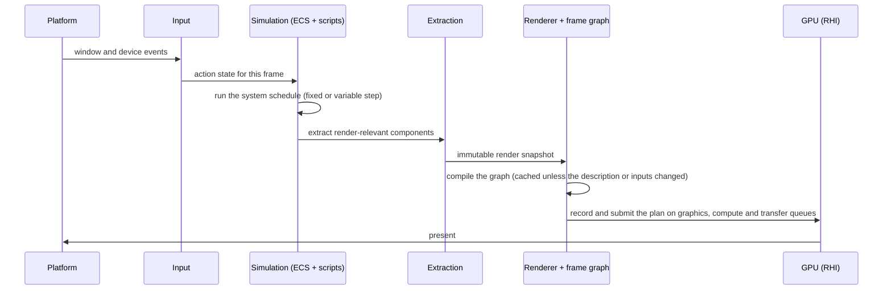

# Clockwork architecture

**Status:** Accepted on 2026-10-20.

This document is the map of the engine: what the subsystems are, how they depend on each other, and how a frame flows through them. Detailed designs live in [`design/`](design/README.md), and cross-cutting decisions in [`decisions/`](decisions/README.md). Sections marked *provisional* are settled by the design doc named in them, and this document is updated when that design is accepted.

## Purpose

Clockwork is a rendering engine for showcasing graphics and simulation techniques. It's a professional showcase, so:

- the code, its tests and its documentation are part of what's being shown, not only the pixels
- techniques must be easy to add, compare and switch between
- every subsystem must be verifiable on its own, without running the whole engine

## Principles

1. **Explicit and derived, never hand-written.** GPU synchronization comes from the frame graph's analysis of declared resource accesses. Rendering code can't issue barriers.
2. **Techniques are data.** A rendering technique is a frame graph description plus its Slang shaders, loaded and hot-reloaded at run time, rather than Rust code that wires passes together.
3. **Pure cores, thin shells.** Each subsystem keeps its logic in plain Rust that can be tested without a GPU, window or file system: the frame graph compiler, ECS storage and scheduling, importers' mesh processing, input mapping. The parts that touch Vulkan, winit or disk stay small and translate only.
4. **No silent failure.** Importers report everything they skip. Device selection logs why each device was rejected. Any unexpected warning or error, including the validation layer's, fails the test that caused it.
5. **Modern Vulkan only.** Vulkan 1.4, with descriptor heaps, device address commands, shader objects, dynamic rendering and timeline semaphores, and no legacy fallback paths. See [ADR 0002](decisions/0002-vulkan-feature-baseline.md).
6. **Every platform from the start.** Windows (Win32), and Linux under both X11 and Wayland, are supported from the first step, and every design accounts for their differences. Android, macOS and iOS are planned, through Mesa's Turnip and KosmicKrisp drivers, so no design may assume a desktop. See [ADR 0003](decisions/0003-supported-platforms.md).
7. **Decisions are written down.** Every design and every cross-cutting decision has a document. Deviations are recorded, not left in commit messages.

## Subsystems

```mermaid
flowchart TD
    platform["Platform<br/>(winit window and event loop)"]
    input["Input and camera"]
    scripting["Scripting (Lua)"]
    ecs["Entity-component system"]
    import["Asset importers<br/>glTF, USD"]
    scene["Scene model<br/>(format-agnostic)"]
    renderer["Renderer and PBR"]
    graph["Frame graph"]
    rhi["Render hardware interface<br/>clockwork-rhi"]
    vulkan["Vulkan backend<br/>clockwork-rhi's vulkan module"]

    platform --> input
    input --> scripting
    input --> ecs
    scripting --> ecs
    import --> scene
    scene --> ecs
    ecs -- "extracted render snapshot" --> renderer
    renderer --> graph
    graph --> rhi
    rhi --> vulkan
```

| Subsystem | Responsibility | Design |
|---|---|---|
| Render hardware interface | Object-safe, backend-agnostic API for GPU resources, programs, queues, command encoding and presentation. Vulkan is the only backend. | `0002-rhi` |
| Frame graph | Loads technique descriptions, compiles them into an execution plan with all synchronization, queue assignment and transient lifetimes derived, and executes the plan through the RHI. | `0003-frame-graph` |
| Input and camera | Translates platform events into engine input, maps devices to actions, and provides camera controllers. Records and replays input. | `0004-input` |
| Entity-component system | Archetype storage, queries, deferred structural changes, a parallel scheduler, hierarchy and transforms, and extraction for the renderer. | `0005-ecs` |
| Asset importers | Read glTF and USD into a format-agnostic, normalised scene, with a report of everything that wasn't imported. | `0006-importers` |
| Renderer and PBR | Turns the extracted scene into frame graph inputs. The Slang shading library: BSDFs, lights, materials, image-based lighting, shadows and tone mapping. | `0007-pbr` |
| Scripting | Embeds Lua through `mlua`. Bindings for the ECS, input and scenes, with hot reload and sandboxing. | `0008-scripting` |
| Diagnostics (cross-cutting) | Sessions, attribution of log events to sessions, and the layers that count them in the application and fail tests on them. Every subsystem may use it. It depends on nothing else in the engine. | `0001-foundations` |

## Dependency rules

Arrows in the diagram are the only dependencies allowed. Each subsystem is a crate (see "Source layout"), so these are crate boundaries that the compiler enforces: a forbidden dependency is a missing entry in a `Cargo.toml`. In particular:

- **No Vulkan types outside `clockwork-rhi`'s `vulkan` module.** Only `clockwork-rhi` depends on `ash`, and its public API names no Vulkan type. The rest of the engine sees only the RHI's handles, descriptions and traits.
- **The frame graph doesn't know about scenes.** It knows passes, resources and accesses. The renderer is the layer that knows what a mesh or a light is.
- **The ECS doesn't know about rendering.** Rendering reads from it only through extraction, so simulation never waits on the GPU.
- **Importers don't know about the ECS or the GPU.** They produce a scene model, which is spawned into the ECS separately. This keeps importers testable against files alone.
- **Only the platform layer (`src/main.rs` today) uses winit types.** Input receives engine events translated from them. Only the root package depends on `winit`.
- **Diagnostics sits below everything.** Every subsystem may depend on `clockwork-diagnostics`, and it depends on no subsystem. It isn't drawn in the diagram, because every box would point at it.

The rules within a crate, such as the Vulkan backend's being private to the RHI, are checked in review.

## Frame lifecycle (*provisional*: settled by `0004-input`, `0005-ecs` and `0003-frame-graph`)



Extraction is the boundary that lets simulation for frame N+1 overlap with recording frame N. Whether the first version overlaps them, or runs them in sequence on one thread, is decided in `0005-ecs`.

## Diagnostics and logging levels

All logging goes through `tracing`, including the `log` crate's records from dependencies and the Vulkan validation layer's messages. Every event is attributed to a **session**: one run of the engine, or one test. Attribution comes from the session span the code runs in, or from an explicit `session` field for callbacks that arrive on threads outside our control. See [`0001-foundations`](design/0001-foundations.md#sessions).

The levels are a contract across the whole engine:

| Level | Meaning |
|---|---|
| `ERROR` | An operation failed, or a bug was detected |
| `WARN` | Something unexpected happened that someone should act on |
| `INFO` | Normal, notable events, including expected limitations such as a missing optional extension |
| `DEBUG`, `TRACE` | Detail for diagnosing problems |

Any unexpected `WARN` or `ERROR` fails the test that caused it, and fails the application's smoke runs (`--fail-on-warnings`). Logging a normal condition at `WARN` is therefore a bug.

## Threading model (*provisional*: settled by `0005-ecs`)

- The platform event loop runs on the main thread, as winit requires on some platforms.
- The ECS scheduler runs systems on a pool of worker threads.
- Each job runs inside the tracing span that was current where it was queued, so that its log events are attributed to the right session.
- **Command recording is multi-threaded.** The frame graph records independent passes on the worker pool, each into its own command buffer, and the buffers are submitted together in the plan's order. A frame with many passes or draws is then not limited by one thread's recording speed.
- **Resources are streamed.** Assets are uploaded while frames render, from threads other than the one rendering, on the transfer queue where the device has a dedicated one. Loading a scene doesn't stall the frame loop.
- `0002-rhi` designs the RHI for both: which of its types are `Send` or `Sync`, what each thread may create, record and submit, and how uploads made on other threads become visible to rendering (see also the `PhysicalDevice` `Send`/`Sync` item in `TODO.md`).

## Source layout

The engine is a Cargo workspace with a crate per subsystem, under `crates/`, each named `clockwork-<subsystem>`: see [ADR 0006](decisions/0006-crates-by-subsystem.md). The root package is the `clockwork` binary, the platform layer and the application code above the subsystems. `xtask`, the developer tooling, is in the workspace too, but isn't a default member.

```
src/main.rs                     clockwork: platform layer, options, winit event loop, window, frame loop
crates/diagnostics/             clockwork-diagnostics: sessions, log attribution, classification and counting
  src/capture.rs                  TestSession and the test subscriber, behind the test-support feature
crates/gpu-memory/              clockwork-gpu-memory: the allocator's pure parts, the TLSF suballocator and the pool
crates/rhi/                     clockwork-rhi: the RHI
  build.rs                        compiles shaders/ to SPIR-V with slangc
  build/slangc.rs                 finds slangc, shared by build.rs and xtask
  shaders/                        Slang shaders
  src/lib.rs                      the RHI trait, backend options and backend selection
  src/test_support.rs             the test environment, for the RHI's tests
  src/vulkan/                     the Vulkan backend
xtask/                          developer tooling: cargo xtask check, cargo xtask lavapipe
.github/workflows/              CI
docs/                           this document, designs, decisions, and the testing guide
```

Each later subsystem's design names its crate: the frame graph (`0003-frame-graph`), input (`0004-input`), the ECS (`0005-ecs`), the asset importers (`0006-importers`), the renderer (`0006-importers`, `0007-pbr`) and scripting (`0008-scripting`). The importers are a crate of their own, `crates/assets/`, to keep `openusd`'s compile out of the engine's rebuilds. Small checked-in test fixtures will go in `testdata/`.

## Roadmap

Each step is a design document, accepted before any implementation, then a series of implementation slices, each reviewed as a stack of small pull requests. See [`design/README.md`](design/README.md) for the process.

| Step | Design | Status |
|---|---|---|
| 0 | [`0001-foundations`](design/0001-foundations.md): design process, diagnostics and test harness, Vulkan 1.4 bindings, checks and CI | Implemented |
| 1 | [`0002-rhi`](design/0002-rhi.md): render hardware interface | Accepted |
| 2 | `0003-frame-graph`: data-driven frame graph | Not started |
| 3 | `0004-input`: input devices, actions and cameras | Not started |
| 4 | `0005-ecs`: entity-component system | Not started |
| 5 | `0006-importers`: glTF and USD importers | Not started |
| 6 | `0007-pbr`: physically based shading in Slang | Not started |
| 7 | `0008-scripting`: Lua scripting | Not started |

The ECS and importer designs need no GPU work, so they can be written and reviewed while the RHI and frame graph are in progress.

## Glossary

- **RHI:** render hardware interface, the engine's backend-agnostic GPU API.
- **Frame graph:** a per-frame graph of passes and the resources they read and write, from which execution order, synchronization and memory lifetimes are derived.
- **Execution plan:** the frame graph compiler's output. Plain data listing batches, barriers, queue transfers and pass invocations, which the backend executes.
- **Transient resource:** a resource that exists only within one frame's graph, which the graph allocates, and may alias with others.
- **Extraction:** copying the render-relevant parts of ECS state into an immutable snapshot for the renderer.
