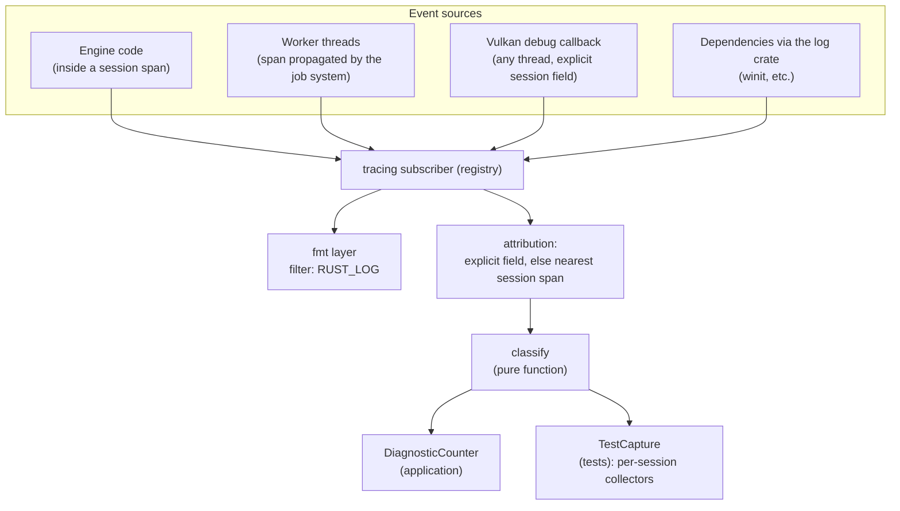

# 0001: Foundations

- **Status:** Proposed
- **Author:** Ralph Potter, with Claude
- **Created:** 2026-10-15
- **Accepted:**
- **Depends on:** ADRs [0001](../decisions/0001-single-binary-crate.md), [0002](../decisions/0002-vulkan-feature-baseline.md) and [0003](../decisions/0003-supported-platforms.md)

## Context

Clockwork draws a hardcoded triangle through a Vulkan 1.4 backend (`src/rhi/vulkan/`). Before the subsystems in the roadmap are built, the project needs ways to show that each one works, and a place to record how and why it's built. Today:

- **Warnings and errors are only logged.** Everything logs through `tracing`, including validation messages (`debug_callback` in `src/rhi/vulkan.rs` turns them into events). Nothing checks what was logged, so a test passes even when the validation layer reported errors. Synchronization validation is off, and it's the validation that matters most once the frame graph derives all barriers.
- **This affects every subsystem, not just Vulkan.** The frame graph compiler, importers, ECS and scripts will all log unexpected conditions, and each should fail the test that caused it. Doing that needs every event to be attributable to the test that caused it, including events from other threads and from driver callbacks.
- **Every test needs a Vulkan driver.** The two tests in `src/rhi.rs` create a real instance, so `cargo test` fails on a machine without one, such as a hosted CI runner. Device selection's tests (`src/rhi/vulkan/device_selection.rs`) are pure and don't, but they can't be run separately from the GPU ones. This is the "Make the unit tests work without a Vulkan driver" item in `TODO.md`.
- **The bindings are behind.** `ash` 0.38 has bindings only up to Vulkan 1.3.281. The engine requests 1.4 with a hand-built version number, and can't query 1.4 features or the extensions ADR 0002 requires: `VK_EXT_descriptor_heap`, `VK_KHR_device_address_commands` and `VK_EXT_present_timing`.
- **Checks are manual.** Formatting, clippy, docs and the windowed run are done by hand, there's no CI, and nothing enforces the `// SAFETY:` comments the code already writes everywhere.
- **Only Linux has ever been run.** ADR 0003 makes Windows (Win32), X11 and Wayland supported from the start, so every check must run on both operating systems, and the windowed checks under all three window systems.
- **There's no CI machine with a GPU.** GPU tests in CI need a software Vulkan driver. Mesa's lavapipe supports every extension ADR 0002 requires, but `VK_EXT_descriptor_heap` only on Mesa's `main` branch as of 2026-10-15: Mesa 26.2.5 doesn't have it, and the development machine's Mesa 26.0.8 has none of the three ADR 0002 extensions.
- **The application has no options.** Device choice, validation features and run length can't be set when starting it.
- **The development machine is being set up again.** As of 2026-10-15, after the driver upgrade, neither `slangc` nor the Khronos validation layer is installed, so `cargo build` fails in `build.rs`. Both will come from a Vulkan SDK installed in the home directory, whose `setup-env.sh` sets `VULKAN_SDK`, `PATH`, `LD_LIBRARY_PATH` and the layer path.

## Goals

1. The design process that later steps follow: the process itself, a design template, and the ADR format, with ADRs for the decisions this design depends on. A testing guide, `docs/testing.md`, written alongside the code that it describes (see "Testing guide").
2. **A diagnostics layer for the whole engine:**
   - every log event attributed to a *session* (one run of the engine, or one test), on any thread
   - **any unexpected warning or error fails the test that caused it**, whichever subsystem logged it
3. GPU tests that fail on any validation error or warning, with synchronization validation on, and that **can't run without validation**.
4. Tests split into tiers, so that tests needing no GPU run anywhere.
5. Tests that skip cleanly on devices without a capability, and a way to make sure skips never hide failures on the reference device.
6. Vulkan 1.4 bindings, with the 1.4 features and the ADR 0002 extensions queried and reported. They aren't required yet: the RHI design makes them required as the code that uses them lands.
7. Command-line options for the application: device, validation, and automated smoke runs that fail on any warning.
8. One command, `cargo xtask check`, that runs every check a branch must pass, on Linux and Windows.
9. CI on every push, with no GPU:
   - build and T0 tests on Linux and Windows
   - on Linux, T1 tests and windowed smoke runs under X11 and Wayland, on a pinned lavapipe built from Mesa source
10. Hardware checks before review: T1 tests and smoke runs on the RTX 3090 (Linux, X11 and Wayland) and on a Windows machine (Win32), for what lavapipe can't cover.
11. Comprehensive rustdoc: every item documented, including private items, struct fields and test helpers.

## Non-goals

- **Making the new extensions required.** That happens in the `0002-rhi` slices that first use each one.
- **Capabilities as part of the RHI's API.** This design adds a test-only capability list. `0002-rhi` designs the real one.
- **The job system.** Span propagation to worker threads is a requirement this design places on it (see "Consequences for later designs"), but the job system itself is designed in `0005-ecs`.
- **Structured diagnostics as data.** Importers' `ImportReport` and similar reports are designed with their subsystems. This design covers log events only.
- **Property, snapshot, benchmark and fuzz infrastructure.** Each arrives with the first design that needs it (see "Test tiers").
- **Lavapipe on Windows.** No released Mesa has descriptor-heap support on lavapipe, and Windows builds of Mesa are only packaged for releases, so Windows T1 tests and smoke runs are run by hand on a Windows machine with a GPU. Revisit this when a Mesa release with descriptor heaps is packaged for Windows.
- **A GPU in CI.** CI uses lavapipe only. Multi-queue paths (lavapipe has one queue family) and present timing (lavapipe doesn't support it) are covered by the hardware checks before review.

## Requirements

| ID | Requirement | Acceptance criterion |
|---|---|---|
| R1 | The design process, template and ADR format exist, with ADRs 0001 and 0002 | Reviewed and merged on this design's branch |
| R2 | Every log event is attributed to a session: by an explicit `session` field if the event has one, otherwise by the nearest enclosing session span | T0 tests: an event in a session span; in a nested span; with an explicit field overriding the span; on another thread with the span propagated; and with no session |
| R3 | `TestSession` fails its test if an unexpected warning or error is attributed to it. Expected messages can be declared. | T0: a `#[should_panic]` test that logs a warning; a test that declares an expected warning and passes; a test that declares one that never comes and fails |
| R4 | Only individually listed messages can be suppressed, each with a reason | `SUPPRESSED` lists each message by target and message ID, with a reason. A T0 test checks that every entry has a non-empty reason. |
| R5 | Validation messages are events on the `clockwork::validation` target, carrying the backend's session explicitly | T1 `validation_errors_are_counted` triggers a known error on purpose and sees it attributed to the test's session |
| R6 | Synchronization validation is on by default in debug builds and tests | T1 `sync_hazards_are_reported` records a write-after-write hazard and sees it reported |
| R7 | When validation is *required*, creating a backend fails if the layer is missing or a requested feature is unsupported. When it's only *preferred*, a warning is logged and creation continues. T1 tests always require it. | The decision is a pure function of the requested validation and the available layers and settings, with T0 tests for each case |
| R8 | Tests needing no GPU pass with no Vulkan driver installed | The hosted CI job runs them on a runner with no Vulkan driver |
| R9 | T1 tests skip, with a message, when the device lacks a capability, unless `CLOCKWORK_REQUIRED_CAPABILITIES` lists it (or is `all`), in which case they fail | T0 tests of the skip decision; T1 runs on lavapipe with its expected set, and on the RTX 3090 with `all` |
| R10 | Device selection can be restricted to devices whose name contains a given substring | T0 tests in `device_selection`: a match, no match (an error listing the available devices), and case-insensitivity |
| R11 | `ash` provides the Vulkan 1.4 and ADR 0002 extension bindings, and `ash-window` builds against the same `ash` | `cargo tree -d` shows one `ash`. `vk::API_VERSION_1_4` replaces the hand-built version. |
| R12 | 1.4 features and properties, and the ADR 0002 extension features, are queried and logged | T1 `reference_device_reports_required_extensions` passes on the RTX 3090 with all capabilities required |
| R13 | `unsafe` blocks must have `// SAFETY:` comments, and every item must be documented | Clippy lints in `Cargo.toml`. `cargo xtask check` passes with `-D warnings`. |
| R14 | The application takes the command-line options `--device`, `--validation`, `--exit-after-frames` and `--fail-on-warnings`, documented in `--help` | T0 tests of option parsing, including invalid values |
| R15 | The application counts warnings and errors from every subsystem and dependency, prints a summary at exit, and exits with an error under `--fail-on-warnings` if any were counted | T0 test of the counting layer; the smoke runs (R16) use `--fail-on-warnings` |
| R16 | `cargo xtask check` runs every per-branch check on Linux and Windows. `--gpu` adds T1 tests and windowed smoke runs under every window system the platform supports. `--lavapipe` uses the pinned lavapipe. `--virtual-displays` (Linux) starts Xvfb and a headless Weston for the smoke runs. | Running each form on the branch that adds it, on both operating systems |
| R17 | CI runs on every push: `cargo xtask check` on hosted Linux and Windows runners, and `cargo xtask check --gpu --lavapipe --virtual-displays` on a hosted Linux runner | Green runs of all three jobs on the slices that add them |
| R18 | `build.rs` finds `slangc` in the Vulkan SDK on Linux and Windows | Lookup order: `SLANGC`, then the SDK's binary directory (`$VULKAN_SDK/bin/slangc` on Linux, `%VULKAN_SDK%\Bin\slangc.exe` on Windows), then `PATH`. A pure function with T0 tests for both platforms on any machine. The build-failure message names all three. |
| R19 | `docs/testing.md` describes every tool and rule the slices add, written in the slice that adds it | Each slice's review checks its section of the guide (see "Testing guide") |
| R20 | `cargo xtask lavapipe` builds lavapipe from a pinned Mesa commit, reproducibly, and the T1 tests and smoke runs can use it | The pinned build reports `VK_EXT_descriptor_heap` and `VK_KHR_device_address_commands`, and `reference_device_reports_required_extensions` passes on it |
| R21 | The application runs under Win32, X11 and Wayland, and the smoke runs exercise each | Smoke runs pass under X11 and Wayland in CI, and under Win32 on the Windows machine before review |

## Architecture

### Test tiers

Every design's test plan uses these tiers. Tiers marked *(later)* get their tooling with the first design that needs it.

| Tier | Kind | What it covers | Where it runs |
|---|---|---|---|
| T0 | Unit | Pure logic: device selection, sync tables, the graph compiler, ECS storage, importers' mesh processing, input mapping. Needs no GPU. | Everywhere, including hosted CI runners |
| T0 | Property *(later)* | Invariants over generated inputs, with `proptest` | Everywhere |
| T0 | Snapshot *(later)* | Readable output that's easier to review than to assert on, such as execution plans and import reports, with `insta` | Everywhere |
| T0 | Soundness *(later)* | `unsafe` code under `miri`, and concurrency primitives under `loom` (nightly toolchain) | Everywhere |
| T1 | GPU | Real Vulkan work, headless, with validation required and synchronization validation on | Pinned lavapipe in CI (Linux); the RTX 3090 and the Windows machine before review |
| T1 | Golden image *(later)* | Rendered images compared against checked-in references, within a tolerance | As above, on the reference device |
| T2 | Fuzz *(later)* | Parsers: frame graph descriptions, glTF, USD, with `cargo-fuzz` | On demand |
| T2 | Benchmark *(later)* | Hot paths, tracked for regressions, with `criterion` | On demand |
| Asset *(later)* | Large content | Sponza, JungleRuins, and comparison with Pixar's `usd-core`. `#[ignore = "needs ~/Assets"]`. | Development machine |

How tests are told apart:
- **T1 tests live in modules named `gpu_tests`**, so `cargo test -- --skip gpu_tests` runs everything else.
- **Asset tests are ignored by default**, and run with `--ignored`.
- **Everything else is T0.**

Tests are unit tests inside the engine crate (ADR 0001). Shared helpers live in `src/test_support.rs`, compiled only for tests. `xtask` has its own unit tests.

### Logging levels are a contract

Failing tests on warnings only works if `WARN` and `ERROR` mean something definite. This design defines them for the whole engine. The architecture document, when written, restates them.

| Level | Meaning | Examples |
|---|---|---|
| `ERROR` | An operation failed, or a bug was detected | A validation error; a failed shader compile in hot reload |
| `WARN` | Something unexpected happened that someone should act on | A validation warning; an asset path that resolved only through the case-insensitive fallback; a Lua script overrunning its budget |
| `INFO` | Normal, notable events, **including expected limitations** | The selected device; an optional extension the device lacks; a pass the graph culled |
| `DEBUG`, `TRACE` | Detail for diagnosing problems | Per-frame timings; every barrier |

Under this contract, a warning or error fails tests and smoke runs. Code that logs a normal condition at `WARN` is a bug, and is fixed by changing its level, not by suppressing the message.

The one existing `warn!` (the validation layer missing, in `validation_layer_available`) fits the contract: it's logged only when validation was preferred and couldn't be enabled.

### Sessions

A session is one run of the engine, or one test. It's identified by a `SessionId`: a number from a process-wide counter, which never repeats within a process. It isn't a Vulkan handle or any other resource handle. Those don't exist yet when the first messages about them arrive, and their values can be reused once the resource is freed.



**Attribution.** A session is entered as a span: `info_span!("session", id = N)`. A `tracing-subscriber` layer records the session ID of each span it sees, in the span's extensions, when the span is created. For each event, attribution is:
1. the event's own `session` field, if present
2. otherwise, the ID of the nearest enclosing span that has one
3. otherwise, *unattributed*

**Where the session span comes from:**
- **Engine code** runs inside the session span, entered once on the main thread by `main`, and by `TestSession` on a test's thread. Most code needs nothing extra.
- **Worker threads** inherit the span from whoever queued the work. The job system enters the queuing thread's `Span::current()` around each job (see "Consequences for later designs").
- **Callbacks from outside our code** may run on threads with no span. These tag their events with an explicit `session` field. The Vulkan debug callback is the only one so far: it receives the session ID through `pUserData`, cast to an integer. Nothing is borrowed, so there's no lifetime to manage.

**Classification** is a pure function from an event's target, level and fields to one of:

| Class | When | Effect |
|---|---|---|
| Counted | `WARN` or `ERROR`, and not one of the classes below | Fails tests; counted by the application |
| Suppressed | Listed in `SUPPRESSED` by target and message ID (for validation, the VUID), with a reason | Logged at its level, but neither counted nor failing |
| Advisory | A best-practices validation message (ID beginning `BestPractices-`) | Logged, but neither counted nor failing |
| Ignored | `INFO` and below | Logged only |

**Filtering per layer.** Each layer has its own filter, rather than one global `EnvFilter`:
- the fmt layer follows `RUST_LOG`
- the counting and capture layers always take `WARN` and above

This matters because `tracing` disables a call site entirely when no layer wants it. With one global filter, `RUST_LOG=error` would turn off every `warn!`, and warnings would go uncounted. For the same reason, the Vulkan callback always requests `ERROR` and `WARNING` from the layer when validation is on, whatever the log level. Only `INFO` and `VERBOSE` still follow `tracing::enabled!`.

**Dependencies.** `tracing-subscriber`'s `tracing-log` feature, already enabled by default, routes the `log` crate's records (winit uses it) into `tracing`. They count like engine events, as agreed in review. A dependency's warning that turns out to be harmless gets a `SUPPRESSED` entry, keyed by its target, with a reason.

### The application

`main` builds the subscriber from three layers:
1. the session-attribution layer
2. the fmt layer, filtered by `RUST_LOG` as today
3. a `DiagnosticCounter`, which counts counted events

It then creates one `Session`, and enters its span for the life of the event loop. The application has a single session, so the counter doesn't need attribution: unattributed events (from the `log` crate, for example) count too.

At exit, `main` logs a summary at `INFO`, such as `0 errors and 2 warnings were logged`. Under `--fail-on-warnings`, it returns an error if the count isn't zero.

### Tests

`TestCapture` is installed once per test process, through a `std::sync::Once` in `src/test_support.rs`, as the global default subscriber. It has:
- the attribution layer
- a fmt layer using `TestWriter`, so logs appear in the output of failing tests only
- the capture layer

The capture layer holds a registry from `SessionId` to collectors, behind a `Mutex`.

`TestSession`:
- **Creating one** allocates a session ID, registers a collector, and enters the session span on the test's thread. The guard is held by the `TestSession`.
- **The collector** records each counted event (level, target, message ID and text) up to a cap of 64, so that a broken loop can't grow memory without bound. Beyond the cap it keeps counting, without recording.
- **Expectations** are declared before the code that triggers them, with `expect(level, target, matcher)`. Each consumes one matching counted event.
- **Dropping it** unregisters the collector. It fails the test if there were unexpected events, or expected ones that never arrived, listing them all. If the test is already panicking (`std::thread::panicking()`), it doesn't panic again, but it still prints them.

**Unattributed counted events in tests** can't fail any particular test. The capture layer prints them to stderr with an `unattributed` banner, so they're visible. The rule is that every test touching engine code creates a `TestSession`, and review checks it (see Risks).

The capture layer runs inside whatever thread emitted the event, including the Vulkan callback's thread. It therefore **never panics**: failure is reported when the `TestSession` is dropped, on the test's own thread. A poisoned mutex is recovered with `into_inner`.

### Validation

- **Events.** `debug_callback` emits each message as an event on the `clockwork::validation` target, at the level it maps to today. The fields are `session`, `message_id` (`pMessageIdName`, which isn't logged at the moment) and `types`, with the message text as the event's message. It no longer does anything else: classification and counting happen in the layers.
- **Features are enabled through `VK_EXT_layer_settings`,** an instance extension provided by the layer, from `BackendOptions`. The setting names are taken from the installed layer's manifest (`VkLayer_khronos_validation.json`, in the Vulkan SDK) during implementation, and listed in one table in the code.
- **Required or preferred.** `BackendOptions::validation` is a `Validation` value:
  - `Off`
  - `Preferred(features)`: if the layer or a feature isn't available, log a warning and continue without it
  - `Required(features)`: if the layer or a feature isn't available, `rhi::create` returns an error

  The guarantee comes from creation succeeding, so the RHI trait has no method for asking whether validation is on. Asking afterwards would fail open: zero messages would look the same as no validation.
- **Defaults and what sets them:**

  | Context | Validation |
  |---|---|
  | T1 tests | Always `Required`, with features from `CLOCKWORK_VALIDATION`, default `sync` |
  | Application, debug build | `Preferred(sync)`, or the `--validation` features |
  | Application, release build | `Off`, or `Preferred` with the `--validation` features |
  | Application, `--fail-on-warnings` | `Required` with the features above, unless they're `off` |

  `ENABLE_VALIDATION` in `src/rhi/vulkan.rs` is replaced by these defaults. Validating release builds is useful for checking optimised code paths.

### Ownership and lifetimes

- `Session` owns its span. Entering it returns a guard that must stay on the thread that entered it. `TestSession` holds both, so it isn't `Send`. That's correct, because it belongs to the test's thread.
- The capture layer's registry holds an `Arc` to each collector, and `TestSession` holds the other. The registry's entry is removed on drop, so a collector never outlives its session.
- The Vulkan backend holds only the session ID, as a `u64`, and gives it to the messengers as `pUserData`. Neither the backend nor the callback borrows anything from the session.

### Threading

- Layers are called on whichever thread emits an event, so the capture layer's registry is a `Mutex<HashMap<SessionId, Arc<Collector>>>`. Each collector uses a `Mutex` around its records.
- Lock hold times are short, and only `WARN` and above reach the layer, so contention isn't a concern.
- `SessionId::unique` uses an `AtomicU64` with relaxed ordering. Only uniqueness matters, not ordering.

### Test fixtures

```
src/diagnostics.rs                   SessionId, Session, classification, SUPPRESSED, attribution and counting layers
src/diagnostics/capture.rs           (cfg(test)) TestCapture, TestSession, expectations
src/test_support.rs                  installs TestCapture; test environment variables; skip reporting
src/rhi/vulkan/test_support.rs       VulkanTestBackend, and the test-only Capability list
src/rhi/gpu_tests.rs                 the current create/headless tests, moved out of src/rhi.rs
src/rhi/vulkan/gpu_tests.rs          backend T1 tests (R5, R6, R12)
```

- **`VulkanTestBackend::headless(&TestSession)`** creates a headless backend in the session, with validation `Required`.
- **The existing T0 check stays in `src/rhi.rs`:** the compile-time check that `ALL_GRAPHICS_APIS` lists every `GraphicsApi`.
- **Capabilities.** The test-only `Capability` enum (`DescriptorHeap`, `DeviceAddressCommands`, `PresentTiming`, `DedicatedComputeQueue`, `DedicatedTransferQueue`) is derived from `PhysicalDevice`. `0002-rhi` replaces it with the RHI's own capability query.

### Configuration

The application and the tests configure a backend the same way, through `BackendOptions`. Only where the values come from differs.

- **Command line (application).** `src/main.rs` parses the options with `clap`'s derive API, into an `Options` struct whose doc comments are the `--help` text:

  | Option | Effect | Default |
  |---|---|---|
  | `--device <SUBSTRING>` | Only consider devices whose name contains the substring, case-insensitively | Best device |
  | `--validation <FEATURES>` | Comma-separated: `off`, or any of `core`, `sync`, `gpu`, `best-practices` (each implies `core`) | `sync` in debug builds, `off` in release |
  | `--exit-after-frames <N>` | Exit cleanly after rendering N frames | Run until closed |
  | `--fail-on-warnings` | Require validation, and exit with an error if any warning or error was logged | Off |

- **Environment (tests).** `cargo test` can't pass options to tests, so tests read `CLOCKWORK_DEVICE`, `CLOCKWORK_VALIDATION` (same syntax as `--validation`, except that `off` is rejected) and `CLOCKWORK_REQUIRED_CAPABILITIES` (`all`, or a comma-separated list of capability names). The environment is read only in `src/test_support.rs`. The engine never reads it, so its behaviour depends only on its options.
- **The option values are parsed by the same functions** (`ValidationFeatures::from_str`), so the two sources can't drift apart.

### Device filter

Selection gains a phase 0, before requirements. If `BackendOptions::device_filter` is set, only devices whose names contain it (case-insensitively) are candidates. If none match, it fails with an error listing every device name. The filter is a parameter of the pure selection function, so it's tested without a GPU.

### Vulkan 1.4 bindings

- **Pinning.** `Cargo.toml` pins `ash` to a commit on its `master` branch through `[patch.crates-io]`. The patch replaces crates.io's `ash` everywhere in the dependency graph, so `ash-window`, and later `gpu-allocator`, use the same bindings. This needs the `master` crate version to stay semver-compatible with 0.38 (it's `0.38.0+1.4.352` per the withdrawn roadmap's survey). The commit chosen is the newest one whose generated bindings include `ext::descriptor_heap`, `khr::device_address_commands` and `ext::present_timing`. The commit hash, its header version and the reason for it go in a comment next to the patch.
- **`PhysicalDevice`** (`src/rhi/vulkan/physical_device.rs`) gains:
  - `properties.vulkan14` and `features.vulkan14`, queried on 1.4 devices
  - feature structures, and properties where they exist, for the three extensions, each chained only when the device supports the extension, following today's pattern
- **Clearing pointers.** The chain-then-clear-`p_next` code grows from seven structures to about thirteen. It moves into a small helper that clears every chained structure's pointer, so that none can be missed.
- **Logging.** Selection logs a one-line capability summary for the chosen device at `INFO`, for example `selected NVIDIA GeForce RTX 3090: descriptor heap, device-address commands, present timing`.
- **What becomes unnecessary:** `API_VERSION`'s hand-built version and its comment, and any 1.4 workarounds.

### Documentation and lints

- **Lints, in `[lints]` in `Cargo.toml`:**
  - `clippy::undocumented_unsafe_blocks = "warn"`
  - `clippy::missing_docs_in_private_items = "warn"`. Unlike rustc's `missing_docs`, this covers private items too, and in a binary crate almost every item is private. It applies everywhere, including struct fields, enum variants, test modules and test helpers.
  - `rust::unsafe_op_in_unsafe_fn`, already the 2024 edition's default, made explicit
- **Rustdoc builds with `--document-private-items` and `-D warnings`,** so broken intra-doc links fail the check.
- **What a doc comment must say:**
  - for every function: what it does, and the `# Errors`, `# Panics` and `# Safety` sections where they apply (the code already does this)
  - for types: their invariants, and their ownership and lifetimes
  - for each module: its role, and how it fits the engine's architecture
  - for tests: what's checked, and why it matters

### Testing guide

`docs/testing.md` is the guide for people writing and running tests. It describes tools, so each part is written in the slice that builds the tool, and reviewed with it. That way the guide never describes something that doesn't exist yet.

| Slice | Section of the guide |
|---|---|
| `foundations-checks` | Prerequisites on Linux and Windows, and the Vulkan SDK environment on each; the test tiers and how to run each; `cargo xtask check`; conventions for writing tests (naming, one behaviour per test, fixtures in `testdata/`, failing test first for bug fixes); CI jobs |
| `foundations-diagnostics` | Warnings and errors fail tests: `TestSession`, expectations, and the rules (no other subscribers, threads enter the session span, unattributed banners, suppression) |
| `foundations-validation` | GPU tests: required validation, `CLOCKWORK_VALIDATION` and its features, capability skips and `CLOCKWORK_REQUIRED_CAPABILITIES`, `CLOCKWORK_DEVICE` |
| `foundations-cli` | Smoke runs on each window system, virtual displays, and the table relating test variables to application options |
| `foundations-ash-1.4` | The minimum Vulkan SDK and driver versions |
| `foundations-lavapipe` | Building and using the pinned lavapipe, bumping the pin, and the lavapipe CI job |

### Platforms

ADR 0003 makes three window systems supported from the start:

| OS | Window systems | How the smoke runs choose it |
|---|---|---|
| Windows | Win32 | The only one |
| Linux | Wayland, X11 | winit uses Wayland when `WAYLAND_DISPLAY` is set, and X11 otherwise. A run forces X11 by unsetting `WAYLAND_DISPLAY` for the child process. |

Platform-specific behaviour in step 0:
- **`slangc` lookup** (R18): the SDK's directory and executable name differ.
- **The Vulkan SDK:** on Linux, `setup-env.sh` sets the variables, including the layer path. On Windows, the installer sets `VULKAN_SDK`, and registers the validation layer in the registry. Neither setup is inspected directly. The prerequisites check asks the Vulkan loader which layers it can find, which is correct on both.
- **Line endings:** a `.gitattributes` file keeps text files, including shaders, as LF on every platform, so that diffs and `cargo fmt --check` agree.
- **Paths:** `xtask` and the engine build paths with `Path`, never by joining strings, and tests that compare paths compare `Path` values.

### Checks: `cargo xtask`

Developer tooling is an `xtask` crate: a small Rust binary in `xtask/`, run through an alias in `.cargo/config.toml` (`xtask = "run --package xtask --"`). The repository becomes a Cargo workspace with two members: the engine (the root package, unchanged, still a single binary crate per ADR 0001) and `xtask`. `default-members` is the engine alone, so plain `cargo build`, `run` and `test` behave as they do today.

`xtask` uses `clap` for its options and `xshell` to run commands. Its logic is pure functions with unit tests: option handling, the `slangc` lookup (shared with `build.rs` as `build/slangc.rs`), deciding which window systems are available, and building the Mesa configuration.

**`cargo xtask check`** runs, in order:
1. a prerequisites check. It prints the `slangc` path and version, the Vulkan SDK version, and, with `--gpu`, the layers and devices the Vulkan loader finds (`xtask` uses `ash` for this). Anything missing is reported with a pointer to `docs/testing.md`.
2. `cargo fmt --all --check`
3. `cargo clippy --workspace --all-targets -- -D warnings`, in debug and release
4. `cargo doc --workspace --no-deps --document-private-items`, with `RUSTDOCFLAGS=-D warnings`
5. `cargo test --workspace -- --skip gpu_tests`

**Options:**

| Option | Adds |
|---|---|
| `--gpu` | `cargo test` including T1, with `CLOCKWORK_REQUIRED_CAPABILITIES=all`; then a smoke run under each window system the platform supports: `cargo run -- --exit-after-frames 300 --fail-on-warnings`, which must exit successfully. A window system with no display available is an error, not a silent skip. |
| `--no-window` | With `--gpu`: leave out the smoke runs, on purpose |
| `--lavapipe` | With `--gpu`: use the pinned lavapipe (see below) as the only driver, through the loader's `VK_DRIVER_FILES` variable, set for child processes only. The required capabilities become lavapipe's expected set: everything except `DedicatedComputeQueue`, `DedicatedTransferQueue` and `PresentTiming`. |
| `--virtual-displays` | Linux, with `--gpu`: start `Xvfb` and a headless Weston (`weston --backend=headless`) for the smoke runs, and stop them afterwards, so that smoke runs work with no desktop session |

### Lavapipe

`cargo xtask lavapipe` builds lavapipe, Mesa's CPU Vulkan driver, from a pinned commit:
- **The pin** is a constant in `xtask/src/lavapipe.rs`, with the commit hash, its date and the reason for choosing it. It's a Mesa `main` commit until a release has descriptor-heap support on lavapipe; then it becomes that release's tag. Changing the pin is a reviewed change like any other.
- **The build** uses Meson, with only what lavapipe needs: `-Dvulkan-drivers=swrast -Dgallium-drivers=llvmpipe -Dplatforms=x11,wayland -Dbuildtype=release`. It's installed in `target/lavapipe/<commit>/`, so builds for different pins coexist and `cargo clean` removes them. The build needs LLVM, Meson, Ninja, Python with Mako, and the X11 and Wayland development packages. The exact list is in `docs/testing.md`, and the prerequisites check reports what's missing.
- **The output** is the driver and its ICD manifest (`lvp_icd.x86_64.json`). `--lavapipe` points `VK_DRIVER_FILES` at the manifest.
- **The same build** is used in CI and locally, so a lavapipe failure in CI can be reproduced with `cargo xtask check --gpu --lavapipe`.
- **Linux only.** Windows is covered by the Windows machine (see Non-goals).

### CI

`.github/workflows/ci.yml` runs on every push and on pull requests, on GitHub-hosted runners only:

| Job | Runner | Runs |
|---|---|---|
| `linux` | `ubuntu-latest` | `cargo xtask check`, with no Vulkan driver installed, which proves R8 |
| `windows` | `windows-latest` | `cargo xtask check`, likewise |
| `linux-lavapipe` | `ubuntu-latest` | `cargo xtask lavapipe`, then `cargo xtask check --gpu --lavapipe --virtual-displays` |

- **Toolchain:** every job installs a pinned Vulkan SDK version, for `slangc` and the validation layer. On Windows the SDK provides `slangc.exe`.
- **Caching:** the lavapipe build is cached, keyed on the Mesa commit and the runner's image, so it's rebuilt only when the pin changes. An uncached build takes several minutes.
- **No secrets and no self-hosted runners,** so pull requests from forks are safe to run.

### Hardware checks before review

CI can't cover everything, so each branch's review description records the result of:
- `cargo xtask check --gpu` on the RTX 3090, under Linux, with both window systems in a desktop session. This covers multi-queue paths and present timing, which lavapipe lacks, and validation on a real driver.
- `cargo xtask check --gpu` on the Windows machine, under Win32.

A branch that touches only code with no platform or GPU behaviour, such as documentation or `xtask` itself, may say so instead.

## API

New module, `src/diagnostics.rs`:

```rust
/// Identifies one session (a run of the engine, or a test) in log events.
/// Unique within the process.
#[derive(Debug, Clone, Copy, PartialEq, Eq, Hash)]
pub struct SessionId(u64);

impl SessionId {
    /// Returns an ID that no other call in this process has returned.
    pub fn unique() -> Self;
    /// The ID as an integer, for passing through C callbacks (`pUserData`).
    pub fn as_u64(self) -> u64;
}

/// A session and its span. Events emitted inside the span are attributed to it.
pub struct Session { /* id, span */ }

impl Session {
    /// Creates a session with a new ID.
    pub fn new() -> Self;
    pub fn id(&self) -> SessionId;
    /// The session's span, for entering on this thread or propagating to others.
    pub fn span(&self) -> &tracing::Span;
}

/// How an event affects tests and the application's warning count.
pub enum Class { Counted, Suppressed, Advisory, Ignored }

/// Classifies an event by its level, target and message ID. Pure.
pub fn classify(level: Level, target: &str, message_id: Option<&str>) -> Class;

/// Layer that attributes events to sessions. Must be in every subscriber that uses
/// `DiagnosticCounter` or `TestCapture`.
pub struct SessionLayer;

/// Layer that counts `Counted` events, for the application's summary and `--fail-on-warnings`.
pub struct DiagnosticCounter { /* ... */ }

impl DiagnosticCounter {
    pub fn errors(&self) -> u32;
    pub fn warnings(&self) -> u32;
}
```

Test-only (`src/diagnostics/capture.rs`):

```rust
/// A test's session. Fails the test, when dropped, if an unexpected warning or error
/// was attributed to it, or an expected one never arrived.
pub struct TestSession { /* session, span guard, collector */ }

impl TestSession {
    /// Installs the test subscriber if needed, then creates and enters a session.
    pub fn new() -> Self;
    pub fn id(&self) -> SessionId;
    /// Declares that one matching event is expected.
    pub fn expect(&self, level: Level, target: &str, matcher: impl Fn(&CapturedEvent) -> bool + Send + Sync + 'static);
}
```

Changes to `src/rhi.rs`:

```rust
/// Options for creating a backend.
#[derive(Debug, Clone)]
pub struct BackendOptions {
    /// The session the backend's events are attributed to, including those the
    /// graphics API reports from its own threads.
    pub session: SessionId,
    /// Only consider devices whose name contains this, ignoring case. `None` considers every device.
    pub device_filter: Option<String>,
    /// Whether to validate, and with which features.
    pub validation: Validation,
}

/// Whether validation must, may or mustn't be enabled.
#[derive(Debug, Clone, Copy, PartialEq, Eq)]
pub enum Validation {
    Off,
    /// Enable these features if available. Otherwise warn and continue.
    Preferred(ValidationFeatures),
    /// Enable these features, or fail to create the backend.
    Required(ValidationFeatures),
}

/// Validation features. Parsed from `off`, or a comma-separated list of
/// `core`, `sync`, `gpu` and `best-practices`.
#[derive(Debug, Clone, Copy, PartialEq, Eq)]
pub struct ValidationFeatures { /* flags */ }

impl FromStr for ValidationFeatures { /* ... */ }

pub fn create(
    api: GraphicsApi,
    window: Option<WindowTarget>,
    options: &BackendOptions,
) -> Result<Box<dyn RenderHardwareInterface>>;
```

The `RenderHardwareInterface` trait itself is unchanged.

Test-only Vulkan fixture (`src/rhi/vulkan/test_support.rs`):

```rust
/// A headless Vulkan backend in a test's session, with validation required.
pub struct VulkanTestBackend { /* the backend */ }

impl VulkanTestBackend {
    /// Creates a headless backend in `session`, configured from the test environment.
    ///
    /// # Panics
    ///
    /// Panics if no device meets the requirements, or if the requested validation
    /// isn't available.
    pub fn headless(session: &TestSession) -> Self;

    /// Returns whether the device has `capability`. If it doesn't, prints a skip message,
    /// or panics if `CLOCKWORK_REQUIRED_CAPABILITIES` includes it.
    pub fn has(&self, capability: Capability) -> bool;
}

/// Returns from the test early if `backend` lacks any of the capabilities.
macro_rules! require_capabilities { /* ... */ }
```

Typical use:

```rust
#[test]
fn descriptor_heap_writes_are_visible_to_shaders() {
    let session = TestSession::new();
    let backend = VulkanTestBackend::headless(&session);
    require_capabilities!(backend, Capability::DescriptorHeap);
    // ...exercise the backend...
} // `backend` is dropped, then `session`, which fails the test if anything was logged at WARN or above
```

A test of something that should warn:

```rust
#[test]
fn case_insensitive_asset_paths_resolve_with_a_warning() {
    let session = TestSession::new();
    session.expect(Level::WARN, "clockwork::import", |event| event.message.contains("case"));
    // ...resolve a path whose case doesn't match...
}
```

## Error handling

- **Errors:**
  - an unmatched device filter, listing the available devices
  - an invalid `--validation` value
  - required validation that isn't available, naming the layer or the feature
  - under `--fail-on-warnings`, counted events at exit, with the counts

  Messages follow the project's style: lowercase, with no trailing punctuation. `clap` reports invalid command lines in its own standard format.
- **Panics:**
  - test fixtures: `TestSession`'s drop check, and `VulkanTestBackend` when creation fails
  - nowhere in layers or callbacks, which run on arbitrary threads, sometimes inside a C callback
- **The debug callback never fails or panics.**

## Performance

Not performance-critical.
- **Attribution** walks the span stack only for events at `WARN` and above, since that's all the counting and capture layers accept.
- **Recording span IDs** costs one extension insert per span with a `session` field. Other spans get one field lookup.
- **Validation:** synchronization validation slows tests considerably, which is accepted. GPU-assisted validation is off by default for that reason.

## Alternatives considered

- **A validation-only side channel.** The first revision of this design had the Vulkan callback count messages into a per-backend `ValidationReport`, through `pUserData`. That duplicated the path messages already take through `tracing`, put classification inside an `extern "system"` callback, and covered validation only, when every subsystem has the same need. Replaced in review by capturing `tracing` events.
- **Thread-local subscribers per test** (`tracing::subscriber::set_default`). This attributes events by thread. It loses events from worker threads and driver threads, and those losses would be silent passes. Rejected for spans plus explicit session fields.
- **A global subscriber that panics on `ERROR`.** It can't tell which of the tests running in parallel caused an event, and it ignores warnings. Rejected.
- **Using the `VkInstance` handle as the ID.** It doesn't exist during `vkCreateInstance`, when the first messages arrive, and handle values can be reused after destruction. Rejected for a counter.
- **A `validation()` or `is_validation_enabled()` query on the RHI.** Checking after creation fails open: zero messages looks the same as no validation. Rejected for requiring validation at creation.
- **Environment variables for the application's options.** They're invisible in `--help`, and easy to leave set by accident. Rejected in review for command-line options. Tests still use environment variables, because `cargo test` can't pass options to them.
- **`lexopt`, `argh` or hand-written parsing instead of `clap`.** All are smaller, but `clap` is the de facto standard, generates complete `--help` text from doc comments, and will scale as options are added.
- **Marking GPU tests `#[ignore]`.** Then `cargo test` on the development machine would silently skip them, which is the wrong default for the machine that's meant to run them. Rejected for the `gpu_tests` naming convention.
- **A Cargo feature `gpu-tests`.** It would need a rebuild to switch tiers, and it's easy to forget. Rejected.
- **A shell script for checks.** An earlier revision used `scripts/check`, a POSIX shell script. It needs no build step and every line is a command you can copy, but it doesn't run on Windows without Git Bash or WSL (and WSL can't check the Windows build), and its logic (the `slangc` lookup, display detection, Mesa configuration) couldn't be unit-tested. Replaced in review by `xtask` once Windows became a requirement.
- **`just`, `cargo-make` or `make`.** Each is another tool to install, and still leaves the logic untested. Rejected.
- **A self-hosted GPU runner.** Planned in an earlier revision, but no machine is available. Replaced by lavapipe in CI, plus hardware checks before review.
- **Building lavapipe on Windows in CI.** Possible with MSVC, LLVM and Meson, but the first build is slow, and it's the most fragile part of CI. Rejected in review for a Windows machine, until a Mesa release with descriptor heaps is packaged for Windows.
- **Using the distribution's Mesa or a released Mesa.** Neither has descriptor heaps on lavapipe yet. Rejected for a pinned `main` commit.
- **An override to run T1 tests without validation.** It would make a pass that proves less than it claims. Rejected in review.

## Consequences for later designs

- **`0005-ecs` (job system):** each job must run inside the span that was current where it was queued. A T0 test there must show that a warning from a job fails the test that queued it.
- **`0003-frame-graph` (parallel recording):** recording threads come from the job system, so they inherit the session. Any thread created outside the job system must enter the session span itself.
- **Every design:**
  - Log levels follow the contract above.
  - Each design's test plan lists the warnings its tests expect, and the tests declare them with `TestSession::expect`.
  - A subsystem that receives callbacks from C code on its own threads (the Lua VM's hooks run on the calling thread, so it isn't one) passes the session explicitly, as the Vulkan backend does.

## Test plan

- **T0:**
  - attribution: all five cases in R2, including a worker thread with the span entered explicitly
  - `TestSession`: unexpected warning (`#[should_panic]`), expected warning, missing expected warning (`#[should_panic]`), the cap on recorded events, and no double panic when the test is already panicking (R3)
  - classification of every class, and every `SUPPRESSED` entry having a reason (R4)
  - `DiagnosticCounter` counts with `RUST_LOG=error` in effect, which proves the per-layer filtering (R15)
  - the validation availability decision for `Off`, `Preferred` and `Required`, with the layer present or missing and a feature supported or not (R7)
  - `ValidationFeatures` parsing, including `off`, implied `core`, and invalid values
  - command-line parsing with `clap`'s `try_parse_from`, including `--help` succeeding, plus `clap`'s `debug_assert` test of the command definition (R14)
  - the skip-or-fail decision (R9)
  - device filter matching (R10)
  - the `slangc` lookup order on both platforms (R18). Build scripts can't have tests of their own, so the lookup is a pure function of the environment and the platform, in `build/slangc.rs`. `build.rs` and `xtask` use it, and `xtask`'s tests cover it.
  - `xtask`: option handling, the window systems chosen for each platform and environment, the required-capability set for `--lavapipe`, and the Meson arguments (R16, R20)
  - the `ALL_GRAPHICS_APIS` compile-time check (kept)
- **T1:**
  - the moved headless tests, now each in a `TestSession`
  - `validation_errors_are_counted`: create an object with an invalid parameter on purpose, expecting the error by its VUID (R5)
  - `sync_hazards_are_reported`: two unsynchronized transfer writes to one buffer, expecting the hazard (R6)
  - `reference_device_reports_required_extensions` (R12)
  - all of these on the pinned lavapipe in CI, with its expected capability set, and on the RTX 3090 and the Windows machine with all capabilities required
- **Smoke:** windowed runs with `--fail-on-warnings` under X11 and Wayland, on virtual displays in CI and in a desktop session on the RTX 3090; under Win32 on the Windows machine (R16, R21).
- **CI:** all three jobs green (R8, R17).
- **Fixtures:** none.

## Implementation slices

| Branch | Contents | Requirements |
|---|---|---|
| `design/foundations` | This design, the design process and template, and ADRs 0001 to 0003 (this branch) | R1 |
| `foundations-checks` | The workspace and `xtask` with `cargo xtask check` (no `--gpu`); the `slangc` lookup for both platforms; `.gitattributes`; `[lints]`, and documenting everything they report; any fixes the Windows build needs; the `linux` and `windows` CI jobs | R13, R18, part of R16 and R17 |
| `foundations-diagnostics` | `src/diagnostics.rs`: sessions, attribution, classification, `DiagnosticCounter`; `TestCapture` and `TestSession`; the application's subscriber rebuilt with per-layer filters and a session. No GPU needed. | R2, R3, R4, part of R15 |
| `foundations-validation` | Validation events on `clockwork::validation` with explicit sessions; `VK_EXT_layer_settings`; `BackendOptions`, `Validation` and `ValidationFeatures`; `VulkanTestBackend` and capability skips; the device filter; the tier split (moving tests); `cargo xtask check --gpu --no-window`. Closes the "unit tests without a Vulkan driver" item in `TODO.md`. | R5–R10, part of R16 |
| `foundations-cli` | `clap` options, the summary at exit, `--fail-on-warnings`; smoke runs in `cargo xtask check --gpu` for each window system, and `--virtual-displays` | R14, R15, R16, R21 |
| `foundations-ash-1.4` | The pinned `ash`, `API_VERSION_1_4`, 1.4 and extension queries, the capability summary log, and the minimum Vulkan SDK version recorded in `docs/testing.md`. Closes the "Vulkan 1.4 bindings" item in `TODO.md`. | R11, R12 |
| `foundations-lavapipe` | `cargo xtask lavapipe`, `--lavapipe`, and the `linux-lavapipe` CI job. Closes the "install `slangc` on CI" item in `TODO.md`. | R17, R20 |

Each slice also writes its section of the testing guide (R19).

`foundations-diagnostics` comes before `foundations-validation`, so that validation is built on it. `foundations-validation` comes before `foundations-ash-1.4`, so that the binding upgrade is checked by the new harness, including synchronization validation. `foundations-lavapipe` comes last, because lavapipe's value in CI is checking the ADR 0002 extensions, which `foundations-ash-1.4` makes visible.

## Risks

| Risk | Likelihood | Impact | Mitigation |
|---|---|---|---|
| A test touching engine code doesn't create a `TestSession`, so its warnings go unattributed and it passes | Medium | Silent passes | Unattributed counted events are printed with a banner. Review checks for sessions. If this keeps happening, add a `#[engine_test]` attribute that creates the session, or a CI step that fails on any unattributed banner in the test output. |
| A thread outside the job system doesn't enter the session span | Medium, once threads exist | Its warnings go unattributed | The same banner. The job system propagates spans by construction, and other threads must be justified in their design. |
| A test installs its own thread-local subscriber, hiding events from the capture layer on that thread | Low | Silent passes | Rule in the testing guide. A test needing to inspect logs uses `TestSession`'s expectations instead. |
| A dependency logs harmless warnings, failing smoke runs | Medium | Noise | Suppress by target with a reason, or file it upstream |
| `ash` `master` has API changes that break `ash-window` | Medium | Can't pin | `ash-window` is small, and we use only two of its functions: replace them with our own surface creation in `surface.rs` |
| `ash` `master`'s version stops being 0.38-compatible, so the patch no longer applies | Low | Can't patch | Pin an older commit that still is. Revisit when `ash` releases. |
| The SDK's validation layer doesn't know `VK_EXT_descriptor_heap` or device-address commands, and reports errors or doesn't validate them | Medium | False failures or blind spots from step 1 | Check the SDK's layer against the extensions in `foundations-ash-1.4`, and record the minimum SDK version in `docs/testing.md`. Update the SDK if it's too old. |
| Synchronization validation reports false positives on new extensions | Medium | Noise | Suppress individually with a reason and an upstream issue (R4) |
| The layer setting names differ between layer versions | Low | Settings silently ignored | Check the requested settings against the layer manifest at creation. Under `Required`, an unknown setting is an error. |
| A machine's environment differs from what the checks expect (for example, a missing SDK variable) | Medium | Checks fail, or test a different layer or driver | `cargo xtask check` prints the `slangc` path, the SDK version, and the layers and devices the loader finds, at the start of every run |
| Mesa `main` at the pinned commit has bugs that cause false failures | Medium | Noise in CI | Pin a commit that passes Mesa's own CI. Report bugs upstream, and move the pin when fixed. Never suppress a lavapipe-only failure without a matching upstream issue. |
| Lavapipe behaves differently from hardware drivers, hiding bugs or reporting false ones | Medium | Missed bugs, or noise | The hardware checks before review. A failure on only one driver is investigated, not suppressed. |
| Multi-queue paths and present timing aren't tested in CI | Certain | Regressions found late | Hardware checks before review are required for any branch touching queues, synchronization or presentation |
| Windows rendering isn't tested in CI | Certain | Windows-only regressions found late | The `windows` CI job builds and runs T0, and the Windows machine's checks are part of every review. Revisit when Windows lavapipe with descriptor heaps is available. |
| Smoke runs on virtual displays are flaky (Xvfb or headless Weston with lavapipe's presentation) | Medium | Spurious failures | Exit after a frame count, not after a time. If presentation through headless Weston proves unreliable, keep the Wayland run on the RTX 3090 only, and record it here. |
| The lavapipe build breaks when CI's runner image changes | Low | CI job fails | The cache key includes the image. The prerequisites check names missing build dependencies. |

## Open questions

1. **Which Windows machine?** The hardware checks need a Windows machine with a GPU and driver that support ADR 0002's extensions. Which machine is it, and is it available for every review?

## Resolved in review

| Question | Resolution |
|---|---|
| CI scope | No GPU in CI. T1 tests and Linux smoke runs use a pinned lavapipe, with hardware checks before review. (An earlier answer assumed a self-hosted GPU runner.) |
| Platforms | Windows (Win32), X11 and Wayland, from the start (ADR 0003) |
| Check tooling | `xtask`, because shell scripts don't run on Windows |
| Windows GPU testing | By hand on a Windows machine before review, not lavapipe in CI |
| Missing validation layer | T1 tests always fail without it. There's no override. |
| Documentation strictness | Comprehensive: every item, including private items, fields and test helpers |
| Smoke-run configuration | Command-line options for the application, not environment variables |
| Machine setup | The Vulkan SDK, installed in the home directory, provides `slangc` and the validation layer. The user sets up its environment. |
| How validation messages are captured | Through `tracing`, not a side channel |
| How events are attributed to tests | Session IDs, carried by spans, or by an explicit field from callbacks. A session isn't tied to the RHI. |
| How validation is guaranteed | Required at creation, not queried afterwards |
| Which messages fail tests | Any unexpected warning or error, from any subsystem |
| Smoke-run strictness | `--fail-on-warnings`, covering every subsystem and dependency |

## As built

*(Filled in at close-out.)*

## Revision history

| Date | Change |
|---|---|
| 2026-10-15 | Proposed |
| 2026-10-15 | Revised after review: added a self-hosted GPU runner for T1 in CI, removed the option to run T1 tests without validation, added command-line options (`BackendOptions`, `clap`) in place of environment variables for the application, `slangc` lookup in the Vulkan SDK, and the `foundations-cli` slice |
| 2026-10-15 | Revised after review: replaced the `ValidationReport` side channel with capture of `tracing` events. Added engine-wide sessions in a new `diagnostics` module, attributed through spans or an explicit field, with `TestSession` failing tests on any unexpected warning or error. Validation became required at creation (`Validation::Required`), with no query method. `--fail-on-validation` became `--fail-on-warnings`. Added the logging-level contract and the `foundations-diagnostics` slice. |
| 2026-10-15 | Revised after review: moved the architecture overview and the ADRs for steps 4 and 7 to a separate design branch, and the testing guide into the implementation slices. Added the test tier definitions and the guide's plan (R19). |
| 2026-10-15 | Revised after review: Windows (Win32), X11 and Wayland supported from the start (new ADR 0003). `cargo xtask` replaced the shell script. A pinned lavapipe built from Mesa source replaced the self-hosted GPU runner in CI, with Linux and Windows CI jobs and hardware checks before review. Added R20 and R21, the `foundations-lavapipe` slice, and `CLOCKWORK_REQUIRED_CAPABILITIES` in place of `CLOCKWORK_REQUIRE_ALL_CAPABILITIES`. |
