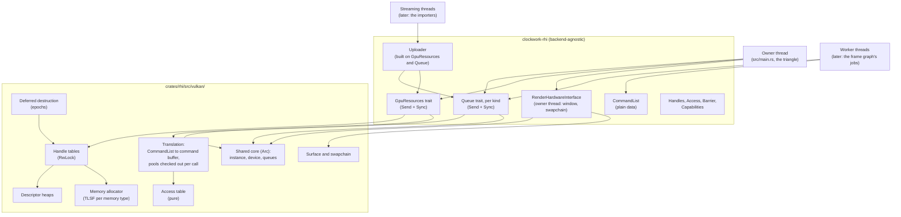

# 0002: Render Hardware Interface

- **Status:** Accepted
- **Author:** Ralph Potter, with Claude
- **Created:** 2026-10-20
- **Accepted:** 2026-10-20
- **Depends on:** [`ARCHITECTURE.md`](../ARCHITECTURE.md), design [0001](0001-foundations.md), and ADRs [0001](../decisions/0001-single-binary-crate.md), [0002](../decisions/0002-vulkan-feature-baseline.md) and [0003](../decisions/0003-supported-platforms.md)

## Context

The engine draws one hardcoded triangle. Everything about it lives inside the Vulkan backend:

- **The RHI can't be asked to draw anything.** `RenderHardwareInterface` (`crates/rhi/src/lib.rs`) has lifecycle methods (`suspend`, `resume`, `resize`) and `render_frame`, which runs `record_frame` in `crates/rhi/src/vulkan.rs`: a clear, a fixed set of shader objects (`TriangleShaders` in `crates/rhi/src/vulkan/shaders.rs`), one draw, and two hand-written barriers. The application can't create a buffer, a texture or a shader, record a command, or choose what to submit. This is the "Add a rendering API to the RHI" item in `TODO.md`.
- **There's no GPU memory.** Nothing allocates a buffer or an image. The triangle's vertices are constants in `crates/rhi/shaders/triangle.slang`.
- **The ADR 0002 baseline isn't used.** Design 0001 queries `VK_EXT_descriptor_heap` and `VK_KHR_device_address_commands`, and reports them, but doesn't enable or require them ("Non-goals" in 0001). Buffer device addresses and timeline semaphores, required by ADR 0002, aren't enabled either. `REQUIREMENTS` in `crates/rhi/src/vulkan/device_selection.rs` has only what the triangle needs.
- **Capabilities are test-only.** The `Capability` enum in `crates/rhi/src/vulkan/test_support.rs` is a stand-in, and 0001 says this design replaces it with the RHI's own query.
- **There's one queue.** `LogicalDevice` (`crates/rhi/src/vulkan/device.rs`) creates a graphics queue and, when windowed, a present queue. The frame graph (`0003-frame-graph`) needs compute and transfer queues, where the device has them, and timeline semaphores between them.
- **Destruction waits for the GPU to be idle.** `TriangleShaders`, `LogicalDevice` and `Swapchain` all call `device_wait_idle` when dropped. That's fine for objects that live as long as the backend, but not for resources created and destroyed while frames are in flight.
- **Everything is single-threaded.** The backend is used from the main thread only, and nothing in it is `Send` or `Sync` (`TODO.md` asks whether `PhysicalDevice` needs to be). `ARCHITECTURE.md`'s threading model expects multi-threaded command recording, with the frame graph recording independent passes on the worker pool, and resource streaming, with assets uploaded from other threads while frames render. It leaves to this design how the RHI supports both.

The frame graph is the next step (`0003-frame-graph`), and it's the RHI's main client. It compiles a technique into an execution plan with the barriers, queue assignments and transient lifetimes worked out, then executes that plan through the RHI. So this design has to provide everything the executor needs, and nothing the graph should be deciding itself.

## Goals

1. **An object-safe, backend-agnostic API** for GPU resources, shaders, command recording, submission and presentation, which uses no Vulkan types outside `crates/rhi/src/vulkan/` (the dependency rule in `ARCHITECTURE.md`).
2. **The ADR 0002 binding model:** buffers identified by device address throughout, images and samplers in descriptor heaps, small per-draw data as push data, and no descriptor sets, pipelines or render passes.
3. **Memory:** buffers and textures in GPU-only, upload and readback memory, through our own allocator, which suballocates from large blocks.
4. **Explicit synchronization as data,** described by engine-level accesses that a pure table translates to Vulkan stages, access flags and image layouts. The frame graph is the only code meant to issue barriers (principle 1 in `ARCHITECTURE.md`). Until it exists, tests and the triangle issue them by hand.
5. **Queues and timelines:** graphics, compute and transfer queues, on dedicated families where the device has them, each with a timeline semaphore. Submission returns a point on a timeline, which is what work waits on.
6. **Deferred destruction:** a resource destroyed by the application is freed only once nothing recorded before its destruction can still use it, with no idle waits.
7. **Capabilities:** queries for optional features and limits, each on the object they govern, which replace the test-only `Capability` list.
8. **The triangle moves out of the backend.** It's drawn by application code through the RHI, from a vertex buffer read through its device address, and the backend no longer knows about it.
9. **Multi-threaded command recording:** command lists are recorded, and translated into Vulkan command buffers, on any thread, in parallel, and submitted together.
10. **Resource streaming:** buffers and textures are created and filled from threads other than the one rendering, on the transfer queue where there's a dedicated one, and handed over to rendering at a known point.
11. **A reversible recording model.** Command lists are plain data (open question 1 of the first revision, resolved in review), with rules that keep a later move to direct recording cheap (see "Keeping the recording model reversible").
12. **Subresources:** rendering to, storing into, sampling, copying and synchronizing individual mips and layers of a texture.
13. **GPU timestamps:** timing scopes recorded in command lists, with durations read back per submission, so the frame graph can report per-pass GPU time.
14. **Per-frame transient memory:** a linear allocator over upload memory, usable from every thread recording a frame, recycled automatically once the GPU is done with it.

## Non-goals

- **The frame graph.** Execution plans, automatic barriers, transient aliasing, queue assignment, and the scheduling of translation jobs are `0003-frame-graph`. This design provides the commands they're executed with, and makes translation safe on any thread.
- **Rendering techniques and materials.** `0007-pbr`. The triangle is a test of the RHI, not the start of the renderer.
- **Shader compilation at run time and hot reload.** Shaders are still compiled to SPIR-V by `clockwork-rhi`'s `build.rs`. The RHI takes SPIR-V, so a later design can compile Slang at run time without changing it. Hot reload of techniques is part of `0003-frame-graph`.
- **Frame pacing and present timing.** The "Add frame pacing" item in `TODO.md`. `VK_EXT_present_timing` is reported as a capability, and nothing uses it yet.
- **`VK_KHR_swapchain_maintenance1`.** Its own `TODO.md` item. The swapchain's lifetime isn't changed here.
- **ASTC and ETC2 textures.** They come with the Android and Apple work (ADR 0003). BC formats are in scope (see "Data structures and layout").
- **Mipmap generation.** The RHI makes it possible, through per-mip storage views, but the compute passes belong to the importers and the renderer.
- **Ray tracing, mesh shaders, sparse resources, queries other than timestamps, calibrated timestamps, multiple GPUs, and video.** Each arrives with the first design that needs it.
- **A second backend.** ADR 0003 keeps Vulkan as the only one. The API stays backend-agnostic because the dependency rules require it, not to prepare for another backend.
- **A streaming system.** The `Uploader` (see "Streaming") moves bytes to the GPU from any thread. Deciding what to load and when, priorities, memory budgets, and reading files asynchronously belong with the importers (`0006-importers`).
- **A thread pool in the RHI.** The RHI never spawns or owns threads. Callers translate on their own threads, such as the job system's workers, which keeps the RHI below the job system in the dependency rules.

## Requirements

| ID | Requirement | Acceptance criterion |
|---|---|---|
| R1 | `VK_EXT_descriptor_heap`, `VK_KHR_device_address_commands`, buffer device addresses, timeline semaphores, host query reset and timestamps on the graphics queue are required by device selection, and enabled on the logical device where they're features | T0 tests in `device_selection` reject a device lacking each one, with the reason. T1 tests pass on lavapipe and the reference machines with the features enabled. |
| R2 | `GpuResources::capabilities`, each `Queue`, and `RenderHardwareInterface::present_capabilities` report optional features and limits, each for what it governs. The test-only `Capability` list is replaced by them, and `require_capabilities!` uses them. | T0 tests derive `Capabilities` from fake `PhysicalDevice`s. The lavapipe expected set is checked against it, as in 0001. |
| R3 | Buffers, textures, samplers and programs are created from descriptions, and referred to by `Copy` handles that carry a generation, so a stale handle is detected rather than reused | Property tests of the handle table against a reference model. T0: a stale handle panics with its label. |
| R4 | Buffers can be in GPU-only, upload or readback memory. Upload buffers are written, and readback buffers read, from the CPU through persistent mappings | T1 `buffer_round_trip`: write an upload buffer, copy it on the GPU to a GPU-only buffer and then to a readback buffer, and read back the same bytes |
| R5 | Every buffer has a device address, which is how shaders, copies, index buffers and indirect arguments refer to it | T1 `compute_writes_through_device_address`: a compute shader writes through a pointer in push data, and the result is read back |
| R6 | Sampled and storage textures, and samplers, have indices into descriptor heaps, which shaders use to access them | T1 `fragment_samples_heap_texture`: a draw samples a texture through its heap index, and the rendered colour is read back |
| R7 | Commands are recorded into a `CommandList`, a plain-data list that needs no device, and checked as they're recorded | T0 tests of recording, including that misuse (a draw outside rendering, rendering begun twice) panics with a message |
| R8 | Barriers are described by `Access` values. A pure table maps each to Vulkan stages, access flags and an image layout | T0: every `Access` has an entry, and read accesses don't map to write flags. T1 `missing_barrier_is_reported`: two writes without a barrier produce the expected synchronization hazard, and adding the barrier removes it. |
| R9 | Each queue kind has a timeline semaphore. `submit` takes translated command buffers and points to wait for, on any queue, and returns a `GpuPoint` | T1 `cross_queue_wait`: a transfer-queue copy waited on by a graphics-queue read. On a device without a dedicated transfer family, both run on the graphics queue, and the test still passes. |
| R10 | A destroyed resource is freed only once every command buffer translated before its destruction has been submitted and has completed, or has been dropped, without waiting for the device to be idle | T0 tests of the deferred-destruction queue against fake epochs and timelines, including a list translated before a destruction and submitted after it. T1 `destroy_while_in_flight`: destroy a buffer straight after submitting work that uses it, with no validation error. |
| R11 | Presentation: the application acquires a swapchain image as a texture handle, renders to it, and presents it with the command buffers that render to it | The smoke runs (0001, R16) pass under Win32, X11 and Wayland with the triangle drawn through the RHI |
| R12 | The backend no longer draws anything itself. `render_frame`, `record_frame`, `TriangleShaders` and `CLEAR_COLOUR` are removed from `crates/rhi/src/vulkan/` | Review. `crates/rhi/src/vulkan/` doesn't mention the triangle. |
| R13 | The triangle is drawn by application code from a vertex buffer read through its device address | T1 `triangle_renders_offscreen`: render to a texture, read it back, and check the centre pixel's colour and a corner's clear colour |
| R14 | No Vulkan type appears in the RHI's API, or outside `crates/rhi/src/vulkan/` | Review. A T0 compile test that `crates/rhi/src/lib.rs`'s public items name no `ash` type (see "Test plan"). |
| R15 | Handles, `CommandList`, `CommandBuffer`, `Uploader` and `GpuPoint` are `Send`. `GpuResources` and `Queue` are `Send + Sync`, and every one of their methods may be called from any thread. `RenderHardwareInterface` stays on the thread that created it. | Static assertions in T0 tests |
| R16 | Command lists are translated in parallel: `Queue::translate` on several threads at once, with the results submitted together in a chosen order | T1 `parallel_translation`: eight threads each translate a list that writes a different region of one buffer, the results are submitted as one batch, and the buffer is read back, with no validation errors |
| R17 | An `Uploader` fills buffers and textures from any thread, on the transfer queue, and reports the point and the barriers rendering needs before first use | T1 `streamed_texture_is_sampled`: a texture uploaded on a spawned thread is sampled by a draw on the test's thread, after waiting for the upload's point and recording its acquire barriers, with no validation errors |
| R18 | Only `clockwork-rhi` and test code can read a `CommandList`'s commands. Correctness never depends on translation rewriting a list. | `Command` is private to `clockwork-rhi`, which the compiler enforces. Review of the translation code. |
| R19 | GPU memory comes from our own allocator, which suballocates from blocks with TLSF, and uses dedicated allocations where the driver requires or prefers them | Property tests of `tlsf.rs` against a model. T1 `many_small_buffers`: create more buffers than `maxMemoryAllocationCount` allows allocations, with no error, then destroy them and check that the statistics show no bytes in use, and at most one empty block per pool. |
| R20 | Each location's memory type is chosen by a pure function of the device's memory properties | T0 tests against fake memory properties for a discrete GPU with and without resizable BAR, an integrated GPU, and lavapipe |
| R21 | Attachments, sampled and storage views, copies and barriers can each name a subresource: a mip range and a layer range | T0 tests of subresource checks and of the view type for each texture dimension. T1 `render_to_mip_and_layer`: render to mip 1 of layer 2 of an array texture, copy that subresource out, and check it, with the rest untouched. T1 `mip_chain_by_compute`: write each mip from the one above through per-mip storage views, then sample the smallest. |
| R22 | Command lists record nested timing scopes, whose durations are read back once their submission completes | T0 tests of tick conversion, including a wrapped counter, and of scope nesting checks. T1 `timings_are_reported`: time a dispatch inside an outer scope, and check both durations are present, non-negative and nested, and that a queue without timestamps reports no durations. |
| R23 | A per-frame transient allocator gives addresses and writable memory to every thread recording a frame, and recycles its chunks once nothing translated in that frame is outstanding | T0 tests of bump allocation, alignment and chunk overflow. T0 property test of concurrent allocations never overlapping. T1 `transient_data_reaches_shaders`: four threads write per-draw data, the draws read it, and after 100 frames the pool holds no more chunks than the busiest frame needed, with no validation errors. |
| R24 | RHI calls return an `RhiError` that tells apart out of device memory, a full descriptor heap, a lost device and a lost surface, with everything else as `Other` | T0 tests of the `VkResult` mapping, and that a lost device is sticky. T1 `full_sampler_heap_is_reported`: create samplers until the heap is full, and get `DescriptorHeapFull` naming the next sampler's label. |
| R25 | Copies between buffers and textures take an explicit `TextureDataLayout`, counted in texel blocks, checked by a pure function | T0 tests of every check, for an uncompressed, a BC and a depth format, including mips smaller than a block. T1 `padded_rows_round_trip`: copy data with padded rows into a texture and back out tightly packed, and compare. |
| R26 | BC1 to BC7 textures can be created, uploaded and sampled where the device supports them | T1 `bc7_texture_round_trip`: upload BC7 blocks through the `Uploader`, copy them back out, and compare the bytes. It needs `bc_compression`, which the reference machines require. |

## Architecture



The backend's API is split three ways, by what each caller needs:

- **`GpuResources`** is shared, as an `Arc<dyn GpuResources>`, and `Send + Sync`. It creates, fills, looks up and destroys resources, and hands out transient frames. It's what streaming threads, and anything else that makes resources, hold.
- **`Queue`**, one for each `QueueKind`, is shared as an `Arc<dyn Queue>`, and `Send + Sync`. It translates command lists for its queue family, submits them, and waits for and reads back their results. It's what the frame graph's workers hold, and what a streaming thread holds for the transfer queue.
- **`RenderHardwareInterface`** stays on the thread that created it, and owns what belongs to the window: the surface and the swapchain, suspend and resume, acquire and present. It hands out the `GpuResources` and the `Queue`s.

`GpuResources` and the queues are views of one shared core in the backend, so the split costs nothing at run time. What it buys:
- **Scope.** Each caller holds only what it needs: a streaming thread can create resources and use the transfer queue, but not submit to the graphics queue.
- **Small fakes.** T0 tests fake only the interfaces the code under test uses, such as resources and one queue for the `Uploader`, rather than every method.
- **One thread-safety story each.** Resources are guarded by table, pool and heap locks. A queue is guarded by its own lock, and orders its work on its own timeline.

It follows the native APIs, which all separate queues from the device (`VkQueue`, `ID3D12CommandQueue`, `MTLCommandQueue`) and keep resource creation on the device. `GpuResources` is named for what it does, rather than `Device`, which suggests one object that everything hangs off.

### Handles

Every GPU object the application sees is a typed handle: `Buffer`, `Texture`, `Sampler` and `Program`. Each is a `Copy` newtype around a `Handle { index: u32, generation: u32 }`, which indexes a table in the backend.

- **Tables** are slot maps: a `Vec` of slots, each holding an entry or a free-list link, and a generation that's incremented when the slot is freed. Looking up a handle whose generation doesn't match its slot's is a bug in the caller, and panics with the label the object was created with. Each slot keeps the label of its previous object until the slot's next removal, which covers using a handle just after destroying it. An older stale handle is still detected, but named by its slot and generation, since keeping every label ever freed would grow without bound. A slot whose generation reaches `u32::MAX` is retired rather than reused, so a generation is never issued twice. This is safe code, with no `unsafe`, so it's checked with property tests rather than `miri`.
- **Each table is behind an `RwLock`.** Translation takes the read lock once per list, not per command, and creation and freeing take the write lock briefly. See "Threading" and "Performance".
- **Why handles rather than trait objects or `Arc`s.** The traits are used as `dyn` objects, so they can't have associated types for their resources. Handles are also plain data, so they can go into a `CommandList`, an execution plan or a render snapshot, and be compared, hashed and sent between threads.
- **Ownership is explicit.** A handle doesn't own its object. The object lives until `destroy_*` is called with the handle, after which the handle is stale. Leaked objects are destroyed with the backend, and counted: the backend logs a `WARN` at drop if any were left, naming the first few labels, so a leak fails the test that caused it. There's one `WARN` for each kind of object left, such as buffers, with how many and the first eight labels, in the order they were created.
- **Labels.** Every description has a `label: &str`, which the backend passes to `VK_EXT_debug_utils` as the object's name, and uses in panics and logs.
  - **Debug builds enable `VK_EXT_debug_utils` whenever the instance offers it,** not only with validation, so that capture tools such as RenderDoc and Nsight see the names on a normal run. The loader offers it with no layer.
  - **Optimized release builds set no names.** They enable the extension only when validation is on, as now, for its messages (0001, "Validation"). Naming is behind `cfg(debug_assertions)`, so it costs a release build nothing, even when validating.
  - Without the extension, names are skipped, and labels are still used in panics and logs.
  - **What's named:** each buffer and image, its memory when the allocation is dedicated, and each descriptor heap's buffer, named after its heap. Pooled memory blocks are shared, so they're named after their memory type instead.
  - **A sampler has no Vulkan object to name** (see "Binding model"), so its label is used only in panics, errors and leak reports.

### Memory

- **Locations.** `MemoryLocation::Device` (GPU-only), `Upload` (CPU writes, GPU reads), and `Readback` (GPU writes, CPU reads). The allocator (see "Memory allocator") maps each to a memory type.
- **Mappings.** Upload and readback buffers are persistently mapped. `write_buffer` copies bytes into an upload buffer, and `read_buffer` copies out of a readback buffer. Each buffer's mapping has its own `Mutex`, held for the copy, so overlapping writes from two threads are a logic error but never undefined behaviour. Neither call synchronizes with the GPU: the caller waits for the `GpuPoint` of the work that last used the range, as Vulkan requires, and a debug check panics if a readback buffer is read while a submission that writes it is still pending. That check arrives in `rhi-commands`, with submissions. `read_buffer` returns a `Result`, since invalidating memory that isn't coherent can fail.
- **Textures** are always GPU-only. Their contents arrive by copies from upload buffers, usually through the `Uploader`.

### Memory allocator

The engine allocates GPU memory itself, rather than through `gpu-allocator` or VMA (see "Alternatives considered"). Vulkan limits how many allocations a device may have at once (`maxMemoryAllocationCount`, often 4,096), so the allocator takes large blocks from Vulkan and suballocates from them. It's `crates/rhi/src/vulkan/memory.rs` and three pure parts, two of which are in `clockwork-gpu-memory` (ADR 0006), since they have no Vulkan types:

```
crates/rhi/src/vulkan/memory.rs               the allocator: pools, blocks, dedicated allocations, statistics
crates/rhi/src/vulkan/memory/memory_types.rs  (pure) choosing a memory type for a location and a resource
crates/gpu-memory/src/pool.rs                 (pure) the blocks of one memory type, and when to add or give one back
crates/gpu-memory/src/tlsf.rs                 (pure) a TLSF suballocator over offsets
```

**Choosing memory types** is a pure function of `VkPhysicalDeviceMemoryProperties`, the resource's `memoryTypeBits`, and the location:

| Location | Required | Preferred, in order |
|---|---|---|
| `Device` | `DEVICE_LOCAL` | not `HOST_VISIBLE`, so host-visible device memory is left for uploads |
| `Upload` | `HOST_VISIBLE`, `HOST_COHERENT` | `DEVICE_LOCAL` when its heap is most of the device's local memory (resizable BAR, or an integrated GPU); otherwise not `DEVICE_LOCAL`, since a 256 MiB BAR window is too small to spend on uploads |
| `Readback` | `HOST_VISIBLE` | `HOST_CACHED`, then `HOST_COHERENT` |

"Most of the device's local memory" means at least half of it, as a heap the CPU can see is with resizable BAR or on an integrated GPU, and a 256 MiB BAR window isn't. Types whose flags need features the engine doesn't enable are never chosen: protected memory, lazily allocated memory (for transient attachments only), and AMD's device-coherent and uncached memory. Readback memory that isn't coherent is invalidated before `read_buffer` copies out of it, in ranges rounded to `nonCoherentAtomSize`. If no type meets a location's requirements, creating the resource fails with an error naming the location. The rule is tested against fake memory properties for a discrete GPU with and without resizable BAR, an integrated GPU, and lavapipe.

**Suballocation** uses TLSF (two-level segregated fit), the algorithm VMA and D3D12MA use by default:
- Free ranges are kept in lists indexed by size class: a first level per power of two, and a second level splitting each power into 16 classes. Two bitmaps record which lists are non-empty.
- Allocating finds a free range at least as large as the request in constant time, with two bit scans, then splits off the remainder. Freeing merges the range with free neighbours, also in constant time.
- Alignment is handled by allocating from an aligned offset within the free range, and returning any gap at the front to the free lists.
- `tlsf.rs` works on `u64` offsets and sizes only, so it has no Vulkan types and no `unsafe`, and is property-tested against a simple model (see "Test plan").

**Pools and blocks:**
- **One pool per memory type,** each behind its own `Mutex`, so allocations of different kinds don't contend. A pool holds a list of blocks, each a `VkDeviceMemory` with a TLSF over its range.
- **Block sizes:** 256 MiB for device-local types, and 64 MiB for host-visible ones, or an eighth of the type's heap if that's smaller. When every block is full, the pool allocates another. An empty block is freed, except the last one in each pool, so that a frame that frees and reallocates the same resources doesn't churn `vkAllocateMemory`.
- **Buffers and images are in separate blocks,** so that `bufferImageGranularity` (which forbids linear and optimal resources from sharing a page on some devices) never needs to be checked.
- **Dedicated allocations:** a resource gets its own `VkDeviceMemory` when the driver requires or prefers it (`VkMemoryDedicatedRequirements`, core since Vulkan 1.1), or when it's larger than half a block. Swapchain images are the driver's, and aren't allocated here.
- **Every block is allocated with `VK_MEMORY_ALLOCATE_DEVICE_ADDRESS_BIT`,** since buffers are used through their device addresses (R5). Host-visible blocks are mapped once, when they're allocated, and stay mapped. A suballocation's pointer is the block's mapped base address plus the suballocation's offset. Mapped pointers are wrapped in a `MappedPointer`, which has the RHI's one `unsafe impl Send` and `Sync`, so that the allocator can be shared between threads (see "Risks").

**Statistics:** each pool counts its blocks, bytes reserved and bytes in use. They're logged at `DEBUG` when a block is allocated or freed, and returned by a test-only accessor, so tests can check that freeing resources returns memory. `VK_EXT_memory_budget` isn't used yet, but is the way to add budgets later.

**What it leaves to later designs:**
- **Aliasing transient resources.** `0003-frame-graph` will place several transient resources in one range at different times. The allocator's internal API (allocate a range from a pool, bind a resource to it) is what that will build on, but the RHI exposes no aliasing yet.
- **Defragmentation.** Moving live resources to compact blocks needs copies and handle updates. It isn't needed until fragmentation is measured, and the statistics are how it would be.

### Binding model

Following ADR 0002, there are no descriptor sets, pipeline layouts or pipelines.

- **Buffers are device addresses.** `buffer_address(buffer)` returns a `GpuAddress` (a `u64`). Shaders read and write buffers through pointers. Copies, fills, index buffers and indirect arguments take addresses too, through `VK_KHR_device_address_commands` (`cmd_copy_memory`, `cmd_bind_index_buffer3`, `cmd_draw_indirect2`, and so on). A buffer is never bound.
- **Images and samplers are heap indices.** The backend owns two descriptor heaps (`VK_EXT_descriptor_heap`): a resource heap and a sampler heap. Each heap is a host-visible buffer, bound once per command buffer with `cmd_bind_resource_heap` and `cmd_bind_sampler_heap`. `texture_index(texture, view)` returns a texture view's slot in the resource heap as a `DescriptorIndex`, writing its descriptor with `write_resource_descriptors` the first time that view is asked for (see "Subresources and views"). Samplers are the same, in the sampler heap, written when they're created. Slot allocation is behind a `Mutex`. Each slot is written by one thread, once, before its index is returned, so writes to the mapped heap never overlap. Slots are freed by deferred destruction (see below), so a descriptor is never overwritten while a submission might still read it.
- **Heap sizes** are fixed at creation: 65,536 resource descriptors and 2,048 samplers. A texture uses one resource slot per view asked for, so a texture with a storage view of each of its 12 mips uses 13 slots with its sampled view. `rhi-baseline` checks these against `maxResourceHeapSize` and `maxSamplerHeapSize` (with the descriptor sizes) on lavapipe and the reference machines, and device selection requires them. Exhausting a heap is an error from `create_texture` or `create_sampler`. The sizes are constants, revisited when a scene needs more.
- **Heap memory.** Each heap is a buffer with `VK_BUFFER_USAGE_DESCRIPTOR_HEAP_BIT_EXT` and a device address, in `Upload` memory from the memory allocator, mapped for as long as the core lives. `Upload` memory is host-coherent, so writing a descriptor needs no flush. Slot `i` is at `i` times the descriptor size rounded up to its alignment, and the range the driver reserves (`minResourceHeapReservedRange` or `minSamplerHeapReservedRange`) follows the last slot, as device selection's size check already assumes.
- **Slot allocation** is a free list, in a pure type with T0 tests: a freed slot is reused before any slot that's never been used, most recently freed first, so a heap that's churned stays compact. With no slot free, creating the sampler or view returns `RhiError::DescriptorHeapFull { heap, label }`, naming the heap and the object's label.
- **Samplers are only a heap slot.** `VK_EXT_descriptor_heap` writes a sampler's descriptor straight from a `VkSamplerCreateInfo` (`write_sampler_descriptors`), so there's no `VkSampler` to create or destroy. The sampler table's entry holds the slot and the description, and `sampler_index` returns the slot.
- **What a `SamplerDesc` holds** is filtering and address modes only, which is all the first users need. Each of the rest arrives with the code that needs it, as `RhiError`'s variants do: anisotropy with the first textured scene, as an optional capability, since it needs `samplerAnisotropy`; depth comparison with shadow maps, using `RenderState`'s `CompareOp`; and border colours, LOD clamps and bias when something asks for them.
- **Until deferred destruction arrives** in `rhi-commands`, `destroy_sampler` frees its slot straight away, as `destroy_buffer` and `destroy_texture` free their objects now. Nothing can submit work yet, so no submission can still read the descriptor. Deferred destruction takes over freeing slots when it arrives.
- **Push data** (`cmd_push_data`) carries each draw's or dispatch's root data: addresses and indices, typically a single address of a per-draw structure. Device selection requires `maxPushDataSize` of at least `MAX_PUSH_DATA_SIZE`, 128 bytes, and `CommandList::push_data` panics on a larger block.
- **Exhausting the resource heap** can now happen in `texture_index` as well as `create_texture`, so `texture_index` returns a `Result`.
- **How shaders index the heaps.** Slang shaders declare unbounded arrays of textures and samplers, and the backend maps them onto the heaps with `VkShaderDescriptorSetAndBindingMappingInfoEXT` when it creates the shader objects. That works with any shader compiler, and keeps heap layout out of the shaders. If the pinned `slangc` can emit `SPV_EXT_descriptor_heap` directly, that's simpler. The first `rhi-shaders` PR decides between them, after exploring how stable `slangc`'s support for the extension is, and records the choice as a revision (see "Resolved in review").

### Subresources and views

Passes often use part of a texture: one mip of a chain while generating the next, one face of a cube map, one cascade of a shadow map array. So every place that names a texture can name part of it.

- **`Subresource`** is a mip range and a layer range: `Subresource { mips: Range<u32>, layers: Range<u32> }`, with constructors `Subresource::ALL`, `Subresource::mip(m)`, `Subresource::layer(l)` and `Subresource::mip_layer(m, l)`. A range past the texture's mips or layers panics where it's used, naming the texture's label.
- **Views.** `TextureView` is `Sampled(Subresource)` or `Storage(Subresource)`. A storage view covers exactly one mip, as Vulkan requires of storage image views used for writing, which `texture_index` checks. `TextureView::sampled()` is shorthand for `Sampled(Subresource::ALL)`.
- **Views are created when first asked for, then cached.** The backend creates the `VkImageView` and its heap slot the first time `texture_index` is called with a given view, and returns the same slot afterwards. Each texture's entry holds its views in a small map behind its own `Mutex`, so creating a view never takes the table's write lock. Its views and slots are retired with the texture, through deferred destruction.
- **The view type follows the subresource:** one layer of a 2D array or cube texture is a 2D view, several layers an array view, and all six faces of a cube texture sampled together a cube view. The rule is a pure function, tested for each texture dimension.
- **Attachments name a subresource too.** `begin_rendering` takes `ColorAttachment` and `DepthAttachment` values: a texture, one mip, a layer range, load and store operations, and a clear value. Rendering to several layers at once is layered rendering, with the layer chosen in the shader (`SV_RenderTargetArrayIndex`). Attachment views are created and cached the same way, but use no heap slot.
- **Copies and barriers** take a `Subresource`: a copy to or from a texture names one mip and a layer range, and a barrier any subresource. A barrier's layouts apply to that subresource only, so different mips of one texture can be in different layouts, as mip generation needs.

### Programs

A `Program` is a set of linked shader objects (`VK_EXT_shader_object`), created from SPIR-V and the entry points for each stage, generalizing `TriangleShaders`: a vertex and fragment pair, or a single compute shader. There's no other state in a program, so the same program draws to any attachment formats.

Because shader objects have no baked state, every piece of rasterization state is set when drawing, from a `RenderState` in the command list: topology, polygon mode, cull mode, front face, depth test, write and compare, stencil off, per-attachment blending and write masks, and sample count. `RenderState::default()` gives the project's conventions: counter-clockwise front faces, back-face culling, and a reverse-Z depth test (`CompareOp::Greater`), with depth cleared to 0 (CLAUDE.md, "Rendering"). The translation sets every state each time a `RenderState` is set, rather than tracking which changed. That's simple, and cheap enough at this scale (see "Performance").

### Command lists and translation

A `CommandList` is plain data: a `Vec<Command>`, where `Command` is an enum private to `clockwork-rhi`, plus arenas for push data and other variable-length data. Recording it needs no device and no backend, and touches no Vulkan types.

- **Why data.** It follows "pure cores, thin shells" (principle 3): recording, its checks, and the frame graph's output can all be tested with no GPU, and compared in snapshot tests once `0003-frame-graph` adds them. The cost is a second pass over the commands, when they're translated, which is budgeted below.
- **Recording checks.** The methods check structural rules as they're called, and panic on misuse, which is a bug in the caller: a draw or dispatch with no program set, a draw outside `begin_rendering`/`end_rendering`, a dispatch or copy inside it, rendering begun twice, a push-data block over the limit, and a list translated with rendering still open. Those checks are pure, so they're T0 tests. Rules that need the backend's state, such as whether a handle is still alive, are checked when the list is translated.
- **The commands** in the first version: `barrier`, `begin_rendering` (colour and depth attachments, each a subresource of a texture, with load and store operations and clear values), `end_rendering`, `set_program`, `set_render_state`, `set_viewport_and_scissor`, `push_data`, `bind_index_buffer` (by address), `draw`, `draw_indexed`, `draw_indirect`, `draw_indexed_indirect`, `dispatch`, `dispatch_indirect`, `copy_buffer`, `copy_buffer_to_texture`, `copy_texture_to_buffer`, `fill_buffer`, `begin_label`/`end_label` for debug regions, and `begin_timing`/`end_timing` for GPU timings (see "Timestamps"). Indirect commands take arguments by address. Recording checks that labels and timings nest, and are all closed when the list is translated.
- **Translation.** `Queue::translate(&list)` turns a list into a `CommandBuffer`: an opaque, `Send` value holding a recorded Vulkan command buffer for that queue's family. Submitting it to a queue of another family panics. It can be called on any thread, any number at once. Each call checks out a command pool from the queue family's free list, records into a command buffer from it, and returns the pool to the list when the `CommandBuffer` is submitted. Vulkan requires a pool to be used by one thread at a time, and checking one out for the whole call guarantees it. The heaps are bound at the start of every command buffer, so each translates independently.
- **Who runs translation in parallel.** The caller. The frame graph's executor will translate each batch's lists as jobs on the worker pool, then submit the results in the plan's order. The RHI doesn't spawn threads (see "Non-goals").

### Keeping the recording model reversible

Plain-data lists were chosen over recorders that call Vulkan directly (see "Alternatives considered"). Moving to recorders later should cost one slice, not a redesign. That holds only if nothing comes to depend on what recorders can't offer, so these are rules, checked in review:

1. **Nothing outside `clockwork-rhi` and test code reads a list.** `Command` is private to `clockwork-rhi`, so the compiler enforces this. Tests inspect lists through a test-only view, which can wrap a recording fake after a reversal.
2. **Translation translates, and nothing more.** It may skip redundant state as a performance optimization, but that's off in tests, and correctness never depends on translation merging, reordering or removing commands. Callers issue the barriers they need.
3. **A list is translated once.** It can be cleared and reused for the next frame, but not cloned or replayed.
4. **Recording methods take plain values and slices,** never offsets into a list's arenas.

With those rules, a reversal makes the recording methods into a `CommandEncoder` trait with the same signatures, turns translation's match arms into a Vulkan recorder's method bodies, and keeps `CommandList` as the plain-data implementation for tests.

### Texture copies

Copies between buffers and textures are where Vulkan is strictest about layout, and where mistakes give skewed textures rather than errors. So every copy states its layout, and one pure function checks it.

- **Layouts are explicit.** `copy_buffer_to_texture` and `copy_texture_to_buffer` take the buffer side as a `GpuAddress` and a `TextureDataLayout { offset, bytes_per_row, rows_per_image }`, and the texture side as a `TextureCopy { texture, mip, layers, origin, extent }`. Data padded any way, such as rows padded in a decoded file, can be copied as it is. `TextureDataLayout::tight(format, extent)` gives the layout of tightly packed data.
- **Rows and images** are counted in texel blocks: one texel for uncompressed formats, a 4×4 block for BC formats. `bytes_per_row` must cover a row of blocks, and `rows_per_image` a layer's rows of blocks.
- **The checks** are a pure function of the format, the layout and the copy, and panic with the texture's label on a violation, since each is a bug in the caller:
  - the offset is a multiple of the format's block size in bytes (8 or 16 for BC formats), and of 4 for depth formats
  - `bytes_per_row` is a multiple of the block size, and at least a row of blocks
  - the origin and extent are multiples of the block extent, except where the extent reaches the edge of the mip, as Vulkan allows for mips smaller than a block
  - the copy stays inside the mip and the layers
  - the buffer range the layout implies is inside the buffer
- **Format information** comes from a pure table: each `Format`'s block extent, block size in bytes, aspects (colour, depth) and whether it's sRGB. The checks, `tight`, view creation and the access table all use it.
- **Depth.** Copies of a depth texture copy its depth aspect. There are no stencil formats yet.
- **The `Uploader`** takes tightly packed bytes and builds the layout itself:
  - It aligns each copy's offset to the larger of the format's block size and the device's `optimalBufferCopyOffsetAlignment`, and keeps rows tight. Vulkan treats the optimal alignments as performance hints, not requirements.
  - A dedicated transfer queue may report a `minImageTransferGranularity` coarser than one texel, which rules out copying regions that aren't multiples of it. A region that is a whole mip is always allowed, so the uploader copies whole mips. A partial region it can't copy on that queue goes to the graphics queue instead, and the `Upload` then has no queue transfer. The decision is a pure function, with a T0 test for each case.
- **No blit.** There's no blit command. Mipmaps are generated by compute passes, through per-mip storage views (see "Subresources and views"): they run on any queue, filter sRGB data correctly, and allow filters other than a box. The passes themselves belong to their users, the importers and the renderer. `mip_chain_by_compute` is the RHI's test that they can be written.

### Synchronization

The frame graph derives barriers, so the RHI's barriers are designed to be easy to derive and check, rather than easy to write by hand.

- **`Access`** is an engine-level enum of the ways a resource is used, such as `VertexShaderRead`, `FragmentShaderSampledRead`, `ComputeShaderWrite`, `ColorAttachmentWrite`, `DepthAttachmentRead`, `DepthAttachmentWrite`, `CopyRead`, `CopyWrite`, `IndirectRead`, `IndexRead`, `HostWrite`, `HostRead` and `Present`, with `Access::None` for an unused or discarded resource.
- **A pure table** maps each `Access` to its Vulkan 1.3 synchronization2 stage mask, access mask, and, for textures, image layout. It's the one place Vulkan's synchronization vocabulary is spelled out, so it's reviewed and tested as data. This follows the approach of Tobias Hector's `simple_vulkan_synchronization`.
- **A `Barrier`** names a buffer or texture (with a `Subresource`), the accesses before and after it, and optionally a queue transfer between two `QueueKind`s. A global memory barrier has only accesses. `CommandList::barrier` takes a slice, and the translation emits each call as one `cmd_pipeline_barrier2`.
- **Queue transfers** follow Vulkan's release and acquire pattern: the barrier is recorded on both queues, with the same accesses. When both kinds share a family, the backend drops the transfer and keeps the barrier's accesses.
- **Layouts follow accesses.** A texture's layout before and after a barrier comes from the table, so it can't disagree with the access. A barrier from `Access::None` uses the `UNDEFINED` layout, discarding the contents, as the triangle does today.
- **The swapchain's own synchronization** (the acquire and render-finished semaphores) stays inside the backend, as it is now. The application sees only that an acquired image starts at `Access::None` and must end at `Access::Present`.

### Queues and submission

- **Queue kinds:** `Graphics`, `Compute` and `Transfer`. Device selection picks a family for each: the graphics family, then a compute family without graphics if there is one, then a transfer family with neither. A kind with no dedicated family shares one with a more capable kind. `Queue::kind` says which are dedicated: `rhi.queue(QueueKind::Transfer).kind()` is `Transfer` only if the transfer queue is. The frame graph decides whether to use them.
- **Queue objects.** `RenderHardwareInterface::queue(kind)` returns the `Queue` for a kind. A kind with no dedicated family gets the `Queue` of the kind it shares with, so code written for dedicated queues runs unchanged, and `Queue::kind` says which it is.
- **Timelines.** Each family in use has one queue and one timeline semaphore. `Queue::submit` takes a `SubmitDesc` (`CommandBuffer`s in submission order, and the `GpuPoint`s to wait for, on any queue) and returns the `GpuPoint` its completion signals: the queue kind and a timeline value. A wait on a point of a shared queue is dropped, since the queue already orders its submissions.
- **Submitting from several threads.** Vulkan requires a queue to be used by one thread at a time, so each queue is behind a `Mutex`, held for the `vkQueueSubmit2` call. Timeline values are assigned under the same lock, so they increase in submission order.
- **Waiting on the CPU.** `Queue::wait(point)` blocks until the point, which must be one that queue returned, is reached. `Queue::is_complete(point)` doesn't block. Frames in flight become the application's choice: it waits for the point of the submission two frames back before reusing its upload memory, rather than the backend holding a fence per frame (`crates/rhi/src/vulkan/frames.rs` goes away).
- **Command pools** are recycled once the points of every command buffer recorded from them are reached. They're an implementation detail, invisible to the API.

### Deferred destruction

`destroy_buffer`, `destroy_texture`, `destroy_sampler` and `destroy_program` don't free anything straight away. They retire the handle, so that it's stale from then on, and queue the object.

With translation on several threads, "every submission so far" isn't enough to know when an object is unused: a list translated before the destruction might be submitted after it. So the queue is keyed by **epochs**:

- The backend keeps an epoch counter. Each `CommandBuffer` records the epoch it was translated in, and each retired object the epoch it was destroyed in, and the counter advances on each destruction.
- A `CommandBuffer` is *outstanding* from translation until its submission completes, or until it's dropped unsubmitted.
- A retired object is freed once no outstanding command buffer was translated in an epoch at or before the one it was destroyed in.

The backend frees what it can at the start of each `submit` and in `collect_garbage`, which the application calls once a frame. At drop, the backend waits for the device to be idle once, then frees everything.

The queue is pure logic over epochs and timeline values, so it's T0-tested with fakes, including the case above. This removes the `device_wait_idle` calls from every object's `Drop` except the backend's own, and the swapchain's (see "Non-goals").

### Transient memory

Most frames write data the GPU reads once, in that frame: per-frame constants, per-draw structures bigger than push data, instance transforms, and inputs to GPU-driven culling. Creating a buffer for each would be slow, and reusing one by hand means tracking when the GPU is done with it. So the RHI provides a per-frame linear allocator over upload memory.

- **A `TransientFrame`** is begun once per frame with `GpuResources::begin_transient_frame()`. It's `Send + Sync`, so every thread recording that frame's passes allocates from the same one.
- **Allocating.** `frame.allocate(size, align)` returns a `TransientAllocation`: its `GpuAddress`, for shaders and commands, and a `&mut [u8]` to write through. It's a bump allocation in the frame's current chunk, with an atomic compare-and-swap on the chunk's offset, so allocations from many threads take no lock. When a chunk is full, a new one is taken from the pool under a `Mutex`.
- **Chunks** are 4 MiB buffers in `Upload` memory, created with storage, index and indirect usage, so transient data can be read through pointers, used as index buffers, or used as indirect arguments. On devices with resizable BAR, upload memory is device-local, which suits data read every frame. An allocation larger than a chunk gets a chunk of its own size, which is freed rather than kept when it's recycled.
- **Writes are visible to the GPU without a barrier** in the submissions that read them, because upload memory is coherent and a queue submission makes host writes before it visible (Vulkan's host-write ordering guarantee). Writes after the list that reads them is submitted are a bug.
- **Ending a frame.** `GpuResources::end_transient_frame(frame)` consumes it, and retires its chunks into the deferred-destruction queue, keyed by epoch like any retired object. Rather than being freed, the chunks return to the pool once no command buffer translated in or before that epoch is outstanding. So the rule for callers is: **translate every list that uses a frame's allocations before ending the frame**, which the frame loop does naturally. A `TransientAllocation` borrows its frame, so the compiler stops an allocation being written to after its frame has ended.
- **Pool size.** Chunks freed beyond what the busiest of the last 8 frames used are released to the allocator, so a one-off spike doesn't hold memory for the rest of the run.

### Streaming

An `Uploader` fills resources from any thread. It's ordinary code in `clockwork-rhi`, outside its `vulkan` module, built only on `GpuResources`' and `Queue`'s methods, so it's the same for every backend, and most of it is T0-testable with fakes of both.

- **Creating one:** `Uploader::new(resources, transfer, graphics, label)`, with the `GpuResources` and the transfer and graphics `Queue`s. It needs the graphics queue for regions the transfer queue can't copy (see "Texture copies"). It's `Send` but not `Sync`: each streaming thread has its own.
- **Uploading:** `upload_buffer(buffer, offset, bytes)` and `upload_texture(copy, bytes, then: Access)`, with tightly packed bytes (see "Texture copies"), copy the bytes into upload buffers the uploader allocates, and record the copies in a `CommandList` for the `Transfer` queue, with the barriers a texture needs before and after its copy.
- **Finishing:** `flush()` translates and submits the list, retires the upload buffers (deferred destruction frees them once the copies complete), and returns an `Upload`: the `GpuPoint` the copies complete at, and the acquire barriers rendering must record before first use. When `Transfer` shares the graphics family, the barriers are empty.
- **Handing over.** Rendering waits for the `Upload`'s point, by passing it in a `SubmitDesc`'s `wait_for`, and records its acquire barriers. The frame graph will do both when it imports a streamed resource. Until then, the triangle and tests do them by hand.
- **Buffers and textures** are created with exclusive sharing. That costs a release and acquire per streamed texture, rather than concurrent sharing's cost on every access, which some drivers pay as disabled compression.

### Timestamps

GPU timings come from timestamp queries, recorded in a command list as named scopes and read back once the submission completes. The frame graph will wrap each pass in one, to report per-pass GPU time.

- **Recording.** `begin_timing(label)` and `end_timing()` bracket the commands to time, and nest. Each scope becomes two `vkCmdWriteTimestamp2` calls at `ALL_COMMANDS`, so a scope's end is written once every command before it has completed.
- **Query pools** are allocated per queue family, in chunks of 256 queries, and checked out by translation with the command pool. Each chunk is reset from the host (`vkResetQueryPool`, Vulkan 1.2's `hostQueryReset`) when it's recycled, so command buffers need no reset commands.
- **Reading results.** `Queue::take_timings(point)` returns `Ok(None)` until the submission at `point` has completed. After that, it returns the submission's timings once: for each command buffer, in submission order, each scope's label, nesting depth and duration in nanoseconds. Results are read with `vkGetQueryPoolResults`, which can't block, since the point has been reached.
- **Results nobody takes** are kept for the 64 most recent submissions with timings on each queue, then discarded, with a `DEBUG` message. Callers that time every frame take each frame's results a frame or two later, so nothing is lost in practice, and memory stays bounded when they don't.
- **Converting ticks.** A duration is the difference of two ticks, masked to the family's `timestampValidBits` so that a counter that wraps between them still gives the right answer, times `timestampPeriod`. The conversion is a pure function with T0 tests, including a wrap.
- **Which queues.** Device selection requires the graphics family to have a non-zero `timestampValidBits`. Compute and transfer families may not, and `Queue::timestamp_period_ns` is `None` on a queue that can't write them. Timings recorded for a queue that doesn't are left out of its command buffers, and reported with no duration, so code that times every pass needs no special case.
- **Not in scope:** calibrating GPU against CPU time (`VK_KHR_calibrated_timestamps`), pipeline statistics, and occlusion queries.

### Presentation

`render_frame` is replaced by two calls on `RenderHardwareInterface`, so that the application controls what's drawn:

1. **`acquire_surface_image()`** returns `Ok(None)` when headless, suspended, or the window has no area. Otherwise it applies any pending resize or out-of-date recreation, as `render_frame` does today, and returns a `SurfaceImage`: a `Texture` handle for this frame's swapchain image, and its extent and format.
2. **`present(PresentDesc { image, command_buffers, wait_for })`** submits the command buffers that render to the image on the graphics queue, with the acquire wait and render-finished signal added, then presents. It returns the submission's `GpuPoint`. An out-of-date or suboptimal result marks the swapchain for recreation at the next acquire, as now.

The swapchain image textures are created and destroyed with the swapchain. Their handles are valid until the next `acquire_surface_image`, and destroying one is a bug.

### Capabilities

What the device can do beyond the requirements is reported by the object it constrains, as the native APIs do (Vulkan's physical device, queue family and surface properties; D3D12's `CheckFeatureSupport` and `GetTimestampFrequency`; wgpu's `Device::limits`, `Queue::get_timestamp_period` and `Surface::get_capabilities`). Each is derived once, from the selected `PhysicalDevice`.

- **Resources and shaders:** `GpuResources::capabilities()` returns a `Capabilities`:

  ```rust
  pub struct Capabilities {
      pub device_name: String,
      /// BC1 to BC7 textures (`textureCompressionBC`).
      pub bc_compression: bool,
      pub limits: Limits,
  }

  pub struct Limits {
      pub max_texture_dimension_2d: u32,
      pub max_compute_workgroup_size: [u32; 3],
  }
  ```

- **Queues:** each `Queue` answers for itself. Whether it's dedicated is its `kind()`, as "Queues and submission" describes. `Queue::timestamp_period_ns()` is the length of one timestamp tick, in nanoseconds as an `f32`, since periods aren't whole nanoseconds, or `None` if the queue's family can't write timestamps.
- **Presenting:** `RenderHardwareInterface::present_capabilities()` returns a `PresentCapabilities`, with `present_timing` (`VK_EXT_present_timing`) and `swapchain_maintenance` (`VK_KHR_swapchain_maintenance1`). They describe the device, so a headless backend reports them too.

The required features (R1), and timestamps on the graphics queue, aren't listed, because a device without them is never selected. Nor is the push data limit: device selection requires at least 128 bytes, so recording, which needs no device, checks against that, as the constant `MAX_PUSH_DATA_SIZE`.

The test-only `Capability` enum keeps its names for `CLOCKWORK_REQUIRED_CAPABILITIES`, but `VulkanTestBackend::has` asks the object that owns each capability rather than inspecting the `PhysicalDevice`, and `DescriptorHeap` and `DeviceAddressCommands` leave the list, since they're no longer optional. The list gains `BcCompression` (`bc-compression`). Lavapipe's expected set becomes `swapchain-maintenance`, plus `bc-compression` if `rhi-baseline` finds that the pinned lavapipe has it.

`rhi-baseline` built a single `Capabilities` with every field. Fields move to their owners as the owners arrive: the presentation fields and the push data limit in `rhi-resources`, whether queues are dedicated in `rhi-commands` with the `Queue` trait, and timestamps in `rhi-timing`.

### The triangle

The triangle becomes `src/triangle.rs`, application code with no Vulkan types. It's a placeholder that `0007-pbr`'s renderer replaces, so it doesn't start `src/renderer/`.

- At start-up it creates a `Program` from `crates/rhi/shaders/triangle.slang`, and a GPU-only vertex buffer holding the three corners' positions and colours, filled through an `Uploader` on the main thread.
- Each frame, it acquires a surface image and records a list: the upload's acquire barriers on the first frame, a barrier to `ColorAttachmentWrite`, a render pass that clears and draws three vertices with the vertex buffer's address in push data, and a barrier to `Present`. It translates the list and presents it, waiting for the upload's point on the first frame.
- The shader reads its vertices through the pointer, not `SV_VertexID` lookups in constant arrays, so the smoke runs exercise device addresses and the uploader on every platform.
- The same function renders to an offscreen texture for `triangle_renders_offscreen` (R13).

### Ownership and lifetimes

- **The Vulkan backend's shared core** holds the instance, the logical device and its queues, the handle tables, the heaps, the memory allocator and the deferred-destruction queue. It's in an `Arc`, which the `GpuResources`, every `Queue` and the `RenderHardwareInterface` hold.
- **The `RenderHardwareInterface`** holds the surface and the swapchain, and its `Arc` to the core. It drops the swapchain and the surface before its `Arc`, so the core, and with it the instance, always outlives them.
- **The core is destroyed with its last `Arc`,** on whichever thread drops it. It waits for the device to be idle, frees everything retired or leaked, then destroys, in declaration order, the deferred queue, the tables, the heaps, the memory allocator (unmapping and freeing every block), the device and the instance.
- **Handles are indices,** with no lifetime of their own. A `CommandList` holds handles, not references, so it borrows nothing. Translation looks every handle up, and panics on a stale one.
- **A `CommandBuffer`** holds an `Arc` to the core, so the pool it came from outlives it. Dropping it unsubmitted returns the pool, and ends its outstanding epoch.
- **Swapchain textures** are owned by the swapchain, and their table entries are removed when it's recreated.
- **A texture's views and heap slots** are owned by its table entry, and retired with it. A sampler's slot is owned by its entry the same way.
- **The heaps' buffers** are owned by the core, and freed after the tables, so that a leaked sampler's or view's slot is never freed into a heap that's already gone.
- **Transient chunks** are owned by the core's pool. A `TransientFrame` holds the chunks it's using until it's ended, and a `TransientAllocation` borrows its frame, so the compiler ensures no allocation outlives the frame it was written in.
- **Timing results** are owned by the core until taken, with at most 64 untaken submissions per queue.

### Threading

| Type | `Send` | `Sync` | Why |
|---|---|---|---|
| Handles, descriptions, `Access`, `Barrier`, `GpuPoint`, `Capabilities`, `PresentCapabilities` | Yes | Yes | Plain data |
| `CommandList` | Yes | Yes | Plain data. Recorded on one thread at a time, through `&mut`. |
| `CommandBuffer` | Yes | No | Translated on one thread, submitted from another |
| `Uploader` | Yes | No | One per streaming thread |
| `TransientFrame` | Yes | Yes | Shared by every thread recording a frame. Allocation is an atomic bump. |
| `TransientAllocation` | Yes | No | An exclusive range of the frame's memory, borrowed from the frame |
| `dyn GpuResources` | Yes | Yes | Shared by every thread that creates, fills or destroys resources |
| `dyn Queue` | Yes | Yes | Shared by every thread that translates for it or submits to it |
| `dyn RenderHardwareInterface` | No | No | Owns the window's surface and swapchain, on the thread that handles window events |

How the Vulkan backend meets this:
- **Locks:** an `RwLock` per handle table; a `Mutex` around each memory pool, each heap's slot allocator, each queue, each queue family's free list of pools, each buffer's mapping, and the deferred-destruction queue. No call holds two of these at once except in a fixed order (table, then memory pool or heap, then deferred queue), which the module documentation states and review checks.
- **Translation holds one read lock per table for the whole list,** so recording 10,000 draws costs a few lock acquisitions, not one per command.
- **`PhysicalDevice` is `Send + Sync`** already: the pinned `ash` declares its structures `Send` and `Sync`, despite their `p_next` pointers, so no `unsafe impl` is needed. A compile-time assertion keeps it so. This closes the `TODO.md` item. (Revised during `rhi-baseline`; see the revision history.)
- **Log events from worker and streaming threads** are attributed through the session span the job system or the thread enters (0001, "Sessions"). The RHI adds no threads of its own, so it needs nothing more.

## API

New and changed items in `crates/rhi/src/lib.rs`. Descriptions, handles, `CommandList` and `Uploader` may move into modules of `clockwork-rhi` as they grow, and the module documentation lists them.

```rust
/// A buffer. Refers to an entry in the backend's buffer table, and is stale once
/// destroyed.
#[derive(Debug, Clone, Copy, PartialEq, Eq, Hash)]
pub struct Buffer(Handle);
// `Texture`, `Sampler` and `Program` likewise.

/// Where a buffer's memory is, and which processor can reach it.
#[derive(Debug, Clone, Copy, PartialEq, Eq)]
pub enum MemoryLocation { Device, Upload, Readback }

/// How a buffer is created.
pub struct BufferDesc<'a> {
    /// The buffer's name, in debug tools and messages.
    pub label: &'a str,
    /// The size, in bytes. Must be greater than zero.
    pub size: u64,
    /// How it's used: storage, index or indirect.
    pub usage: BufferUsage,
    pub location: MemoryLocation,
}

/// How a texture is created.
pub struct TextureDesc<'a> {
    pub label: &'a str,
    pub dimension: TextureDimension,
    pub format: Format,
    pub extent: Extent3d,
    pub mip_levels: u32,
    pub array_layers: u32,
    /// Sampled, storage, colour attachment, depth-stencil attachment, copy source,
    /// copy destination.
    pub usage: TextureUsage,
}

/// How a program is created: linked shader objects from SPIR-V.
pub struct ProgramDesc<'a> {
    pub label: &'a str,
    /// SPIR-V words, holding every stage's entry point.
    pub spirv: &'a [u32],
    /// The stages and their entry points: vertex and fragment, or compute.
    pub stages: &'a [(ShaderStage, &'a CStr)],
}

/// How a sampler is created. Every mip is sampled, with no bias.
#[derive(Debug, Clone, Copy, PartialEq, Eq)]
pub struct SamplerDesc<'a> {
    pub label: &'a str,
    /// Filtering when the texture is magnified.
    pub mag_filter: Filter,
    /// Filtering when the texture is minified.
    pub min_filter: Filter,
    /// Filtering between mips.
    pub mip_filter: Filter,
    /// What coordinates outside 0 to 1 sample, along u, v and w.
    pub address_modes: [AddressMode; 3],
}

/// How texels are filtered.
#[derive(Debug, Clone, Copy, PartialEq, Eq, Hash)]
pub enum Filter { Nearest, Linear }

/// What a coordinate outside 0 to 1 samples.
#[derive(Debug, Clone, Copy, PartialEq, Eq, Hash)]
pub enum AddressMode { Repeat, MirroredRepeat, ClampToEdge }

/// A descriptor heap: one for texture views, and one for samplers.
#[derive(Debug, Clone, Copy, PartialEq, Eq, Hash)]
pub enum HeapKind { Resource, Sampler }

/// A buffer's address on the GPU, for shaders, copies and indirect arguments.
#[derive(Debug, Clone, Copy, PartialEq, Eq, Hash)]
pub struct GpuAddress(pub u64);

/// A slot in a descriptor heap, for shaders to index.
#[derive(Debug, Clone, Copy, PartialEq, Eq, Hash)]
pub struct DescriptorIndex(pub u32);

/// A failure the caller may handle. See "Error handling".
#[derive(Debug)]
pub enum RhiError {
    /// Device memory ran out while creating the named object.
    OutOfDeviceMemory { label: String },
    /// The heap has no free slot for the named texture view or sampler.
    DescriptorHeapFull { heap: HeapKind, label: String },
    /// The device was lost. Every later call returns this too.
    DeviceLost,
    /// The window's surface was lost. `resume` recreates it.
    SurfaceLost,
    /// Anything else, with its context.
    Other(anyhow::Error),
}

pub type RhiResult<T> = Result<T, RhiError>;

/// A point on a queue's timeline, reached when a submission completes.
#[derive(Debug, Clone, Copy, PartialEq, Eq, Hash)]
pub struct GpuPoint { queue: QueueKind, value: u64 }

/// A command list translated for one queue, ready to submit. Returns its command
/// pool, and stops holding back deferred destruction, when submitted or dropped.
pub struct CommandBuffer { /* backend-specific, boxed */ }

pub struct SubmitDesc<'a> {
    /// Submitted in this order.
    pub command_buffers: Vec<CommandBuffer>,
    /// Points that must be reached before the commands run.
    pub wait_for: &'a [GpuPoint],
}

/// The GPU's resources, shared by every thread that creates, fills or destroys
/// them.
pub trait GpuResources: Debug + Send + Sync {
    /// The device's name, and its optional features and limits for resources and
    /// shaders.
    fn capabilities(&self) -> &Capabilities;

    /// # Errors
    /// Returns an error if memory can't be allocated.
    fn create_buffer(&self, desc: &BufferDesc<'_>) -> Result<Buffer>;
    /// # Errors
    /// Returns an error if memory can't be allocated, or the resource heap is full.
    fn create_texture(&self, desc: &TextureDesc<'_>) -> Result<Texture>;
    /// # Errors
    /// Returns an error if the sampler heap is full.
    fn create_sampler(&self, desc: &SamplerDesc<'_>) -> Result<Sampler>;
    /// # Errors
    /// Returns an error if the SPIR-V is invalid or the shaders can't be created.
    fn create_program(&self, desc: &ProgramDesc<'_>) -> Result<Program>;

    /// Retires the buffer. It's freed once nothing translated before now can use it.
    fn destroy_buffer(&self, buffer: Buffer);
    // `destroy_texture`, `destroy_sampler` and `destroy_program` likewise.

    fn buffer_address(&self, buffer: Buffer) -> GpuAddress;
    /// The heap slot for a view of the texture, created the first time it's asked for.
    ///
    /// # Errors
    /// Returns an error if the resource heap is full, or the view can't be created.
    ///
    /// # Panics
    /// Panics if the subresource is out of range, or a storage view covers more than
    /// one mip.
    fn texture_index(&self, texture: Texture, view: TextureView) -> Result<DescriptorIndex>;
    fn sampler_index(&self, sampler: Sampler) -> DescriptorIndex;

    /// Copies `data` into an upload buffer at `offset`.
    ///
    /// # Panics
    /// Panics if the buffer isn't in upload memory, or the range is out of bounds.
    fn write_buffer(&self, buffer: Buffer, offset: u64, data: &[u8]);
    /// Copies from a readback buffer at `offset` into `out`.
    ///
    /// # Errors
    /// Returns an error if memory that isn't coherent can't be invalidated.
    ///
    /// # Panics
    /// Panics if the buffer isn't in readback memory, the range is out of bounds,
    /// or a pending submission writes to it.
    fn read_buffer(&self, buffer: Buffer, offset: u64, out: &mut [u8]) -> Result<()>;

    /// Frees retired objects that nothing can still use.
    fn collect_garbage(&self);

    /// Starts a frame's transient allocations.
    fn begin_transient_frame(&self) -> TransientFrame;
    /// Ends the frame. Its memory is reused once nothing translated before now is
    /// outstanding, so every list using it must already be translated.
    fn end_transient_frame(&self, frame: TransientFrame);
}

/// A queue that work is submitted to, one for each `QueueKind`. Shared by every
/// thread that translates for it or submits to it.
pub trait Queue: Debug + Send + Sync {
    /// The kind of queue this is. A kind with no dedicated family is served by
    /// the queue of the kind it shares with, whose kind this returns.
    fn kind(&self) -> QueueKind;
    /// The length of a timestamp tick, in nanoseconds, or `None` if this queue
    /// can't write timestamps.
    fn timestamp_period_ns(&self) -> Option<f32>;

    /// Translates `commands` for this queue's family. May be called on any
    /// thread, any number at once.
    ///
    /// # Errors
    /// Returns an error if a command buffer can't be allocated or recorded.
    ///
    /// # Panics
    /// Panics on a stale handle, or a list with rendering still open.
    fn translate(&self, commands: &CommandList) -> Result<CommandBuffer>;
    /// # Errors
    /// Returns an error if the submission fails, for example because the device was lost.
    fn submit(&self, desc: SubmitDesc<'_>) -> Result<GpuPoint>;
    /// # Errors
    /// Returns an error if waiting fails, for example because the device was lost.
    ///
    /// # Panics
    /// Panics if `point` isn't one this queue returned.
    fn wait(&self, point: GpuPoint) -> Result<()>;
    fn is_complete(&self, point: GpuPoint) -> bool;
    /// The timings of the submission at `point`, once: `None` until it completes.
    ///
    /// # Errors
    /// Returns an error if the results can't be read, for example because the device
    /// was lost.
    fn take_timings(&self, point: GpuPoint) -> Result<Option<SubmissionTimings>>;
}

pub struct PresentDesc<'a> {
    pub image: SurfaceImage,
    /// Render to the image. Submitted in this order on the graphics queue.
    pub command_buffers: Vec<CommandBuffer>,
    pub wait_for: &'a [GpuPoint],
}

pub trait RenderHardwareInterface: Debug {
    // `api`, `is_headless`, `is_suspended`, `suspend`, `resume` and `resize` are
    // unchanged. `render_frame` is removed.

    /// The GPU resources, to share with other threads.
    fn resources(&self) -> &Arc<dyn GpuResources>;
    /// The queue for `kind`, to share with other threads. A kind with no
    /// dedicated family gets the queue of the kind it shares with.
    fn queue(&self, kind: QueueKind) -> &Arc<dyn Queue>;
    /// What presenting to a window can do on the selected device.
    fn present_capabilities(&self) -> &PresentCapabilities;

    /// # Errors
    /// Returns an error if the swapchain can't be recreated, or acquiring fails.
    fn acquire_surface_image(&mut self) -> Result<Option<SurfaceImage>>;
    /// Submits the command buffers, then presents the image.
    ///
    /// # Errors
    /// Returns an error if submitting fails, or presenting fails other than by
    /// being out of date.
    fn present(&mut self, desc: PresentDesc<'_>) -> Result<GpuPoint>;
}

/// Fills buffers and textures from any thread, on the transfer queue.
pub struct Uploader { /* resources, queues, label, upload buffers, list */ }

impl Uploader {
    pub fn new(
        resources: Arc<dyn GpuResources>,
        transfer: Arc<dyn Queue>,
        graphics: Arc<dyn Queue>,
        label: &str,
    ) -> Self;
    /// # Errors
    /// Returns an error if upload memory can't be allocated.
    pub fn upload_buffer(&mut self, buffer: Buffer, offset: u64, data: &[u8]) -> Result<()>;
    /// Uploads `data` to `region`, leaving the texture ready for `then` once the
    /// upload's acquire barriers are recorded.
    ///
    /// # Errors
    /// Returns an error if upload memory can't be allocated.
    /// `data` is tightly packed, in texel blocks.
    pub fn upload_texture(&mut self, copy: TextureCopy, data: &[u8], then: Access) -> Result<()>;
    /// Submits everything uploaded since the last flush.
    ///
    /// # Errors
    /// Returns an error if translation or submission fails.
    pub fn flush(&mut self) -> Result<Upload>;
}

/// A finished upload: when it completes, and what rendering records before first use.
/// Part of a texture: a range of mips and a range of layers.
#[derive(Debug, Clone, PartialEq, Eq, Hash)]
pub struct Subresource {
    pub mips: Range<u32>,
    pub layers: Range<u32>,
}

/// How a shader sees a texture.
#[derive(Debug, Clone, PartialEq, Eq, Hash)]
pub enum TextureView {
    Sampled(Subresource),
    /// Exactly one mip.
    Storage(Subresource),
}

/// How texture data is laid out in a buffer, for a copy. Rows and images are
/// counted in texel blocks.
#[derive(Debug, Clone, Copy, PartialEq, Eq)]
pub struct TextureDataLayout {
    /// Where the data starts, from the buffer address given with it.
    pub offset: u64,
    /// The distance between the starts of two rows of blocks.
    pub bytes_per_row: u32,
    /// The rows of blocks between the starts of two layers or depth slices.
    pub rows_per_image: u32,
}

impl TextureDataLayout {
    /// The layout of tightly packed data for `extent` texels of `format`.
    pub fn tight(format: Format, extent: Extent3d) -> Self;
}

/// The texture side of a copy: a region of one mip, in some layers.
pub struct TextureCopy {
    pub texture: Texture,
    pub mip: u32,
    pub layers: Range<u32>,
    pub origin: [u32; 3],
    pub extent: Extent3d,
}

/// A colour attachment: one mip of a texture, and the layers to render to.
pub struct ColorAttachment {
    pub texture: Texture,
    pub mip: u32,
    pub layers: Range<u32>,
    pub load: LoadOp<[f32; 4]>,
    pub store: StoreOp,
}
// `DepthAttachment` likewise, with a depth clear value.

/// The timings recorded in one submission, in submission order.
pub struct SubmissionTimings {
    pub command_buffers: Vec<CommandBufferTimings>,
}

pub struct CommandBufferTimings {
    /// The command list's label.
    pub label: String,
    /// In the order the scopes began.
    pub scopes: Vec<Timing>,
}

pub struct Timing {
    pub label: String,
    /// 0 for an outermost scope.
    pub depth: u32,
    /// `None` on a queue that can't write timestamps.
    pub duration: Option<Duration>,
}

/// One frame's transient allocations. Shared by every thread recording the frame.
pub struct TransientFrame { /* chunks, current chunk's atomic offset */ }

impl TransientFrame {
    /// # Errors
    /// Returns an error if a new chunk can't be allocated.
    pub fn allocate(&self, size: u64, align: u64) -> Result<TransientAllocation<'_>>;
}

/// Memory for this frame only. Writable until the frame ends.
pub struct TransientAllocation<'frame> { /* address, pointer, size */ }

impl TransientAllocation<'_> {
    pub fn address(&self) -> GpuAddress;
    pub fn bytes_mut(&mut self) -> &mut [u8];
}

pub struct Upload {
    pub point: GpuPoint,
    pub acquire: Vec<Barrier>,
}
```

In these signatures, `Result<T>` is `RhiResult<T>`, and each method's `# Errors` section names the variants it can return. `create` and `BackendOptions` are unchanged, and `create` still returns `anyhow::Result`.

Typical use, drawing the triangle into a surface image:

```rust
let graphics = rhi.queue(QueueKind::Graphics).clone();
let Some(image) = rhi.acquire_surface_image()? else { return Ok(()) };
let mut commands = CommandList::new("triangle");
commands.barrier(&[Barrier::texture(image.texture, Access::None, Access::ColorAttachmentWrite)]);
commands.begin_rendering(&Rendering::colour(image.texture, LoadOp::Clear(clear_colour)));
commands.set_program(self.program);
commands.set_render_state(&RenderState::default().cull(CullMode::None));
commands.set_viewport_and_scissor(image.extent);
commands.push_data(bytemuck::bytes_of(&TrianglePushData { vertices: self.vertices_address }));
commands.draw(3, 1);
commands.end_rendering();
commands.barrier(&[Barrier::texture(image.texture, Access::ColorAttachmentWrite, Access::Present)]);
let command_buffer = graphics.translate(&commands)?;
self.last_frame = rhi.present(PresentDesc {
    image,
    command_buffers: vec![command_buffer],
    wait_for: &[],
})?;
```

Translating in parallel, as the frame graph's executor will, here with scoped threads:

```rust
let command_buffers = std::thread::scope(|scope| {
    let handles: Vec<_> = lists
        .iter()
        .map(|list| {
            let span = tracing::Span::current();
            scope.spawn(|| span.in_scope(|| graphics.translate(list)))
        })
        .collect();
    handles.into_iter().map(|handle| handle.join().unwrap()).collect::<Result<Vec<_>>>()
})?;
let done = graphics.submit(SubmitDesc { command_buffers, wait_for: &[] })?;
```

A T1 test of the binding model:

```rust
#[test]
fn compute_writes_through_device_address() {
    let session = TestSession::new();
    let backend = VulkanTestBackend::headless(&session);
    let resources = backend.resources();
    let graphics = backend.queue(QueueKind::Graphics);
    let output = resources.create_buffer(&BufferDesc::readback("output", 4)).unwrap();
    let program = resources.create_program(&test_shaders::WRITE_VALUE).unwrap();
    let mut commands = CommandList::new("write value");
    commands.set_program(program);
    commands.push_data(bytemuck::bytes_of(&resources.buffer_address(output)));
    commands.dispatch([1, 1, 1]);
    commands.barrier(&[Barrier::buffer(output, Access::ComputeShaderWrite, Access::HostRead)]);
    let command_buffer = graphics.translate(&commands).unwrap();
    let done = graphics.submit(SubmitDesc::new(vec![command_buffer])).unwrap();
    graphics.wait(done).unwrap();
    let mut value = [0; 4];
    resources.read_buffer(output, 0, &mut value);
    assert_eq!(u32::from_le_bytes(value), 0xC10C_C0DE);
}
```

## Data structures and layout

- **`Command`** is an enum of at most 64 bytes, checked by a static assertion, with variable-length data (barrier lists, push data, attachment lists) stored in side arenas in the `CommandList` and referred to by range. A list for a frame of 10,000 draws is then a few contiguous allocations, reused if the caller keeps the list and calls `clear`.
- **Push data** is copied into the list's byte arena, with each block's offset aligned to 4 bytes.
- **Shader-visible structures** that the CPU writes, such as the triangle's vertices and push data, are `#[repr(C)]` and `bytemuck::Pod`, with their Slang counterparts next to them, and a static assertion of each Rust type's size. `glam` already enables `bytemuck`.
- **Formats.** `Format` is the engine's own enum, with only the formats in use:
  - uncompressed: `Rgba8Unorm`, `Rgba8Srgb`, `Bgra8Unorm`, `Bgra8Srgb`, `Rgba16Float`, `Rgba32Float`, `R32Uint`, `Depth32Float`, plus the surface's format
  - block-compressed (BC), for textures loaded by the importers: `Bc1RgbaUnorm`, `Bc1RgbaSrgb`, `Bc3Unorm`, `Bc3Srgb`, `Bc4Unorm`, `Bc4Snorm`, `Bc5Unorm`, `Bc5Snorm`, `Bc6hUfloat`, `Bc6hSfloat`, `Bc7Unorm` and `Bc7Srgb`. BC2 is left out, since BC3 replaces it.
  - **BC formats are an optional capability,** `Capabilities::bc_compression` (`textureCompressionBC`). Every desktop GPU has it. Creating a BC texture without it is a bug, and panics. Tests that need it skip without it, as 0001's capabilities do, and the reference machines require it.
  - **ASTC and ETC2** come with the Android and Apple work (ADR 0003), where they're the native formats. They add rows to the format table and a capability each, and change nothing else, since the copy rules already count in blocks.
  - The Vulkan translation is a match, with a T0 test that each format round-trips.

## Error handling

- **Errors returned to the caller** are an `RhiError`. It has a variant only for each failure a caller can do something about, and one for everything else:

  | Variant | When | What a caller can do |
  |---|---|---|
  | `OutOfDeviceMemory { label }` | `VK_ERROR_OUT_OF_DEVICE_MEMORY` from creating a resource or a block, or a transient chunk | Streaming evicts resources and tries again, or loads a lower mip level |
  | `DescriptorHeapFull { heap, label }` | No free slot in the resource or sampler heap | Free views or samplers, or report that the scene needs a bigger heap |
  | `DeviceLost` | `VK_ERROR_DEVICE_LOST` from any call | Stop rendering and exit cleanly. Recovery is out of scope. |
  | `SurfaceLost` | `VK_ERROR_SURFACE_LOST_KHR` from acquiring or presenting | Call `resume` with the window, which recreates the surface |
  | `Other(anyhow::Error)` | Anything else: invalid SPIR-V, host memory exhaustion, a failed swapchain recreation, an unexpected `VkResult` | Report it. There's no specific recovery. |

  - **Every `GpuResources`, `Queue` and `RenderHardwareInterface` method, and every `Uploader` and `TransientFrame` method, returns `RhiResult<T>`** (`Result<T, RhiError>`). `rhi::create` keeps returning `anyhow::Result`, since a backend that can't be created can only be reported.
  - **Messages name the object's label,** for example `failed to create buffer "triangle vertices": out of device memory`, and `Other` keeps its `anyhow` context chain.
  - **`RhiError` implements `std::error::Error`,** and is `Send + Sync + 'static`, so `?` turns it into an `anyhow::Error` in application code. `Display` and `Error` are written by hand, so no new dependency is needed.
  - **Mapping `VkResult`s to variants** is a pure function in the Vulkan backend, with a T0 test for each result it maps, and that every other result becomes `Other` with the result's name in the message.
  - **New variants** are added only with a caller that handles them differently from `Other`, so the set stays small.
  - **Each variant arrives with the code that returns it,** not before: `RhiError` starts with `Other` alone, and the mapping with no mapped results. `OutOfDeviceMemory` comes with buffer creation and `DescriptorHeapFull` with the descriptor heaps, both in `rhi-resources`; `DeviceLost`, and its stickiness, with submission and waiting in `rhi-commands`; and `SurfaceLost` with acquiring and presenting in `rhi-present`. Each brings its own tests.
- **Panics, which are bugs in the caller:** a stale handle, the wrong memory location for `write_buffer` or `read_buffer`, an out-of-bounds range, a subresource outside its texture, a storage view of more than one mip, recording misuse (R7), unbalanced labels or timings, destroying a swapchain texture, and translating a list with rendering still open. Each names the label involved. A panic on a worker thread is the job system's to propagate.
- **Poisoned locks** are recovered with `into_inner`, as in 0001's capture layer: a panic while holding one is already a bug being reported, and the tables stay consistent because no table operation panics halfway through.
- **Diagnostics:** leaked objects at drop are a `WARN` (see "Handles"). Validation messages are unchanged from 0001.
- **A lost device** is sticky: once any call sees it, the core records it, and every later call that touches the GPU returns `DeviceLost` without calling Vulkan. Recovering from it is out of scope.

## Performance

Budgets for the RHI's own CPU time, measured with `criterion` benchmarks on the RTX 3090 machine. They're the first T2 benchmarks, so this design adds `criterion` as a dev-dependency.

| Operation | Budget |
|---|---|
| Recording a draw (`set_render_state`, `push_data`, `draw`) | Under 50 ns |
| Translating a list of 10,000 draws, on one thread | Under 1 ms |
| Translating eight such lists on eight threads | Under 2 ms in total, so that lock contention doesn't erase the parallelism |
| Handle lookup, with the table's read lock already held | Under 5 ns |
| TLSF allocate or free, in `tlsf.rs` alone | Under 100 ns |
| Transient allocation, within a chunk, with eight threads allocating at once | Under 50 ns |
| `texture_index` for a view that already exists | Under 50 ns |
| Creating and destroying a buffer, when its pool has room | Under 10 µs, dominated by the driver's `vkCreateBuffer` and `vkBindBufferMemory2` |
| Allocations per frame in steady state | None in `CommandList` once warmed up, and none in translation |

These are generous: the frame graph's pass count is in the tens, and draw counts in the showcase scenes are in the thousands. If translation exceeds its budget, setting state only when it changes is the first remedy. If contention does, the tables' locks are the first suspect, and per-thread snapshots of them the remedy.

## Alternatives considered

- **`Send` recorders that call Vulkan directly.** One pass over the commands rather than two, and the shape of D3D12 command lists, `wgpu` and most engines' RHIs. But recording would need a device, so recording and the frame graph's output couldn't be tested without a GPU or a fake, and no whole-list check before emitting would be possible. Rejected in review for plain-data lists translated in parallel, with the rules in "Keeping the recording model reversible" so that the choice can be undone in one slice.
- **A `CommandEncoder` trait with a Vulkan recorder and a plain-data fake.** One-pass recording, and testable through the fake. But tests would cover what callers asked for, not what the backend emitted, and every command would be a virtual call. Considered in review, and kept as the shape a reversal would take.
- **Translating on the owner thread only.** The first revision of this design. It allowed lists to be built in parallel, but not recorded into Vulkan command buffers in parallel, and had no streaming, so it didn't meet `ARCHITECTURE.md`'s threading model. Replaced in review.
- **A thread pool inside the RHI for translation.** It would make the RHI depend on a pool, or bring its own beside the job system. Rejected for translation on the caller's threads.
- **Concurrent sharing for every resource,** so that streamed resources need no queue transfer. Simpler for the uploader, but some drivers disable compression for concurrently shared images, on every access. Rejected for exclusive sharing with release and acquire barriers.
- **`anyhow::Error` everywhere,** as the first revision had. Simplest, but callers could only tell failures apart by matching message text, and streaming must react to running out of memory. Replaced in review by `RhiError`.
- **A variant for every `VkResult`.** Complete, but it would put Vulkan's vocabulary in the API, and most results have no recovery a caller could choose. Rejected for a small set, with `Other` for the rest.
- **Copies from tightly packed data only.** A simpler API, but padded data would need repacking on the CPU first. Rejected in review for explicit layouts.
- **A blit command for mipmaps.** One command per mip, but graphics queues only, no compressed formats, a per-format feature check, and no control over filtering. Rejected in review for compute passes.
- **ASTC alongside BC now.** It would cover the planned mobile targets early, but nothing could test it on the reference machines, whose NVIDIA desktop GPUs lack it. Deferred to the Android and Apple work.
- **`thiserror` for `RhiError`.** It would save a few lines of `Display` code, for a new dependency. Rejected while the enum has five variants.
- **Typed resources as associated types, or generic methods.** They'd make the traits not object-safe. Rejected for handles.
- **`Arc`-counted resources that free themselves on drop.** Convenient, but the drop happens wherever the last reference goes, which can be a worker thread or the middle of recording, and the frame graph's transient resources want explicit lifetimes anyway. Rejected for explicit destruction, with leaks reported.
- **`gpu-allocator`.** A pure-Rust allocator for `ash`, used by several projects, and the first revision's choice. But the allocator is where the frame graph's transient aliasing will live, and the engine is a showcase of how such pieces are built, so it should be ours, and tested as ours. It also depends on `ash` 0.38, so it would have needed the `[patch.crates-io]` pin, and been one more dependency that could break against `ash` `master`. Replaced in review by our own allocator.
- **VMA (Vulkan Memory Allocator) through `vk-mem`.** The industry standard, with defragmentation and budgets. It's C++, built from source, which adds a C++ toolchain to every platform's build, its Rust bindings lag `ash`, and it's as much someone else's as `gpu-allocator`. Rejected.
- **A buddy allocator, or a free list sorted by offset,** instead of TLSF. A buddy allocator is simpler, but rounds every allocation up to a power of two, wasting up to half of it. A sorted free list is simplest, but best-fit search is linear in the number of free ranges. TLSF is constant-time with little waste, and is what VMA and D3D12MA chose. Rejected.
- **A `VkDeviceMemory` per resource.** Simplest of all, but runs into `maxMemoryAllocationCount` and is slow to allocate. Rejected, except for dedicated allocations.
- **`VK_KHR_unified_image_layouts`, using `GENERAL` everywhere.** It would remove layouts from the access table. But it would have to join ADR 0002's requirements, every target driver would need it, and the table makes layouts cheap to get right. Rejected in review for layouts derived from accesses.
- **Descriptor buffers (`VK_EXT_descriptor_buffer`) or descriptor sets with update-after-bind.** Both are what ADR 0002 rules out. Rejected.
- **Exposing Vulkan's stage and access flags directly in barriers.** Most expressive, but easy to get subtly wrong, and it would put Vulkan types in the API. Rejected for `Access`.
- **One timeline semaphore for the whole device.** Simpler, but it can't express that a transfer finished while graphics work is still running. Rejected for one per queue.
- **Deferred destruction keyed to submitted points alone.** Simpler, but wrong once lists are translated on other threads: a list translated before a destruction and submitted after it would use a freed object. Rejected for epochs.

## Test plan

- **T0 unit:**
  - device selection rejects devices lacking each new requirement (R1)
  - `Capabilities` derived from fake devices, and lavapipe's expected set checked against `Capability` (R2)
  - the handle table: insert, lookup, remove, and stale-handle panics with the label (R3)
  - descriptor heap slot allocation: slots in order, freed slots reused most recent first, a full heap, and slot offsets with each descriptor size and alignment (R6)
  - the leak report's message: the count, the first eight labels in creation order, and nothing for a kind with none left (R3)
  - `SamplerDesc` translation to `VkSamplerCreateInfo`, for each filter and address mode
  - `CommandList` recording checks, one test per misuse, each `#[should_panic]` with the expected message, including unbalanced labels and timings (R7, R22)
  - subresource range checks, the single-mip rule for storage views, and the view type chosen for each texture dimension and subresource (R21)
  - timestamp tick conversion with each `timestampValidBits` width, including a counter that wraps between a scope's two ticks (R22)
  - transient bump allocation: alignment, a full chunk moving to a new one, an allocation larger than a chunk, and the pool shrinking after a spike (R23)
  - the access table: every `Access` has an entry, read accesses map to no write flags, and attachment accesses map to the matching layouts (R8)
  - the deferred-destruction queue against fake epochs and timelines: freed only once nothing outstanding predates the destruction, including a list translated before a destruction and submitted after it, and one dropped unsubmitted (R10)
  - the `Uploader` against fakes of `GpuResources` and `Queue`: the copies and barriers it records for buffers and textures, its acquire barriers when `Transfer` is and isn't shared, and that it retires its upload buffers (R17)
  - memory type selection for each location against fake memory properties: a discrete GPU with and without resizable BAR, an integrated GPU, lavapipe, and a device with no type for a location (R20)
  - dedicated-allocation decisions: required, preferred, and larger than half a block (R19)
  - the `VkResult` to `RhiError` mapping for each mapped result, every other result becoming `Other` with its name, and a lost device being sticky (R24)
  - the copy layout checks, `TextureDataLayout::tight`, and the format table's block sizes, for uncompressed, BC and depth formats (R25)
  - the `Uploader`'s offset alignment, and its choice of whole-mip copies or the graphics queue under each transfer granularity (R25)
  - `Format` translation round-trips
  - static assertions of each type's `Send` and `Sync` in the "Threading" table, and that `Command` is at most 64 bytes (R15)
  - no `ash` type in the RHI's API: a test module in `crates/rhi/src/lib.rs` that uses every public item with no `ash` import in scope, so that a Vulkan type in a signature fails to compile there (R14)
- **T0 property** (the first use of the tier, adding `proptest`):
  - random sequences of inserts and removes on the handle table, checked against a `HashMap` model, including that every stale handle is detected (R3)
  - random sequences of allocations (with random sizes and power-of-two alignments) and frees on `tlsf.rs`, checked against a model that records every live range: no two live ranges overlap, every range is aligned and within the block, an allocation fails only when no free range could hold it, and freeing everything leaves one free range covering the block (R19)
  - concurrent transient allocations of random sizes and alignments from several threads: every allocation is aligned, inside a chunk, and overlaps no other (R23)
  - random interleavings of translations, destructions, submissions, completions and drops on the deferred-destruction queue, checked against a model that records which objects each command buffer could use: no object is freed while one that could use it is outstanding (R10)
- **T1 GPU,** each in a `TestSession`, with validation required and synchronization validation on. Threads a test spawns enter its session span.
  - `buffer_round_trip` (R4), in each location, so that readback through non-coherent memory is covered where the device has it
  - `many_small_buffers` (R19)
  - `large_buffer_is_dedicated`: a buffer over half a block gets its own allocation, shown by the statistics (R19)
  - `compute_writes_through_device_address` (R5)
  - `fragment_samples_heap_texture` (R6), also run with `CLOCKWORK_VALIDATION=gpu` on the reference machines before review, since core validation can't see accesses through descriptor heaps (ADR 0002). Not in CI, where it would be slow on lavapipe.
  - `missing_barrier_is_reported`, expecting the hazard with `TestSession::expect`, and its counterpart with the barrier, expecting nothing (R8)
  - `cross_queue_wait` (R9), which runs on lavapipe's single family as well as on dedicated ones
  - `destroy_while_in_flight` (R10)
  - `parallel_translation` (R16)
  - `streamed_texture_is_sampled` (R17), which on lavapipe's single family checks the path with no queue transfer, and on the reference machines the one with a dedicated transfer family
  - `render_to_mip_and_layer` and `mip_chain_by_compute` (R21)
  - `timings_are_reported` (R22)
  - `transient_data_reaches_shaders` (R23)
  - `padded_rows_round_trip` (R25) and `bc7_texture_round_trip` (R26)
  - `full_sampler_heap_is_reported` (R24). Running out of device memory isn't tested on the GPU, since provoking it reliably would exhaust the test machine's memory. Its mapping is covered by the T0 test.
  - `triangle_renders_offscreen` (R13)
  - `stale_handle_panics` on a real backend (R3)
  - `leaked_objects_are_reported`: a buffer, a texture and a sampler left when the backend drops, expecting one `WARN` for each with `TestSession::expect` (R3)
  - `freed_sampler_slots_are_reused`: destroying a sampler frees its slot for the next one (R6)
  - debug names have no T1 test of their own, since Vulkan can't read a name back. Validation checks every naming call's parameters, and the names are checked by eye in a RenderDoc capture before review.
  - on lavapipe in CI, and on the RTX 3090 and the Windows machine with all capabilities required
- **T2 benchmarks:** recording, single-threaded and parallel translation, handle lookup, TLSF allocation and freeing, buffer creation, contended transient allocation, and cached `texture_index`, against the budgets in "Performance".
- **Smoke:** the 0001 smoke runs, unchanged, now drawing the triangle through the RHI (R11, R12).
- **Fixtures:** test shaders in `crates/rhi/shaders/tests/`, compiled by `clockwork-rhi`'s `build.rs` with the others: a compute shader writing a constant through a pointer, a fragment shader sampling a heap texture, and a copy of the triangle for offscreen rendering if it can't share the application's. No checked-in data.
- **Expected warnings:** `missing_barrier_is_reported` expects one synchronization hazard, and `leaked_objects_are_reported` its three leak reports. No other test expects a warning.

## Implementation slices

Each slice is a stack of small PRs, as `CLAUDE.md` describes.

| Branch | Contents | Requirements |
|---|---|---|
| `design/rhi` | This design (this branch) | |
| `rhi-baseline` | Require and enable descriptor heaps, device address commands, buffer device addresses, timeline semaphores and host query reset, and require timestamps on the graphics queue; `Capabilities`, including `bc_compression`, enabled where supported; the test-only `Capability` list moved onto it; lavapipe's expected set updated; `PhysicalDevice` made `Send + Sync` | R1, R2 |
| `rhi-memory` | `tlsf.rs` and its property tests; memory type selection; pools, blocks, dedicated allocations and statistics; the allocator's benchmarks | R19, R20 |
| `rhi-resources` | `RhiError` and its `VkResult` mapping, with `OutOfDeviceMemory` and `DescriptorHeapFull`; the `GpuResources` trait and the backend's shared core; `PresentCapabilities` on the RHI, and the push data limit as a constant; handle tables; buffers in all three locations, on the allocator, with addresses, mappings, `write_buffer` and `read_buffer`; textures and samplers; the descriptor heaps and their slot allocation; debug names; leak reporting | R3, R4, part of R6, part of R15, part of R24 |
| `rhi-commands` | `CommandList` and its checks; the access table and barriers, with queue transfers; translation, with pools checked out per call; the `Queue` trait, with timelines, `submit` and `wait`, and whether queues are dedicated from `Queue::kind`; `RhiError::DeviceLost`, and its stickiness; copies and fills, with subresources; the format table, `TextureDataLayout` and the copy checks; deferred destruction with epochs | R7, R8, R9, R10, R16, R18, R25, part of R4, part of R21, part of R24 |
| `rhi-timing` | Timing scopes, query pools and their host reset, tick conversion, `take_timings`, and `Queue::timestamp_period_ns`, replacing `Capabilities::timestamps` and `Limits::timestamp_period_ns` | R22 |
| `rhi-shaders` | Programs; `RenderState`; heap mapping for shaders; push data; texture views and attachments with subresources; draws and dispatches, including indirect; the test shaders | R5, R6, the rest of R21 |
| `rhi-transient` | `TransientFrame` and `TransientAllocation`; the chunk pool and its recycling through the deferred-destruction queue | R23 |
| `rhi-streaming` | `Uploader` and `Upload`, with copy alignment and the transfer-granularity fallback; BC formats and their round-trip test | R17, R26 |
| `rhi-present` | `acquire_surface_image` and `present`; `RhiError::SurfaceLost`; swapchain images as textures; the triangle moved to `src/triangle.rs`, filled through an `Uploader`; `render_frame`, `record_frame`, `TriangleShaders` and `frames.rs` removed; benchmarks | R11, R12, R13, R14, R15, part of R24 |

Each slice writes the matching part of `docs/testing.md` (benchmarks and property tests in their slices), and updates `TODO.md`. `rhi-baseline` comes first so that every later slice is tested on the real baseline. `rhi-memory` comes before `rhi-resources`, which creates every resource on it, and most of it is pure, so it can be reviewed without a GPU. `rhi-timing` follows `rhi-commands`, since timing copies needs nothing more. `rhi-transient` and `rhi-streaming` need shaders for their tests. `rhi-present` comes last, because the triangle needs every other piece.

## Risks

| Risk | Likelihood | Impact | Mitigation |
|---|---|---|---|
| The validation layer in the pinned SDK doesn't fully support `VK_EXT_descriptor_heap`, reporting false errors or missing real ones | Medium | False failures or blind spots | 0001 recorded the minimum SDK. Suppress false errors individually with an upstream issue (0001, R4). GPU-assisted validation for binding tests before review. |
| `slangc`'s support for `SPV_EXT_descriptor_heap` is missing, incomplete or unstable | Medium | More mapping code, or shader bugs | The first `rhi-shaders` PR explores it before anything depends on it. The mapping path (`VkShaderDescriptorSetAndBindingMappingInfoEXT`) works with ordinary bindings, and is the fallback. |
| A bug in our allocator gives two live resources overlapping memory | Low | Corruption that's hard to trace | `tlsf.rs` is pure and property-tested against a model of live ranges. Debug builds also check, on every allocation, that the new range overlaps no live range in its block. Synchronization validation reports overlapping resources' accesses as hazards. |
| A list using transient memory is translated after its frame ends, so its data is overwritten while the GPU reads it | Low | Corrupt data, which validation can't detect | The rule is stated where `end_transient_frame` is documented, and the frame graph's executor follows it by construction. Debug builds fill recycled chunks with a pattern, so a late read shows as obvious garbage. |
| The `unsafe` behind `TransientAllocation::bytes_mut` is wrong | Low | Undefined behaviour | The atomic bump hands each allocation a disjoint range, which the concurrent property test checks, and the mapping lives as long as the frame that borrows it. One `unsafe` block, with its reasoning in a `SAFETY` comment. |
| Lavapipe or a reference driver lacks timestamps or host query reset | Low | A requirement some devices fail | Check both with `vulkaninfo` in `rhi-baseline` before requiring them |
| Fragmentation wastes memory in long runs | Medium | Memory growth | TLSF keeps waste low. The pool statistics show reserved against used bytes. Defragmentation can be designed once it's measured. |
| The memory type rules pick badly on a device we haven't tested, such as one with a small BAR window | Medium | Slow uploads, or failed allocations | The rules are a pure function, tested against fake properties for each kind of device. Selection logs the chosen type for each location at `INFO`. |
| Lavapipe's descriptor-heap or device-address-command support is incomplete at the pin | Medium | T1 failures only in CI | Investigate before suppressing (0001's rule). Move the pin to Mesa 26.3.0 first (in `TODO.md`), which may fix it. |
| Lock contention makes parallel translation little faster than serial | Medium | Lost parallelism | The parallel-translation benchmark. Translation takes each table's read lock once per list. Per-thread snapshots of the tables are the next step. |
| A lock-ordering mistake deadlocks | Low | Hangs | One documented order, and no call holds more than the documented locks. T1 tests run translation, creation and destruction concurrently. |
| A type shared between threads isn't `Send` or `Sync` after a change, such as an `ash` update | Low | A build failure | Every type gets `Send` and `Sync` from its fields and locks. Compile-time assertions, for `PhysicalDevice`, the memory allocator, and each type in the "Threading" table (R15), turn a lost impl into a build error. |
| The one `unsafe impl Send`/`Sync`, on `MappedPointer`, is wrong | Low | Undefined behaviour | A mapped pointer is only an address into memory that stays mapped while its block exists, with no thread affinity in Vulkan. Its `SAFETY` comment says so, and access through it is serialized by the per-buffer mapping locks ("Memory"). No other type has an `unsafe impl`. |
| Translation of plain-data command lists is too slow | Low | Frame time | The budgets and benchmarks catch it. Tracking state changes is the first remedy. The reversibility rules keep recorders possible. |
| Code comes to depend on lists being data, making a reversal expensive | Medium | A redesign rather than a slice | The rules in "Keeping the recording model reversible", with `Command` private so the main one is compiler-enforced |
| Deferred destruction keeps memory alive too long, if `collect_garbage` isn't called or a `CommandBuffer` is held unsubmitted | Medium | Memory growth | `submit` collects too. A `DEBUG` log of the queue's length and the oldest outstanding epoch each frame. |
| The `Access` table is wrong for an access the tests don't cover | Medium | Hazards or over-synchronization | Synchronization validation in every T1 test. Each new `Access` needs a T1 test that uses it. |
| Push-data or heap-size limits differ between drivers | Low | A requirement some devices fail | Require only what the first users need (128 bytes of push data, and the heap sizes above), and check lavapipe's and the reference machines' limits with `vulkaninfo` in `rhi-baseline` before requiring them |

## Open questions

None remain. See *Resolved in review* below.

## Resolved in review

| Question | Resolution |
|---|---|
| Command lists as data, or recorders that call Vulkan directly | Data, translated into command buffers in parallel on the caller's threads, with rules that keep a later move to recorders to one slice |
| Multi-threaded recording and streaming | Both in scope, as `ARCHITECTURE.md`'s threading model requires: a `Send + Sync` `GpuResources` and `Queue`s, translation on any thread, and an `Uploader` per streaming thread |
| Image layouts: derived from accesses, or `GENERAL` everywhere with `VK_KHR_unified_image_layouts` | Derived from accesses, through the access table (see "Synchronization"). ADR 0002's requirements are unchanged. |
| How shaders reach the heaps: mapped ordinary bindings, or `SPV_EXT_descriptor_heap` from `slangc` | Deferred to the first `rhi-shaders` PR, which explores how stable `slangc`'s support for the extension is, and records the choice as a revision. The mapping path is the fallback. |
| Which memory allocator | Our own, with TLSF suballocation from blocks (see "Memory allocator"), rather than `gpu-allocator` |
| Rendering to and storing into parts of a texture | Supported: attachments, views, copies and barriers name a `Subresource` (see "Subresources and views") |
| GPU timestamps | Included: timing scopes in command lists, read back per submission (see "Timestamps") |
| Texture copy layout | Explicit `TextureDataLayout`s on copies, counted in texel blocks and checked by a pure function. The `Uploader` takes tightly packed data. (See "Texture copies".) |
| Compressed formats | BC1 to BC7 now, as an optional capability. ASTC and ETC2 with the Android and Apple work. |
| Mipmap generation | Compute passes through per-mip storage views, with no blit command |
| Error types | A small `RhiError`: out of device memory, a full descriptor heap, a lost device, a lost surface, and `Other` for everything else (see "Error handling") |
| Per-frame transient data | The RHI provides it, as a linear allocator over upload memory recycled through deferred destruction (see "Transient memory"), rather than leaving it to `0003-frame-graph` |
| Where the triangle lives | `src/triangle.rs`, as a placeholder until `0007-pbr`, rather than starting `src/renderer/` before that design exists |
| Whether GPU-assisted validation runs in CI | No. It runs before review only, on the reference machines, as ADR 0002 says. CI keeps core and synchronization validation. |

## As built

Filled in at close-out.

## Revision history

| Date | Change |
|---|---|
| 2026-10-20 | Proposed |
| 2026-10-20 | Revised after review: command lists stay plain data, but are translated into command buffers on any thread, in parallel, rather than only on the owner thread, with rules to keep the choice reversible (goals 9 and 11, R16, R18). Added streaming through an `Uploader` (goal 10, R17, the `rhi-streaming` slice). The backend is split into a shared `Device` (`Send + Sync`) and the owner thread's `RenderHardwareInterface`, so `PhysicalDevice` becomes `Send + Sync`. Deferred destruction is keyed by translation epochs rather than submitted points. `present` takes the command buffers that render to the image. |
| 2026-10-20 | Revised after review: image layouts are derived from accesses, rather than `GENERAL` with `VK_KHR_unified_image_layouts`, closing that open question |
| 2026-10-20 | Revised after review: GPU-assisted validation runs before review only, not in CI, closing that open question |
| 2026-10-20 | Revised after review: how shaders reach the heaps is deferred to the first `rhi-shaders` PR, which explores the stability of `slangc`'s `SPV_EXT_descriptor_heap` support |
| 2026-10-20 | Revised after review: the triangle stays in `src/triangle.rs`, closing the last open question |
| 2026-10-20 | Revised after review: our own memory allocator replaces `gpu-allocator`, with TLSF suballocation from blocks, memory types chosen by a pure function, and dedicated allocations (R19, R20, and the `rhi-memory` slice before `rhi-resources`) |
| 2026-10-20 | Revised after review: subresources for attachments, views, copies and barriers (goal 12, R21); GPU timestamps, with host query reset and graphics-queue timestamps required (goal 13, R22, the `rhi-timing` slice); and a per-frame transient allocator in the RHI (goal 14, R23, the `rhi-transient` slice). `texture_index` creates views on first use and returns a `Result`. |
| 2026-10-20 | Revised after review: RHI calls return `RhiError`, a small set of errors callers can act on, rather than `anyhow::Error` (R24) |
| 2026-10-20 | Revised after review: texture copies take explicit layouts in texel blocks, checked by a pure function (R25); BC formats are added as an optional capability (R26), with ASTC and ETC2 deferred; mipmaps are generated by compute, with no blit command |
| 2026-10-20 | Accepted |
| 2026-10-20 | Revised during `rhi-baseline`: the set of queue kinds in `Capabilities::timestamps` is `QueueKindSet`, rather than `QueueKinds`, so that its name doesn't differ from `QueueKind`'s by one letter, and its empty value is `EMPTY` |
| 2026-10-20 | Revised during `rhi-baseline`: `PhysicalDevice` needs no `unsafe impl Send`/`Sync` ("Threading"). The pinned `ash` declares its structures `Send` and `Sync`, unlike `ash` 0.38, which the plan assumed, so `PhysicalDevice` gets both from its fields. A compile-time assertion keeps it so, and the risk of a wrong `unsafe impl` becomes the risk of losing an impl in a change. |
| 2026-10-22 | Revised during `rhi-memory`: memory type selection ("Memory allocator") never chooses protected, lazily allocated, or AMD device-coherent or uncached types, which need features the engine doesn't enable, and a heap holds "most of the device's local memory" from half of it up |
| 2026-10-22 | Revised during `rhi-memory`: the allocator's mapped pointers are wrapped in `MappedPointer`, with an `unsafe impl Send` and `Sync`, since raw pointers are neither and the allocator is shared between threads. It's the RHI's one such impl, which "Risks" now records. Host-visible types that are also device-local get 64 MiB blocks, as host-visible types. |
| 2026-10-22 | Revised for ADR 0006: the RHI is the `clockwork-rhi` crate, in `crates/rhi/`, and the paths here follow it. The allocator's pool and TLSF suballocator are the `clockwork-gpu-memory` crate, so that their benchmarks can reach them. `Command` is private to the crate. |
| 2026-10-27 | Revised during `rhi-resources`: each of `RhiError`'s variants arrives with the code that returns it, rather than all at once ("Error handling"), so R24 is split between `rhi-resources`, `rhi-commands` and `rhi-present` |
| 2026-10-27 | Revised during `rhi-resources`: a stale handle's panic names its object only if the object was its slot's most recent, and otherwise names the slot and generation; slots whose generation runs out are retired ("Handles") |
| 2026-10-27 | Revised during `rhi-resources`: the `Device` trait is split into `GpuResources`, for creating, filling and destroying resources, and a `Queue` per kind, for translating, submitting, waiting and timings. `RenderHardwareInterface` hands out both, the `Uploader` takes both, and `SubmitDesc` loses its queue kind. Capabilities are split the same way: `GpuResources::capabilities` for resources and shaders, each `Queue` for whether it's dedicated and its timestamps, and `RenderHardwareInterface::present_capabilities` for presenting, with the push data limit a constant ("Architecture", "Queues and submission", "Capabilities", "Threading", "API") |
| 2026-10-27 | Revised during `rhi-resources`: `read_buffer` returns a `Result`, since invalidating memory that isn't coherent can fail, and its check for pending submissions that write the buffer arrives with submissions in `rhi-commands` ("Memory", "API") |
| 2026-10-28 | Revised during `rhi-resources`: `SamplerDesc`, `Filter`, `AddressMode` and `HeapKind` are defined, with filtering and address modes only. A sampler is only a slot in the sampler heap, with no `VkSampler`. Each heap is a buffer in `Upload` memory, its slots allocated from a free list, and `destroy_sampler` frees its slot straight away until deferred destruction arrives. Debug builds enable `VK_EXT_debug_utils` whenever the instance offers it, so names reach capture tools without validation, and optimized release builds set no names. The leak report is one `WARN` per kind of object, with the first eight labels ("Handles", "Binding model", "Ownership and lifetimes", "API", "Test plan") |
