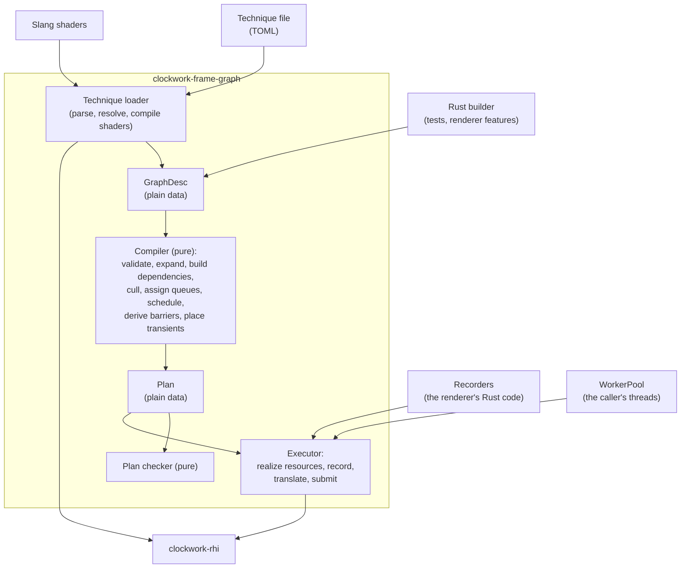

# 0003: Frame graph

- **Status:** Accepted
- **Author:** Ralph Potter, with Claude
- **Created:** 2026-11-22
- **Accepted:** 2026-11-24
- **Depends on:** [`ARCHITECTURE.md`](../ARCHITECTURE.md), designs [0001](0001-foundations.md) and [0002](0002-rhi.md), and ADRs [0002](../decisions/0002-vulkan-feature-baseline.md), [0003](../decisions/0003-supported-platforms.md) and [0006](../decisions/0006-crates-by-subsystem.md)

## Context

Design 0002 is implemented. The RHI can create resources, record command lists, translate them on any thread, and submit them to graphics, compute and transfer queues. Its barriers are described by engine-level accesses. But everything that uses it still synchronizes by hand:

- **The application writes its own barriers.** `Triangle::draw` (`src/triangle.rs`) takes the target's accesses before and after the draw and records barriers for them, and the vertices' upload acquire barriers. `draw_frame` (`src/main.rs`) passes `Access::Acquired` and `Access::Present`. That's allowed only until this design exists: `ARCHITECTURE.md`'s first principle says synchronization comes from the frame graph's analysis of declared accesses, and rendering code can't issue barriers.
- **Techniques are code.** The triangle is the whole frame, wired in Rust. The second principle says a technique is a frame graph description and its Slang shaders, loaded and hot-reloaded at run time. Design 0002 left hot reload to this design ("Non-goals"), but this design defers it to the asset system (see "Non-goals").
- **Shaders are compiled at build time.** The application's `build.rs` compiles `assets/shaders/triangle.slang`, as a stop gap until shaders are loaded at run time (0002, "The triangle").
- **Most of the RHI is unused by the application.** It uses one queue, no transient memory and no timings, and records one list on one thread. The compute and transfer queues, parallel translation, per-frame transient memory and timestamps exist for the frame graph to use.
- **More complex scenes need more passes.** Even a simple scene renderer needs a depth prepass, an HDR target and tone mapping, and `0007-pbr` adds shadow maps, image-based lighting and bloom. Each new pass multiplies the hand-written barriers, and their mistakes are hard to see: design 0002 found that synchronization validation reports no hazard between two render passes that write one attachment, or between copies by address (0002, "As built").

This design adds the frame graph: a description of a frame's passes and the resources they use, compiled into an execution plan with every barrier, queue handover and transient resource worked out, and executed through the RHI.

## Goals

1. **Derived synchronization.** Passes declare how they use each resource. The compiler derives every barrier, image layout, queue ownership transfer and timeline wait, and the render pass load and store operations. Code that records a pass can't record a barrier or begin a render pass.
2. **A pure compiler.** Compiling a graph needs no GPU. Its output, the execution plan, is plain data, which T0 tests check, snapshot and verify against an independent checker.
3. **Scheduling from dependencies.** The order passes are written in defines what each read sees. The compiler builds the dependency graph that follows from it, and chooses the order passes run in from that graph, so that work overlaps across queues and independent passes share their barriers. Which schedule to use is a choice, so schedules can be compared, and the written order is always one of them.
4. **Transient resources.** Textures and buffers that live within a frame are declared by the graph, sized relative to its output, created by it with the usage their accesses need, and placed in shared memory when their lifetimes don't overlap.
5. **Persistent and imported resources.** Resources whose contents survive from frame to frame, and resources the caller owns, such as the surface image and streamed uploads, are used by passes like any other, with their states carried between frames or given by the caller.
6. **Queues.** Passes can run on the compute and transfer queues, where the device has dedicated ones. A graph written for dedicated queues runs unchanged on a device where they're shared.
7. **Parallel recording.** Passes are recorded on worker threads, each into its own command list. Consecutive small lists are translated together into one command buffer, and large ones alone, so the number of command buffers follows the work rather than the number of passes. Translation runs on worker threads too, and command buffers are submitted in the plan's order.
8. **Techniques are data.** A technique is a file describing its graph, and the Slang shaders it names. Both are loaded at run time, so changing a technique needs no rebuild.
9. **Measurable passes.** Every pass is a debug region and a timing scope, so capture tools show the graph's structure and the engine reports each pass's GPU time.
10. **The application renders through the graph,** and records no barriers of its own.

## Non-goals

- **The renderer.** Meshes, materials, lights, cameras, the render snapshot and extraction from the ECS are `0005-ecs`, `0006-importers` and `0007-pbr`. The frame graph doesn't know about scenes (`ARCHITECTURE.md`, "Dependency rules"). Passes that draw a scene are recorded by Rust code the renderer registers.
- **The job system.** The graph runs its recording jobs on a `WorkerPool` its caller provides (see "Threading"). `0005-ecs` provides the engine's pool. Until then, the application implements it over a `rayon` thread pool.
- **Recording one pass on several threads.** Each pass records one command list. Splitting a pass with many draws across threads, as secondary command buffers or as several render pass instances, waits until a pass's recording is measured to need it.
- **The best possible schedule.** Finding the best order for a dependency graph is NP-hard in general, so the compiler's schedules are heuristics, chosen to be predictable and cheap (see "Scheduling"). Searching for better ones, or tuning them per GPU, waits until a technique is measured to need it.
- **Split barriers.** Vulkan's events allow a barrier's two halves to be recorded apart, so that work between them overlaps. The RHI has no events, and nothing has measured a need for them.
- **Hot reload, and how files are read.** `0006-importers` will design how assets are read, through one abstraction over the file system and other sources such as compressed asset packages, and how they're reloaded when they change. Techniques and their shaders should reload the same way as textures and models, through the same mechanism, rather than the frame graph having one of its own. So this design loads techniques once, when the application starts or calls `Technique::load`, and reads their files directly, through one function that the asset system will replace (see "Techniques"). Whether reloading polls files or uses the platforms' file events, which review compared, is decided there too. `TODO.md` tracks both.
- **Run-time parameters.** A technique's constants are set in its file, and changed by editing it and restarting, until hot reload exists. Setting them from a debug UI or a script waits for those to exist (`0008-scripting`).
- **History resources.** Temporal techniques read the previous frame's version of a texture. A persistent texture covers a resource read and written in one frame. Pairs that swap each frame arrive with the first temporal technique, in `0007-pbr`.
- **Composing techniques.** A frame runs one technique. Overlays and debug views drawn over it are passes in that technique for now.
- **Shipping shaders.** Shaders are compiled at run time with the `slangc` the build already needs, from the source tree. Caching compiled shaders, packaging assets and running without the Vulkan SDK are later work, with the importers' asset handling.
- **Tile memory on mobile GPUs.** Android is planned (ADR 0003). The graph knows which attachments are never stored, which is what lazily allocated memory and `VK_KHR_dynamic_rendering_local_read` need, but using them waits for the Android work, since nothing can run there yet. Nothing in this design assumes a desktop GPU.

## Requirements

| ID | Requirement | Acceptance criterion |
|---|---|---|
| R1 | The compiler derives barriers from declared accesses: write to read, read to write, write to write, and layout changes, at the granularity of a texture's mips and layers, with reads that share a layout joined into one barrier | T0 tests of each case. Snapshot tests of the example techniques' plans. |
| R2 | Code that records a pass can't record a barrier, begin or end a render pass, or record commands its kind of pass doesn't allow | The recorder types have no such methods, which a `compile_fail` doc test of each checks |
| R3 | Every plan is free of hazards: each pair of uses of a resource that conflict is ordered by a barrier or a timeline wait, and every use finds the resource in the layout it needs | A plan checker, written independently of the compiler, verifies the plans of randomly generated graphs in a property test, under every schedule and under random valid orders, and every plan compiled in debug builds |
| R4 | Passes whose results nothing uses are culled, unless they're marked as having side effects | T0 tests |
| R5 | A pass can be repeated for each mip of a texture, reading the mip above, so a mip chain is built in one description | T0 tests of expansion and barriers. T1 `mip_chain_in_graph`. |
| R6 | Transient textures and buffers are created by the graph, with sizes relative to the output and usage derived from their accesses, recreated when the output's size changes, and destroyed through deferred destruction | T0 tests of usage derivation. T1 `graph_renders_offscreen`, and `transients_survive_frames_in_flight`, which executes three frames without waiting, with no validation messages. |
| R7 | Persistent resources keep their contents from one frame to the next | T1 `persistent_texture_accumulates` |
| R8 | Imported resources: the output, from the accesses the caller gives to those it asks for, and the caller's textures and buffers, as declared; uploads are acquired, and waited for, before the first pass that runs | T0 tests. T1 `graph_renders_offscreen` with an upload. The smoke runs present through the graph. |
| R9 | Passes run on the queue they ask for, with cross-queue dependencies as timeline waits and queue ownership transfers, and with neither where kinds share a queue | T0 tests for each queue layout. T1 `async_compute_hands_over`, on dedicated and shared queues. |
| R10 | Passes are recorded on a `WorkerPool`, a list each. Each batch's lists are split, in order, into translation units by their command counts, and each unit is translated on the pool into one command buffer, submitted in the plan's order. | T0 tests of partitioning. T1 `parallel_recording_matches_serial`, and `coalescing_renders_the_same`, which renders with every list in a unit of its own and with every batch in one unit. |
| R11 | Each pass is a debug region and a timing scope, and the graph reports each pass's GPU time once its frame completes | T1 `pass_timings_are_reported` |
| R12 | Transient resources whose lifetimes don't overlap share memory, and their first use after another's is ordered after it | Property test: no two resources live at once overlap. T1 `aliased_transients_keep_contents`. |
| R13 | Techniques are TOML files, parsed into the same description the Rust API builds, with every error reported with its file, line and column | T0 tests of parsing, and of each error's message |
| R14 | Fullscreen and compute passes are described in data alone, with their push data laid out from their bindings and checked against the shader's reflection when the technique loads | T0 tests of layout. T1 `graph_renders_offscreen`, whose final pass is a fullscreen pass. A load test with a mismatched shader. |
| R15 | A technique's programs are compiled from Slang at run time with `slangc` | T1 tests load their techniques this way |
| R16 | The application renders the triangle through a technique, `assets/techniques/triangle.toml`, and records no barriers itself. Its `build.rs` compiles no shaders. | Review. The smoke runs. |
| R17 | A plan is compiled only when the technique, the output's size or format, the queues, or the choice of schedule or aliasing change. Executing a compiled plan allocates nothing in steady state. | T0 tests of the cache key. The benchmarks count allocations. |
| R18 | Passes run in an order the compiler chooses from their dependencies: read after write, write after read and write after write, as the written order defines them. Every schedule is a topological order of that graph, and is deterministic. | T0 tests of the dependency graph's edges, and of each schedule's choices. Property test: every schedule of a random graph is a topological order of it, and gives the same results as the written order, which the plan checker's verification of each shows. |
| R19 | The schedule is chosen with `CompileInputs::schedule`: `AsWritten`, which runs passes in the written order, or `Overlap`, the default, which starts work on other queues early, finishes waiting for it late, and groups independent passes so their barriers are recorded together | T0 tests and snapshots of each schedule. The benchmarks compare the GPU time of the example techniques under each. |

## Architecture



The frame graph is a new crate, `clockwork-frame-graph`, in `crates/frame-graph/`, depending on `clockwork-rhi` and `clockwork-diagnostics`, as `ARCHITECTURE.md`'s diagram allows. It has three layers, following "pure cores, thin shells":

- **The description,** `GraphDesc`: resources, passes and programs, by name. A technique file is parsed into one, and Rust code can build one directly. It's plain data, and holds no RHI handles.
- **The compiler,** a pure function from a description and its inputs (the output's format and size, which queues are dedicated, and the choices of schedule and aliasing) to a `Plan`. It has no GPU and no I/O, so all of its logic is T0-tested.
- **The executor,** `FrameGraph`, which owns the resources a plan creates, and each frame records the plan's passes into command lists on the worker pool, translates them, and submits them.

### Passes and resources

A **resource** is a texture or a buffer, named in the description, and one of:

- **Transient:** created by the graph, with contents that live within a frame. Its description gives its format, its size (in texels, or relative to the output), and its mips and layers, but not its usage, which the compiler derives from its accesses. A transient buffer gives its size in bytes.
- **Persistent:** created by the graph, as a transient one is, but its contents are kept from one frame to the next, so it's never placed in shared memory. A pass may read it before any pass in the frame writes it, and sees the last frame's contents.
- **Imported:** owned by the caller, who gives its handle each frame. Its description says the accesses it's in before the frame and must be in after it, which are the same every frame. `output` is a reserved import: the texture the frame renders to, such as the surface image, whose format, size and accesses before and after are compile inputs.

A **pass** has a name, a kind, the queue it asks for, and its uses of resources. Its kind decides what it can do:

| Kind | Recorded by | Can declare | Queue |
|---|---|---|---|
| `raster` | A recorder the renderer registers | Colour and depth attachments, and reads and writes through shaders | Graphics |
| `fullscreen` | The graph: one draw of a fullscreen triangle with a program from the technique | Colour attachments, and bindings | Graphics |
| `compute` | A recorder, or the graph: one dispatch of a program from the technique | Reads and writes through shaders, and bindings for the graph's dispatch | Graphics or compute |
| `transfer` | A recorder | Copy reads and writes, and fills | Any |

**Uses** are RHI `AccessSet`s on a resource, or on a `Subresource` of a texture, so a pass can read mip 2 of a texture while writing mip 3. Attachments are uses too, with the accesses 0002's "Synchronization" gives them: a colour attachment that's cleared or discarded is `ColorAttachmentWrite`, and one that's kept, because the pass blends with it or draws over it, adds `ColorAttachmentRead`. A depth attachment is `DepthAttachmentRead`, with `DepthAttachmentWrite` if the pass writes depth, or clears or discards it, since its load operation then writes it. An attachment is one mip of one layer of a texture, mip 0 of layer 0 unless the pass names another, so a pass can render to one mip of a chain.

**Bindings** are what the graph's own fullscreen and compute passes put in their push data: a texture view's heap index, a sampler's, or a buffer's address, each with the access the shader uses it for, and constants from the technique. The layout is fixed by the order of the bindings (see "Data structures and layout"), so the graph can fill it without knowing the shader, and it's checked against the shader's reflection when the technique loads.

**Repeating a pass for each mip.** A compute or fullscreen pass can be repeated for each mip of a texture after the first, with each repetition's uses and attachments naming the `current` and `previous` mip. Raster passes can't be repeated until a technique needs one, and transfer passes have no need to be. The compiler expands it into a pass per mip, named with the mip, so a mip chain is one entry in the description and its barriers come from the usual rules. A pass can't record barriers between its own draws or dispatches, so this is how a chain is built.

### Compiling

The compiler takes a `GraphDesc` and `CompileInputs`, and returns a `Plan` or every error it found. Its steps:

1. **Validate.** Names resolve, and each texture, buffer and pass has its own. Each access suits its pass's kind and its resource: raster passes read through vertex and fragment shaders and as draw arguments, compute passes read and write through compute shaders and read dispatch arguments, transfer passes copy, attachment accesses come only from attachments, and no pass uses an access that starts or ends a frame or that the CPU makes. No sampled access to a buffer, no attachment that's a BC or 3D texture, no storage view of more than one mip. A use declared as a read doesn't write, and one declared as a write does. A raster or fullscreen pass has at least one attachment, at most eight colour attachments and one depth attachment, each a different mip or layer, with depth only in a depth format and colour in any other. Each pass asks for a queue its kind can run on: raster and fullscreen passes graphics, compute passes graphics or compute, and transfer passes any. IDs and subresources name resources, mips and layers the description has. A 3D texture has a fixed size and one layer, and a cube map's layers are a multiple of six. A texture sized by the output has one mip or a full chain, since how many mips its size allows changes with the window, and a fixed count above one could stop the graph compiling when the window shrinks. A pass's uses of one subresource have one layout, by the RHI's rule. A raster pass's attachments are the same size. A size scaled from the output's is rounded up, except within the scale's own rounding error of a whole number, relative to the size, since a scale such as a third isn't exact in floating point. A mip relative to a repetition is used only by a pass repeated for each mip of that texture, which has more than one mip. A repeated pass's uses are checked once, as written, rather than once per repetition, so a mistake in one is reported once.
2. **Expand** passes repeated for each mip, then check the order of reads and writes, on the expanded passes, so a repetition's read of the previous mip follows the repetition that wrote it: every read of a transient resource follows, in the written order, a pass that writes it, and the output is written.
3. **Build the dependency graph** (see "Scheduling").
4. **Cull** passes whose writes nothing reads. Starting from the output, imported resources' final accesses, persistent resources, and passes marked as having side effects, a pass is kept if a kept pass depends on it by reading something it writes. Culled passes are logged at `DEBUG`, naming them. A pass culled because a debug view isn't shown is normal, so it's not a warning.
5. **Assign queues.** Each pass asks for a `QueueKind`, which is graphics unless it says otherwise, and runs on that kind's `QueueId`. Kinds that share a queue share an ID (0002, "Queues and submission"), so on a device with one queue family every pass runs on one queue, and the next steps find nothing to transfer.
6. **Schedule:** choose the order passes run in, and group them (see "Scheduling").
7. **Derive barriers** in that order (see below).
8. **Batch.** A batch is a run of consecutive passes on one queue, ended by a pass on another queue that a later pass on this one depends on. Each batch is one submission, waiting for the batches on other queues it depends on.
9. **Place transient resources** in shared memory (see "Aliasing").
10. **Derive load and store operations.** An attachment's load operation is a clear if the pass asks for one, a load if the pass keeps the contents, and otherwise "don't care". Its store operation is a store if a pass that runs later in the frame uses it, or it's persistent or imported, and otherwise "don't care", which lets a tiling GPU skip writing it out.

### Scheduling

**The written order defines meaning.** A read sees the most recent write before it in the order passes are written, as a graph built in code sees the order its builder was called in. Without an order, a pass that reads `hdr` and one that writes it could mean either "read the old contents" or "read the new ones". So the written order is where every dependency comes from, and nothing else about it is binding.

**The dependency graph** has a node for each pass, and an edge from one pass to a later one, in the written order, wherever their uses of a subresource conflict:

- **Read after write:** the later pass reads what the earlier one wrote, the latest write before it.
- **Write after read:** the later pass overwrites what the earlier one still has to read.
- **Write after write:** the later pass's contents are the ones that count.

Reads after reads add no edge. Uses of different mips or layers of one texture don't conflict. A read of a persistent resource before any write in the frame sees the last frame's contents, so it has an edge to the frame's first write of it, as any write after a read does. Edges are found per subresource, as barriers are, and kept transitively reduced, so the graph stays small.

**A schedule** is a topological order of the graph, split into groups: runs of consecutive passes on one queue with no edges between them. Any topological order gives the same results as the written order, since every pair of conflicting uses keeps its order. Each schedule is deterministic, breaking ties by the written order, so plans don't change from run to run. There are two:

- **`AsWritten`** runs passes in the written order, which is always a topological order, and puts each in a group of its own. It's for debugging, and for bisecting a problem to scheduling, as `CompileInputs::aliasing` is for aliasing.
- **`Overlap`,** the default, is a list scheduler. It keeps the passes whose dependencies have all been scheduled as ready, and repeatedly takes the first of them by these priorities, in order:
  1. A pass on another queue whose results a graphics pass needs, so that work on the compute and transfer queues starts as early as its inputs allow.
  2. A pass that joins the group being built: on the same queue, with no edge from any pass in it.
  3. A pass that doesn't wait for another queue, ahead of one that does, so the graphics queue waits for other queues' work as late as it can.
  4. The pass with the longest path of dependents to the end of the frame, so the work everything else waits on goes first.
  5. The pass written first.

  A pass moves at most `MAX_DISTANCE` places from where it's written, 16 to start with, which bounds how far moving work lengthens transient resources' lifetimes, and so how much it costs aliasing. `graph-aliasing` tunes the distance against the example techniques' memory and GPU times.

**Groups share their barriers.** Passes in a group don't depend on each other, so nothing needs synchronizing between them, and the barriers each needs from earlier passes are recorded together before the group's first pass. The GPU then overlaps the group's passes rather than draining between them. In `AsWritten`, every pass is its own group, so its barriers are recorded before it, as they would be by hand.

**Readable plans.** `Plan::describe` lists passes in the order they run, with their groups, and notes each pass that runs somewhere other than its written place, with the priority that moved it, so a moved pass can be traced to the rule that moved it.

**Deriving barriers.** The compiler walks the groups in the schedule's order, keeping each subresource's state: the queue it was last used on, and the `AccessSet` it's been used with since its last barrier. Textures are tracked per mip and layer, and buffers whole. For each use of a subresource by a pass:

- **Reads after reads, in one layout and on one queue,** need no barrier. The reads join the state's set.
- **Anything else,** a write, a read after a write, or a change of layout, needs a barrier from the state's set to the pass's, recorded before the pass's group. A barrier into reads looks ahead, and includes the reads of later passes on the same queue, in the same layout, before the subresource's next write, so a texture written once and sampled by three passes has one barrier, not three.
- **A use on another queue** needs a queue ownership transfer: a release recorded after the last pass that used it on the old queue, an acquire before this pass, and a timeline wait between their batches. A use that discards the contents, such as the first write of a transient resource in a frame, needs only the wait, since Vulkan doesn't need an ownership transfer for contents nobody reads.
- **The first use in a frame** is ordered after the last use in the previous frame, which may still be running on the GPU when a frame is in flight. For a persistent or transient resource, the barrier is from the accesses the plan ends the frame with, kept so the next frame starts where the last ended. For the first frame after a compile, it's from `Access::None`. For an import, it's from the accesses its description gives.

Barriers for adjacent subresources with the same transition are combined into one with the mips and layers they cover. Buffer transitions on one queue are combined into one global barrier per group, since buffers are reached by address and a global barrier has the same effect as a barrier per buffer, with less to translate. Buffer queue transfers stay buffer barriers, since a global barrier can't carry one.

**The plan checker** is a second, independent implementation of the rules, written for clarity rather than speed. It builds the happens-before relation the plan's barriers and waits give, following Vulkan's rules for chaining barriers through their stages, and checks every pair of conflicting uses against it, and every use's layout. It knows nothing of schedules or groups, only the order the plan runs passes in and its barriers and waits, so it checks every schedule the same way. It's used by the property tests, on random graphs, and runs after every compile in debug builds, panicking with the hazards it found. The compiler and the checker would have to make the same mistake for a hazard to pass both. Since synchronization validation misses some hazards between RHI commands (0002, "As built"), the checker is the main evidence for R3.

### Aliasing

Transient resources live from their first use in a frame to their last, which on one queue is a range of passes in the schedule's order, so the schedule decides how much memory can be shared. Two whose ranges don't overlap can share memory. Across queues, a range is extended to the batches that can run alongside it, since passes on different queues only have an order where a wait gives them one.

- **Placement** is a pure function: given each resource's size, alignment and lifetime, it assigns offsets in a heap, largest first, each at the lowest offset where it overlaps nothing that's live at the same time. That's within a few percent of the best possible for the frame graphs it's tested on, and it runs only when a plan is compiled.
- **Heaps.** Textures and buffers are placed in separate heaps, as the RHI's allocator keeps them in separate blocks, so that `bufferImageGranularity` never needs checking. Each heap is one allocation, sized by its placement, and created through a new RHI call (see "Changes to the RHI").
- **The first use of a resource after another's in the same memory** is ordered after the other's last use, and discards the contents, with a barrier from the other's accesses to its own, in the `Undefined` layout. Persistent resources are never placed in shared memory.
- **Aliasing can be turned off,** with `CompileInputs::aliasing`, which `FrameGraph::set_aliasing` sets, so that a corruption can be bisected to it. Every resource then has memory of its own, and the plans are otherwise the same.

### Executing

`FrameGraph::execute` runs one frame:

1. **Compile if needed.** If the technique, the output's format or size, the queues, or the choice of schedule or aliasing have changed since the last compile, it compiles again, and creates the transient and persistent resources the new plan needs. Resources the old plan created and the new one doesn't need are destroyed, through deferred destruction, so frames in flight that use them finish first. Persistent resources whose description and size haven't changed are kept, with their contents.
2. **Bind the frame's handles:** the output, the imports, and the transient frame the caller has begun, which passes allocate per-draw data from.
3. **Record,** a job per pass, on the worker pool. Each job resets its pass's command list, kept from the last frame, then records:
   - if the pass is the first of its group, the group's barriers, which also order the group's other passes, since a barrier orders every command after it on the queue, in later command buffers too
   - a debug region and a timing scope, both named for the pass
   - for a raster or fullscreen pass, the render pass, and a viewport and scissor covering its attachments
   - the pass itself, through its recorder or the graph's draw or dispatch
   - the end of the render pass, the timing scope and the debug region, then any releases to other queues

   The first graphics batch also starts with a list holding the acquire barriers of the frame's uploads.
4. **Partition** each batch's lists, in the order they run, into translation units (see "Coalescing"). This runs on the calling thread, once every list is recorded.
5. **Translate,** a job per unit, on the worker pool, each translating its lists, in order, into one command buffer for its queue.
6. **Submit** the batches in the plan's order, each with its waits, collecting each submission's timepoint for the batches that wait on it. The last graphics batch isn't submitted: it's returned to the caller, who presents it with the surface image through `RenderHardwareInterface::present`, or submits it when the output is offscreen.
7. **Collect timings.** Each frame takes the timings of earlier frames whose submissions have completed (`Queue::take_timings`), and keeps the most recent complete frame's per-pass GPU times for `FrameGraph::timings`. A command buffer translated from several lists reports each pass's timing scope separately, as nested scopes do now, so coalescing doesn't merge passes' times.

Every list that uses the frame's transient memory is translated before `execute` returns, so the caller can end the transient frame afterwards, as 0002's "Transient memory" requires.

### Coalescing

Every command buffer costs something beyond its commands: translating it checks out a command pool, begins and ends the buffer, binds both descriptor heaps and claims timestamp queries, and each is submitted on its own. A fullscreen pass is one draw, so for small passes that overhead can be most of their cost. But recording needs a list per job to run in parallel, and the graph can't tell before recording which passes are expensive: a recorder that draws ten thousand meshes and one that sets two constants look alike when compiling. So passes are recorded one list each, and the lists are coalesced when they're translated, by which time each knows how many commands it holds.

- **Partitioning** walks each batch's lists in the order they run, adding each to the current unit until the unit holds `UNIT_COMMANDS` commands, a thousand to start with, which the executing benchmarks tune. A list that holds that many on its own gets a unit of its own, and closes the one before it. It's a pure function of the lists' command counts, so it's T0-tested, and deterministic for a given frame.
- **Units never cross a batch,** since a batch is one submission on one queue.
- **Coalescing changes no synchronization.** Within a submission, a barrier orders every command after it on the queue, whichever command buffer it's in, so where command buffers begin and end doesn't matter. The plan, its groups and barriers, and the plan checker are the same however lists are coalesced. That's why partitioning is an execution decision, made each frame from what was recorded, rather than part of the plan.
- **The extra step costs a join.** Recording and translating become two rounds of jobs, with a wait between them, which costs microseconds on a pool whose threads are running, against the command buffers it saves.

A frame of thirty passes, most of them fullscreen and compute passes, then translates into a few command buffers rather than thirty, while a pass with thousands of draws still gets a thread and a command buffer to itself.

### Recorders

Passes that draw the scene, or anything else the technique file can't describe, are recorded by Rust code the renderer registers, by name, in `Recorders<D>`. `D` is the frame's data, such as the render snapshot, which every recorder reads and none writes. A pass names its recorder, and compiling fails if no recorder of that name and kind is registered.

A recorder is given:

- **A `PassContext`:** the pass's name and the size of its attachments; the handle, heap index or address of each resource the pass declares, by name; the technique's programs and samplers, by name; and the frame's transient memory.
- **The frame's data,** `&D`.
- **A recorder for its kind of pass:** `RasterCommands`, `ComputeCommands` or `TransferCommands`. Each wraps the pass's `CommandList`, and has only the methods its kind of pass may use. None has `barrier`, `begin_render_pass` or `end_render_pass`, and only `TransferCommands` copies.

The types stop a recorder synchronizing, but not from using a resource the pass didn't declare, such as one it was given in the frame's data. The rule is: **every resource the GPU writes during a frame is a graph resource, and every use of one is declared.** Scheduling makes the rule matter more: an undeclared use adds no edge to the dependency graph, so the pass can be moved past the pass it really depends on, where in the written order it would usually have been after it by luck. Resources the GPU only reads after they're uploaded, such as meshes and material textures, are acquired once through their `Upload`, and need no barriers after that, so recorders use them without declaring them.

### Techniques

A technique is a TOML file in `assets/techniques/`, naming its programs, samplers, resources and passes. The triangle's, which R16 asks for:

```toml
# The triangle, drawn into an HDR target, then copied to the output.

[programs.triangle]
source = "triangle.slang"
vertex = "vertexMain"
fragment = "fragmentMain"

[programs.present]
source = "present.slang"
vertex = "fullscreenVertex"
fragment = "presentFragment"

[samplers.nearest]
filter = "nearest"
address = "clamp-to-edge"

[textures.scene]
format = "rgba16-float"
size = "output"

[[passes]]
name = "triangle"
kind = "raster"
recorder = "triangle"
colour = [{ texture = "scene", load = { clear = [0.02, 0.05, 0.1, 1.0] } }]

[[passes]]
name = "present"
kind = "fullscreen"
program = "present"
bindings = [
  { texture = "scene", access = "fragment-shader-sampled-read" },
  { sampler = "nearest" },
]
colour = [{ texture = "output", load = "discard" }]
```

And a mip chain, built by repeating a compute pass:

```toml
[textures.bloom]
format = "rgba16-float"
size = { relative = "output", scale = 0.5 }
mips = "full"

[[passes]]
name = "bloom downsample"
kind = "compute"
queue = "compute"
program = "downsample"
for-each-mip = "bloom"
bindings = [
  { texture = "bloom", mip = "previous", access = "compute-shader-sampled-read" },
  { texture = "bloom", mip = "current", access = "compute-shader-write" },
  { sampler = "linear" },
  { constant = "float", value = 0.5 },
]
dispatch = { mip-of = "bloom", group = [8, 8, 1] }
```

- **Names** in files are the RHI's names in kebab case: `Access::FragmentShaderSampledRead` is `fragment-shader-sampled-read`, and `Format::Rgba16Float` is `rgba16-float`. One table maps each, beside the types, with a T0 test that every variant has a name.
- **Parsing** uses `serde` and the `toml` crate, into types that mirror the file, which are then resolved into a `GraphDesc`. Every error keeps the span of the value it's about, and is reported as `assets/techniques/bloom.toml:14:3: pass "bloom downsample" binds "bloom" as compute-shader-write, which needs a single mip`. Resolving reports every error it finds, not only the first.
- **Programs** are compiled when the technique loads, by running `slangc` with the options the build scripts use, found by the lookup in `crates/rhi/build/slangc.rs`, which this crate includes as `xtask` does. Shaders find their modules in `assets/shaders/` and the RHI's `crates/rhi/shaders/`, such as `heap.slang`, through a constant `clockwork-rhi` sets from its manifest directory. Programs compile in parallel, on the worker pool.
- **Reflection.** `slangc` also writes each program's reflection (`-reflection-json`). For the graph's own passes, the loader checks the size and offset of each field of the entry point's push data against the layout the bindings give, and fails the load naming the first field that differs. Recorders' push data is theirs to check, as 0002's "Binding model" describes.
- **Where assets are.** The application finds `assets/` from `--assets`, which defaults to the source tree's (`CARGO_MANIFEST_DIR`), since nothing is packaged yet.
- **Reading files.** The loader reads a technique file through one function, which takes its path and returns its text, so that the asset system `0006-importers` designs can replace it with reads from its own sources, such as packages. `slangc` reads shader sources itself, from the file system. Shaders in a package will need compiling ahead of time, which is that design's to decide with shipping shaders (see "Non-goals").
- **Replacing a technique.** `FrameGraph::set_technique` replaces the running technique, which is how the asset system will install a reloaded one. The next `execute` compiles a plan for it. The old technique's programs and the resources its plan created are destroyed through deferred destruction, so frames in flight finish with what they used, and persistent resources with the same name, description and size keep their contents. Nothing calls it after start-up until hot reload exists, but `graph_renders_offscreen` switches techniques between frames, so it's tested before then.

### Changes to the RHI

The compiler needs two things the RHI keeps to itself, coalescing two it doesn't have, and aliasing three. Each is recorded as a revision of design 0002 when it's added.

The compiler's, added in the `graph-plan` slice:

- **The layout rule.** `Layout`, `Access::layout` and `AccessSet::layout` are public, so validation checks that a pass's uses of a subresource share a layout, and barrier derivation finds layout changes, by the rule recording checks rather than a copy of it. So are `Access::is_alone_only` and `AccessSet::is_valid_combination`, so validation rejects `None`, `Present` and `Acquired` beside other accesses as recording does. Validation checks `Access::applies_to_textures` before a texture's layout, since a layout of none can mean either.
- **Queue IDs without a device.** `QueueId::new(index)` is public, so `QueueLayout`s can be built for compiling and testing plans with no GPU. A real queue's ID still comes from `Queue::id`.

Coalescing's, added in the `graph-execute` slice:

- **Translating several lists into one command buffer.** `Queue::translate_lists(&[&CommandList])` translates the lists in order into one `CommandBuffer`, checking out one pool and binding the heaps once. Each list is checked as a whole, as `translate` checks one, so a render pass, debug region or timing scope must still end in the list that began it, and a list's push data and bound programs don't carry into the next. It keeps design 0002's rules for a reversible recording model: each list is translated once, and nothing is merged, reordered or removed. `translate(&list)` becomes `translate_lists(&[&list])`.
- **A list's size.** `CommandList::command_count()` says how many commands a list holds, which partitioning needs. It reads no command, so nothing outside the RHI comes to depend on lists being data, and a list recorded straight into Vulkan after a reversal can count its commands as well.

Aliasing's, added in the `graph-aliasing` slice:

- **Placement queries.** `GpuResources::texture_placement(&TextureDesc)` and `buffer_placement(&BufferDesc)` return a `Placement { size, alignment }`: how much memory the resource needs, from `vkGetDeviceImageMemoryRequirements` and its buffer counterpart, which need no resource to exist.
- **Aliasing heaps.** `create_aliasing_heap(&AliasingHeapDesc { label, size, kind })` allocates device memory for textures or for buffers, as a dedicated allocation through the RHI's allocator, and `create_placed_texture(heap, offset, &TextureDesc)` and `create_placed_buffer(heap, offset, &BufferDesc)` create resources in it. Placed resources are destroyed like any other. `destroy_aliasing_heap` retires the heap through deferred destruction, and panics if a resource placed in it is still alive.
- **Discarding barriers.** `Barrier::discard(texture, subresource, previous, after)` and `Barrier::discard_buffer(buffer, previous, after)` discard a resource's contents, in the `Undefined` layout for a texture, as a barrier from `Access::None` does, but ordered after `previous`: the accesses of whatever last used the same memory. A barrier from `Access::None` has no stages, so it would let the new resource's first write overtake the old one's last use.

Nothing else in the RHI changes. The executor uses its existing commands, queues, timings and transient memory.

Translating several lists at once is also the first remedy for design 0002's missed translation budget that's in this design's reach, for small lists: it saves each list's pool, heap binding and command buffer. It doesn't help a list of 10,000 draws, whose time is in setting its render state, which `TODO.md` tracks.

### Ownership and lifetimes

- **`FrameGraph`** owns the current plan, the transient and persistent resources and aliasing heaps it created, and a command list per pass, reused each frame. It holds an `Arc<dyn GpuResources>` and the `Arc<dyn Queue>`s. Dropping it destroys what it created, through deferred destruction.
- **A `Technique`** owns the programs and samplers it created, and destroys them when it's dropped. `FrameGraph` holds the running technique, and `set_technique` drops the old one once its replacement is installed.
- **Imports, uploads and the transient frame** are the caller's, borrowed for one `execute`.
- **Command buffers** are submitted within `execute`, except the last graphics batch's, which the caller presents or submits.
- **Handles in a plan** are indices into the plan's own tables, not RHI handles, so a plan is pure data that can be compiled, compared and snapshotted with no GPU. The executor maps them to RHI handles when it creates the resources.

### Threading

| Type | `Send` | `Sync` | Why |
|---|---|---|---|
| `GraphDesc`, `Plan`, `CompileInputs`, `PassTimings` | Yes | Yes | Plain data |
| `Technique` | Yes | Yes | Descriptions and handles |
| `FrameGraph` | Yes | No | Used by the frame loop, through `&mut` |
| `Recorders<D>` | Yes | Yes | Shared by every recording job. Each recorder is `Fn + Send + Sync`. |
| `PassContext` | Yes | Yes | Read by one job, built from shared data |
| `RasterCommands`, `ComputeCommands`, `TransferCommands` | Yes | No | Each wraps one pass's list, through `&mut` |

**The worker pool** is a trait the caller implements:

```rust
/// Runs jobs on the caller's threads.
pub trait WorkerPool: Sync {
    /// Calls `job` with each index in `0..count`, in any order and on any
    /// threads, and returns once every call has returned. Each call runs in
    /// the tracing span that was current where `for_each` was called.
    fn for_each(&self, count: usize, job: &(dyn Fn(usize) + Sync));
}
```

It's object-safe, and has no lifetime beyond the call, so jobs borrow the frame's data freely. The graph only ever needs to run a number of jobs and wait for them, to record passes and to compile programs, so the trait has nothing more.

- **`Serial`,** which the crate provides, runs each job in turn on the caller's thread. Tests are deterministic with it, panics have plain backtraces, and log events stay in the caller's session with no help.
- **The application implements the trait over a `rayon` thread pool,** in a dozen lines, running each job with `ThreadPool::scope` and entering the caller's span in it. The pool's threads live for the whole run, so nothing is spawned per frame. Only the application depends on `rayon`.
- **`0005-ecs` chooses the engine's job system,** with the scheduler's needs in view, such as priorities between recording, simulation and streaming. Its pool then implements the trait, so recording jobs and systems share one set of threads. If it chooses `rayon`, the application's implementation moves there. If not, only that implementation changes, not the frame graph.

**What runs where:** compiling, creating resources and submitting run on the thread that calls `execute`. Recording runs on the pool, a job per pass, each with its own list, and translating then runs on the pool, a job per translation unit, each reading its own lists, so jobs share nothing mutable. Partitioning runs between them, on the calling thread. The RHI's queues, resources and transient frame are `Sync`, as 0002 designed them for this.

## API

```rust
/// A frame's passes and resources, by name. Built in Rust, or loaded from a
/// technique file.
#[derive(Debug, Clone, PartialEq)]
pub struct GraphDesc { /* resources, passes, programs and samplers */ }

impl GraphDesc {
    pub fn new(label: &str) -> Self;
    /// The texture the frame renders to, given each frame.
    pub fn output(&self) -> TextureId;
    pub fn transient_texture(&mut self, name: &str, desc: TransientTexture) -> TextureId;
    pub fn persistent_texture(&mut self, name: &str, desc: TransientTexture) -> TextureId;
    pub fn import_texture(&mut self, name: &str, import: ImportDesc) -> TextureId;
    pub fn transient_buffer(&mut self, name: &str, size: u64) -> BufferId;
    pub fn persistent_buffer(&mut self, name: &str, size: u64) -> BufferId;
    pub fn import_buffer(&mut self, name: &str, import: ImportDesc) -> BufferId;
    /// A raster pass, recorded by the recorder registered as `recorder`.
    pub fn raster_pass(&mut self, name: &str, recorder: &str) -> RasterPassBuilder<'_>;
    pub fn fullscreen_pass(&mut self, name: &str, program: &str) -> FullscreenPassBuilder<'_>;
    pub fn compute_pass(&mut self, name: &str, recorder: ComputeRecorder) -> ComputePassBuilder<'_>;
    pub fn transfer_pass(&mut self, name: &str, recorder: &str) -> TransferPassBuilder<'_>;
}

/// A transient or persistent texture's description. Its usage is derived.
#[derive(Debug, Clone, Copy, PartialEq)]
pub struct TransientTexture {
    pub dimension: TextureDimension,
    pub format: Format,
    pub size: TextureSize,
    pub mips: MipCount,
    pub layers: u32,
}

/// A texture's size: fixed, or the output's scaled and rounded up, with a
/// depth of 1.
#[derive(Debug, Clone, Copy, PartialEq)]
pub enum TextureSize {
    Fixed(Extent3d),
    Output { scale: f32 },
}

/// One mip of one layer of a texture, rendered to as an attachment. A
/// `TextureId` converts to its mip 0 of layer 0.
#[derive(Debug, Clone, Copy, PartialEq, Eq, Hash)]
pub struct AttachmentTarget {
    pub texture: TextureId,
    pub mip: u32,
    pub layer: u32,
}

/// The accesses an imported resource is in before each frame, and must be
/// left in after it.
#[derive(Debug, Clone, Copy, PartialEq, Eq)]
pub struct ImportDesc {
    pub before: AccessSet,
    pub after: AccessSet,
}

impl RasterPassBuilder<'_> {
    pub fn colour(&mut self, target: impl Into<AttachmentTarget>, attachment: Attachment<[f32; 4]>) -> &mut Self;
    pub fn depth(&mut self, target: impl Into<AttachmentTarget>, attachment: Attachment<f32>, write: bool) -> &mut Self;
    pub fn read(&mut self, resource: impl Into<ResourceUse>, access: impl Into<AccessSet>) -> &mut Self;
    pub fn write(&mut self, resource: impl Into<ResourceUse>, access: impl Into<AccessSet>) -> &mut Self;
    /// Keeps the pass even if nothing reads what it writes.
    pub fn side_effects(&mut self) -> &mut Self;
}
// The other builders likewise, with `queue`, `bindings`, `dispatch` and
// `for_each_mip` where their kind allows.

/// How an attachment's contents start. `T` is the clear value: four floats
/// for colour, one for depth, as in the RHI's `LoadOp`.
#[derive(Debug, Clone, Copy, PartialEq)]
pub enum Attachment<T> {
    Clear(T),
    /// The pass reads the contents, by blending or drawing over them.
    Keep,
    /// The pass overwrites every pixel it needs.
    Discard,
}

/// What a plan is compiled for.
#[derive(Debug, Clone, PartialEq)]
pub struct CompileInputs {
    pub output: OutputDesc,
    /// Each kind's queue, which kinds sharing a queue share.
    pub queues: QueueLayout,
    /// Whether transient resources may share memory.
    pub aliasing: bool,
    /// How the order passes run in is chosen.
    pub schedule: Schedule,
}

/// How the compiler chooses the order passes run in. Every schedule is a
/// topological order of the dependency graph the written order defines.
#[derive(Debug, Clone, Copy, PartialEq, Eq, Hash, Default)]
pub enum Schedule {
    /// The written order, each pass in a group of its own.
    AsWritten,
    /// Work on other queues early, waits for it late, and independent passes
    /// grouped so they share their barriers.
    #[default]
    Overlap,
}

/// The texture a frame renders to: its format and size, and the accesses
/// it's in before the frame and must be left in after it.
#[derive(Debug, Clone, Copy, PartialEq)]
pub struct OutputDesc {
    pub format: Format,
    pub extent: Extent2d,
    pub before: AccessSet,
    pub after: AccessSet,
}

impl OutputDesc {
    /// A surface image: from `Access::Acquired` to `Access::Present`.
    pub fn surface(format: Format, extent: Extent2d) -> Self;
}

/// The queue each kind runs on, from `Queue::id`.
#[derive(Debug, Clone, Copy, PartialEq, Eq, Hash)]
pub struct QueueLayout {
    pub graphics: QueueId,
    pub compute: QueueId,
    pub transfer: QueueId,
}

/// Compiles `desc` into a plan.
///
/// # Errors
/// Returns every error found, each naming the passes and resources involved.
pub fn compile(desc: &GraphDesc, inputs: &CompileInputs) -> Result<Plan, CompileErrors>;

impl Plan {
    /// A readable description of the plan: its batches, passes, barriers and
    /// waits, for snapshot tests and debugging.
    pub fn describe(&self) -> String;
}

/// Checks that a plan orders every pair of conflicting uses, and that every use
/// finds its layout.
///
/// # Errors
/// Returns each hazard found.
pub fn check(desc: &GraphDesc, plan: &Plan) -> Result<(), Vec<Hazard>>;

/// Recorders for the passes a technique leaves to code, by name. `D` is the
/// frame's data, which every recorder reads.
pub struct Recorders<D> { /* ... */ }

impl<D> Recorders<D> {
    pub fn new() -> Self;
    pub fn raster(
        &mut self,
        name: &str,
        record: impl Fn(&PassContext<'_>, &D, &mut RasterCommands<'_>) + Send + Sync + 'static,
    );
    // `compute` and `transfer` likewise.
}

/// What a recorder can find out about its pass.
impl PassContext<'_> {
    pub fn name(&self) -> &str;
    pub fn extent(&self) -> Extent2d;
    pub fn texture(&self, name: &str) -> Texture;
    pub fn texture_index(&self, name: &str, view: TextureView) -> DescriptorIndex;
    pub fn buffer_address(&self, name: &str) -> GpuAddress;
    pub fn program(&self, name: &str) -> Program;
    pub fn sampler_index(&self, name: &str) -> DescriptorIndex;
    pub fn transient(&self) -> &TransientFrame;
}

/// The commands a raster pass may record. The render pass, its viewport and
/// its scissor are already set.
impl RasterCommands<'_> {
    pub fn bind_program(&mut self, program: Program);
    pub fn set_render_state(&mut self, state: &RenderState);
    pub fn set_viewport(&mut self, viewport: &Viewport);
    pub fn set_scissor(&mut self, scissor: Rect2d);
    pub fn push_data(&mut self, offset: u32, data: &[u8]);
    pub fn bind_index_buffer(&mut self, address: GpuAddress, size: u64, format: IndexFormat);
    pub fn draw(&mut self, vertices: u32, instances: u32);
    // `draw_indexed`, the indirect draws, and the debug labels and timings
    // nested inside the pass's own, as `CommandList` has them.
}

/// One frame's inputs.
pub struct Frame<'a> {
    pub output: Texture,
    pub imports: &'a [(&'a str, Resource)],
    /// Uploads to acquire before the first pass, and wait for.
    pub uploads: &'a [Upload],
    pub transient: &'a TransientFrame,
}

/// Compiles plans, owns what they create, and executes them.
pub struct FrameGraph { /* ... */ }

impl FrameGraph {
    pub fn new(resources: Arc<dyn GpuResources>, queues: [Arc<dyn Queue>; 3], label: &str) -> Self;
    /// Replaces the running technique. The next `execute` compiles it.
    pub fn set_technique(&mut self, technique: Technique);
    /// Whether transient resources may share memory: on by default, and off
    /// to bisect a corruption. The next `execute` compiles again.
    pub fn set_aliasing(&mut self, aliasing: bool);
    /// How passes are scheduled: `Overlap` by default, and `AsWritten` to
    /// bisect a problem to scheduling. The next `execute` compiles again.
    pub fn set_schedule(&mut self, schedule: Schedule);
    /// Records, translates and submits a frame, compiling first if needed.
    /// Returns the last graphics batch, for the caller to present or submit.
    ///
    /// # Errors
    /// Returns an error if compiling fails, a resource can't be created, or
    /// translating or submitting fails.
    pub fn execute<D: Sync>(
        &mut self,
        frame: &Frame<'_>,
        output: &OutputDesc,
        recorders: &Recorders<D>,
        data: &D,
        workers: &dyn WorkerPool,
    ) -> Result<FinalBatch>;
    /// The GPU time of each pass in the most recent frame whose timings have
    /// been read back.
    pub fn timings(&self) -> Option<&PassTimings>;
}

/// The last graphics batch of a frame: its command buffers, and the
/// timepoints it waits for.
pub struct FinalBatch {
    pub command_buffers: Vec<CommandBuffer>,
    pub wait_for: Vec<GpuTimepoint>,
}

impl Technique {
    /// Loads a technique file, and compiles its programs.
    ///
    /// # Errors
    /// Returns every error in the file, or the first shader that fails to
    /// compile.
    pub fn load(path: &Path, assets: &Assets, resources: &Arc<dyn GpuResources>, workers: &dyn WorkerPool) -> Result<Self, TechniqueError>;
}
```

The triangle's frame, in the application:

```rust
let Some(image) = rhi.acquire_surface_image()? else { return Ok(()) };
let transient = resources.begin_transient_frame();
let uploads: Vec<Upload> = triangle.take_upload().into_iter().collect();
let batch = graph.execute(
    &Frame { output: image.texture, imports: &[], uploads: &uploads, transient: &transient },
    &OutputDesc::surface(image.format, image.extent),
    &recorders,
    &triangle,
    &workers,
)?;
resources.end_transient_frame(transient);
self.last_frame = rhi.present(PresentDesc {
    image,
    command_buffers: batch.command_buffers,
    wait_for: &batch.wait_for,
})?;
```

and its recorder, which no longer knows its target's accesses:

```rust
recorders.raster("triangle", |pass, triangle: &Triangle, commands| {
    commands.bind_program(pass.program("triangle"));
    commands.set_render_state(&RenderState::default().cull(CullMode::None).depth(None));
    commands.push_data(0, bytemuck::bytes_of(&triangle.push_data()));
    commands.draw(3, 1);
});
```

## Data structures and layout

- **Identifiers.** `TextureId`, `BufferId` and `PassId` are `u32` indices into a `GraphDesc`'s tables, and names are kept beside them for messages and lookups. A plan's tables are indexed the same way, so the executor maps each to an RHI handle with one array index.
- **Subresource state** is a `Vec` per texture of one entry per mip and layer, which is small for the textures frames use: a full chain of 13 mips with one layer is 13 entries.
- **The dependency graph** is a `Vec` of edges per pass, indexed by `PassId`, with the kind of each edge kept for `describe` and for messages.
- **Plans** are flat: a `Vec` of batches, each a range of a `Vec` of groups, each with a range of a `Vec` of barriers and a range of a `Vec` of passes. Executing walks them in order and allocates nothing.
- **`Plan::describe`** writes one line per batch, group, barrier, pass and wait, in the order they run, so a snapshot's diff shows which barrier changed or which pass moved. A pass that runs somewhere other than its written place says where it was written and which of the schedule's priorities moved it:

  ```
  batch 0 on compute
    group 0
      barrier occlusion: none -> compute-shader-write
      pass "ambient occlusion" (compute), written 3rd, moved by: work on other queues first
      release occlusion to graphics
  batch 1 on graphics
    group 0
      barrier depth: none -> depth-attachment-read | depth-attachment-write
      barrier shadow: none -> depth-attachment-read | depth-attachment-write
      pass "depth prepass" (raster)
        render pass: depth clear, store
      pass "shadow map" (raster), written 4th, moved by: joins the group
        render pass: shadow clear, store
    group 1
      wait for batch 0
      acquire occlusion from compute
      barrier depth: depth-attachment-write -> depth-attachment-read
      barrier occlusion: compute-shader-write -> fragment-shader-sampled-read
      ...
    end of frame
      barrier output: color-attachment-write -> present
  ```

- **Push data of the graph's passes** is laid out from the bindings in order: a texture view or a sampler is a 4-byte `DescriptorIndex`, a buffer an 8-byte address aligned to 8, and a constant 4 bytes (`float`, `int` or `uint`) or 16 (`float4`). It must fit the RHI's 128 bytes, which the loader checks. A shared Slang module, `assets/shaders/graph.slang`, has the fullscreen vertex shader, so shaders written for the graph start from the same place.
- **Snapshots** use the `insta` crate, the workspace's first, with the snapshots checked in beside the tests.

## Error handling

- **A technique that can't be loaded** is a `TechniqueError`: the file's parse and resolve errors, each with its span, or a shader that failed to compile, with `slangc`'s output, or a push data layout that doesn't match the shader's reflection. Its `Display` lists every error, one per line, starting with the file and position.
- **A graph that can't be compiled** is a `CompileErrors`, a list of every error found, each naming the passes and resources involved: `pass "lighting" reads "gbuffer normals", which no earlier pass writes`. A graph built in Rust gets the same checks as one loaded from a file.
- **Executing** returns `RhiError`s from the RHI, with the pass's name in the context for errors from translating.
- **Panics** are bugs in the caller: a frame without an import the plan needs, a `PassContext` lookup of a resource the pass didn't declare, a recorder that panics, which the worker pool propagates, and a plan the checker rejects in a debug build, which is a bug in the compiler.
- **Diagnostics:** culled passes and recompiles at `DEBUG`, with why the plan was recompiled; a technique loaded at `INFO`, with how long loading and compiling its shaders took.

## Performance

Budgets for the frame graph's own CPU time, measured with `criterion` benchmarks in `crates/frame-graph/benches/`, on the same machine as design 0002's:

| Operation | Budget |
|---|---|
| Compiling a 64-pass graph with 128 resources, including scheduling and placement | Under 1 ms |
| GPU time of the example techniques under `Overlap`, against `AsWritten` | No worse on any of them, on lavapipe's single queue and the reference machines |
| Executing a 32-pass frame with empty recorders, on one thread, including translation | Under 1 ms |
| The same, on eight workers of a pool whose threads are already running | Under 0.5 ms |
| Allocations per frame in steady state | None in the graph |
| Transient memory with aliasing, for the example techniques at 3840 × 2160 | At most 10% more than the most memory live at any one pass |

Compiling isn't per frame, so its budget is generous. Executing is dominated by translation, which design 0002's budgets cover, and coalescing keeps it to a few command buffers a frame. The graph's own work per pass is a few barriers and commands, and a lookup per name a recorder asks for.

## Alternatives considered

- **Graphs built in Rust every frame,** as most engines' render graphs are. Flexible, and the frame's code can decide anything as it builds. But it makes techniques code, against the second principle, and recompiles every frame. Rejected for descriptions loaded from data and compiled when they change, with the Rust builder kept for tests and for the loader to target.
- **RON for techniques.** RON is serde's data model written out: enums, structs, tuples and options each have a syntax, so a description reads as its Rust value would, and deriving `Deserialize` does most of the loading. The description has many values that are one of several kinds, such as an attachment's `Clear`, `Keep` or `Discard`, and a binding that's a texture, a sampler or a constant, which RON writes as variants. TOML has no sum types, so the loader maps strings and tables onto them by hand, and nests awkwardly beyond two levels, with inline tables on one line. But TOML was chosen in review:
  - **Errors point at values.** R13 reports every error, including those found after parsing, at its line and column. The `toml` crate keeps each value's position with `Spanned<T>`. `ron` reports positions only for syntax errors, as far as the review found, so the loader would track them itself.
  - **Familiarity.** Everyone working in Rust edits `Cargo.toml`, and editors highlight, format and check TOML against a schema. RON would be one more thing to learn.
  - **The format is separate from the API.** The name table is the format's vocabulary, so renaming a Rust type doesn't break technique files. RON's convenience comes from using Rust's names, and keeping them apart needs a `serde` rename on every item.
  - **The shape suits it.** A technique is mostly a flat list of passes with a few fields each, which `[[passes]]` tables read well as.

  RON is worth revisiting if descriptions grow deeper, or the loader fills with code mapping TOML onto variants, which `TODO.md` tracks. Both formats would parse into the same `GraphDesc`, so a switch changes only the loader.
- **JSON or KDL for techniques.** JSON is everywhere, but has no comments, and is noisy to edit by hand. KDL reads well as a tree, but is less known than either TOML or RON. Lua, which `0008-scripting` brings, could later generate descriptions, but a technique shouldn't need a script to exist.
- **Linking Slang as a library** rather than running `slangc`. A long-lived session loads Slang's core module once and keeps modules cached, so recompiling one edited shader would take a fraction of what starting `slangc` does, and reflection, diagnostics and the files a shader read come back as data rather than JSON, text and a dependency file. But running `slangc` was chosen in review:
  - **Nothing new to build or ship.** `slangc` is already a prerequisite, found by the lookup the build scripts and `xtask` share, so the engine compiles with the same version and options as the build, in one way.
  - **Isolation.** A crash or hang in the compiler is a failed load, which a timeout can end, rather than a crashed engine, which matters for features as new as `SPV_EXT_descriptor_heap`.
  - **No `unsafe`.** Slang's compiling API is COM-style C++ interfaces. Binding them by hand means virtual tables declared to match `slang.h` exactly, where a mismatch after an SDK update is undefined behaviour rather than an error, and a `SAFETY` comment on every call. The `shader-slang` crate would do that for us, but bindings like it lag the SDK, as `ash`'s pin shows.

  Neither way compiles shaders on Android or iOS, which need them compiled ahead of time and shipped, so the choice only affects desktop development. The library is worth revisiting once hot reload exists, if reloading an edited shader is too slow, which `TODO.md` tracks. Programs are compiled through a small interface, taking sources and returning SPIR-V and push data reflection, so a switch changes only that.
- **Running passes only in the written order,** as this design first proposed. Plans are as predictable as they can be, and a snapshot changes only where the description does. But work on other queues overlaps only as well as the author orders it, and every pass drains the GPU before the next, even where they're independent. Rejected in review for scheduling from the dependency graph, with `AsWritten` kept as a schedule for debugging.
- **Dependencies declared by hand,** with passes naming the passes they follow. Explicit, but it duplicates what resource uses already say, and gets out of step with them. Rejected for dependencies derived from uses, with the written order giving their direction.
- **A scheduler that minimizes memory,** running each pass as close to its consumers as it can. It's the opposite of `Overlap`'s aim of starting work early, which lengthens lifetimes. Rejected as the default, since overlap is what the graph's queues are for, with `MAX_DISTANCE` bounding the memory it costs. A schedule that minimizes memory can be added beside the others, if a technique needs one.
- **A copy of each transient resource per frame in flight,** so frames never share one. Simpler to synchronize, but two or three times the memory, for resources that are often the largest in the frame. Rejected for barriers from the last frame's final accesses.
- **A barrier per buffer.** Exact, but buffers are reached by address, so a barrier on one buffer orders nothing a global barrier wouldn't, and costs more to translate. Rejected, except for queue transfers.
- **A command buffer per pass,** as this design first proposed, translating each pass's list on its own. The most parallel, but a small pass's command buffer can cost more than its commands, and a frame of thirty passes submits thirty. Rejected in review for coalescing lists into translation units.
- **A command list per batch.** The fewest command buffers, but a batch could only be recorded on one thread, however many heavy passes it has. Rejected.
- **Merging passes before recording,** recording several passes into one list in one job. It saves the second round of jobs, but the graph can't know before recording which passes are expensive, so a bad guess puts two heavy passes on one thread. Rejected for coalescing at translation, when each list's size is known.
- **Using `rayon` directly in the frame graph.** It's mature, its threads steal work from each other, and it would need no trait. But it would decide part of `0005-ecs` early: if that design chooses another job system, the engine has two pools competing for cores until the frame graph moves. `rayon` has no priorities, which the job system must weigh once streaming and simulation share threads with recording. And even a one-thread `rayon` pool runs jobs on its own thread, so running in order on the caller's thread, as `Serial` does, would need code of its own anyway. Rejected in review for the `WorkerPool` trait, which the application implements over `rayon` until `0005-ecs`.
- **A pool of scoped threads spawned for each call,** in this crate, for the application. It needs no dependency, but spawning eight threads costs on the order of 100 to 200 µs a frame, a real part of executing's budget. Rejected in review for `rayon` in the application.
- **Hot reload of techniques in this design,** as `ARCHITECTURE.md` and design 0002 planned, by polling the files a technique was loaded from, or watching them with `notify`. It would make techniques quicker to work on now. But `0006-importers` will design how every asset is read, from the file system or packages, and reloaded, and techniques should reload the same way as textures and models rather than through a mechanism of their own. Deferred in review to that design, which `TODO.md` tracks with the comparison of polling and `notify`.
- **Leaving aliasing to a later design.** The rest of the graph is simpler without it. But the transient resources' lifetimes, the plans and the barriers are designed here, and adding aliasing later would change all three. Scheduling also lengthens the lifetimes aliasing shares memory between, and `MAX_DISTANCE` trades one against the other, so they're tuned together. Kept, as the last slice, with a switch to turn it off.

## Test plan

- **T0 unit:**
  - parsing each part of a technique file, and each error's message and span (R13)
  - resolving: every kind of error, all reported together (R13)
  - the name table: every `Access` and `Format` has a name in kebab case, and names round-trip
  - validation: one test per rule in "Compiling", each with the expected `CompileErrors` (R1, R2)
  - culling: unread passes are culled, side effects and the output keep passes (R4)
  - expansion of passes repeated for each mip, with their names and uses (R5)
  - the dependency graph: an edge for each of read after write, write after read and write after write, none for reads after reads or for different mips of one texture, and a read seeing the latest write before it in the written order (R18)
  - each schedule's choices, a test per priority of `Overlap`, `MAX_DISTANCE`, ties broken by the written order, and groups formed only from independent passes on one queue (R18, R19)
  - barrier derivation, a test per case: write to read, read to write, write to write, reads joining in one layout, reads in different layouts, a write to one mip while reading another, queue transfers, discarding uses on another queue, and the first use in a frame for transient, persistent and imported resources (R1, R9)
  - load and store operations for each case (R1)
  - usage derived from accesses, for textures and buffers (R6)
  - partitioning into translation units: small lists joined up to the threshold, a large list alone, closing the unit before it, units never crossing a batch, and an empty batch (R10)
  - batching and waits for each queue layout: everything shared, a dedicated compute queue, and dedicated compute and transfer queues (R9)
  - placement: lifetimes, overlap within a queue and across queues, and heap sizes (R12)
  - the cache key: what recompiles and what doesn't (R17)
  - push data layout from bindings, and the check against a reflection fixture, matching and not (R14)
  - `compile_fail` doc tests that the recorder types have no `barrier`, `begin_render_pass` or `end_render_pass`, and that `RasterCommands` has no `dispatch` or copies (R2)
  - static assertions of the "Threading" table
- **T0 snapshot:** `Plan::describe` for each example technique (the triangle, a deferred renderer's passes, a bloom chain, and a compute pass on the compute queue), compiled for each queue layout and each schedule, with and without aliasing (R1, R9, R12, R19)
- **T0 property:**
  - random graphs, with random resources, kinds of pass, queues and accesses, compiled under each schedule and verified by the plan checker (R3, R18)
  - each schedule of a random graph is a topological order of its dependency graph, and the same on every run (R18)
  - random graphs compiled in random valid topological orders, which the compiler accepts as a schedule through a test-only entry point, and verified by the plan checker, so barrier derivation is correct for any order a future schedule might choose (R3, R18)
  - the checker itself, on plans with one barrier removed at random, which it must reject (R3)
  - placement: random lifetimes and sizes, with no two resources live at once overlapping, and each at its alignment (R12)
- **T1 GPU,** in `crates/frame-graph/src/gpu_tests.rs`, each in a `TestSession` with validation required and synchronization validation on:
  - `graph_renders_offscreen`: the triangle's technique, rendered to an offscreen output with an upload, and read back, then replaced with `set_technique` by one that clears to another colour, which the next frame shows (R6, R8, R14, R15)
  - `mip_chain_in_graph`: a bloom-like chain filled by repeated compute passes, with the smallest mip read back (R5)
  - `async_compute_hands_over`: a compute pass on the compute queue writes a buffer and a texture that a graphics pass reads, on the reference machines' dedicated queue and lavapipe's shared one (R9)
  - `persistent_texture_accumulates`: a pass adds one to a persistent texture each frame, read back as three after three frames (R7)
  - `transients_survive_frames_in_flight`: three frames executed without waiting between them (R6)
  - `parallel_recording_matches_serial`: the same frame on `Serial` and on a `rayon` pool, a dev-dependency of the crate's tests, read back and compared (R10)
  - `coalescing_renders_the_same`: the example techniques rendered with every list in a unit of its own, with the default threshold, and with each batch in one unit, read back and compared, and with every pass's timing reported in each (R10, R11)
  - `pass_timings_are_reported`: every pass of a frame has a duration once it completes (R11)
  - `aliased_transients_keep_contents`: two transient textures placed in the same memory, each written and read in turn, with the right results, and validation's aliasing checks clean (R12)
  - `mismatched_push_data_is_reported`: a fullscreen pass whose shader's push data doesn't match its bindings fails to load, naming the field (R14)
  - `schedules_render_the_same`: the example techniques rendered under `AsWritten` and `Overlap`, read back and compared, on dedicated and shared queues (R18, R19)
- **T2 benchmarks:** compiling, executing on one thread and on eight, and placement, against the budgets in "Performance" (R17), and the example techniques' GPU time under each schedule, from their pass timings (R19)
- **Smoke:** the 0001 smoke runs, unchanged, now presenting through the frame graph (R8, R16)
- **Fixtures:** example techniques and their shaders in `crates/frame-graph/tests/techniques/`, and a reflection JSON file for the layout check's T0 test. The triangle's technique and shaders are in `assets/`.
- **Expected warnings:** none. No test expects a warning or an error.

## Implementation slices

Each slice is a stack of small PRs, as `CLAUDE.md` describes.

| Branch | Contents | Requirements |
|---|---|---|
| `design/frame-graph` | This design (this branch) | |
| `graph-plan` | The `clockwork-frame-graph` crate; the RHI's layout rule and `QueueId::new` made public, recorded as revisions of 0002; `GraphDesc` and its builders; validation, expansion, the dependency graph, culling, the `AsWritten` schedule, and barrier derivation and load and store operations on one queue, for any order; `Plan` and `describe`, with `insta`; the plan checker and its property tests, in random orders too; the compiling benchmark | R1, R3, R4, R5, R18, part of R17 |
| `graph-execute` | The RHI's `Queue::translate_lists` and `CommandList::command_count`, recorded as revisions of 0002; `FrameGraph`; transient and persistent resources, created without aliasing; imports and uploads; `Recorders`, `PassContext` and the recorder types; the graph's fullscreen and compute passes; `WorkerPool` and `Serial`; partitioning into translation units; debug regions, timing scopes and `timings`; `set_technique`; the executing benchmarks, which tune `UNIT_COMMANDS` | R2, R6, R7, R8, R10, R11, R17 |
| `graph-techniques` | TOML technique files, the name table, spans and errors; compiling programs with `slangc` at run time, with reflection and the push data check; `assets/techniques/triangle.toml`; the application rendering through the graph, on a `WorkerPool` over `rayon`, its barriers and its `build.rs`'s shader compilation removed | R13, R14, R15, R16 |
| `graph-queues` | Queue assignment, batching, cross-queue waits and ownership transfers, and their snapshots and T1 test; the `Overlap` schedule, groups and their shared barriers, `set_schedule`, `schedules_render_the_same`, and the GPU time benchmarks | R9, R19 |
| `graph-aliasing` | The RHI's placement queries, aliasing heaps, placed resources and discarding barriers, recorded as revisions of 0002; lifetimes and placement; heaps sized and created by the executor; `CompileInputs::aliasing`; `MAX_DISTANCE` tuned against memory and GPU time | R12 |

Each slice updates `docs/testing.md` where it adds a kind of test, and `TODO.md`. `graph-plan` is pure, so it's reviewed without a GPU. It derives barriers for any order from the start, and runs passes as written, so the first slices are predictable while the rest is built. `graph-execute` comes before techniques, so the executor is tested with graphs built in Rust before files exist. `graph-techniques` moves the application onto the graph as soon as it can load the triangle's technique. `Overlap` comes with queues, since overlapping their work is most of what it's for, and `AsWritten` is the default until then. Aliasing is last, since it's the riskiest, needs the lifetimes across queues that `graph-queues` defines, and is where the schedule's cost in memory is tuned.

## Risks

| Risk | Likelihood | Impact | Mitigation |
|---|---|---|---|
| The compiler misses a hazard that synchronization validation can't see either, such as between render passes or copies by address (0002, "As built") | Medium | Rare corruption, depending on timing | The independent plan checker, in property tests and after every compile in debug builds. Synchronization validation in every T1 test, for what it does see. |
| Aliasing corrupts a resource: a missing discard barrier, or a lifetime across queues computed too short | Medium | Corruption that's hard to trace | The checker covers memory shared between resources as it does subresources. Placement is property-tested. `CompileInputs::aliasing` turns it off to bisect. It's the last slice, so everything else is proven first. |
| A recorder uses a resource it didn't declare, so its barrier and its dependency are missing | Medium | Hazards the graph can't see, more often once scheduling moves the pass | The rule in "Recorders". `PassContext` hands out only declared resources, and panics on others. Review of recorders. A problem that goes away under `AsWritten` points at a missing dependency. |
| `Overlap` makes a technique slower than its written order, or uses more memory | Medium | Frame time or memory | The benchmarks compare the example techniques' GPU time under each schedule, and `MAX_DISTANCE` bounds how far passes move. `AsWritten` is one call away. A schedule that suits a technique better can be added beside the others. |
| Scheduling makes plans hard to follow | Low | Slower debugging | `describe` gives each moved pass's written place and the priority that moved it, and snapshots show every change of order |
| Descriptions can't express a technique, such as one whose pass count depends on the scene | Medium | Techniques written in Rust after all | Recorders cover what data can't, and repetition per mip covers chains. A technique that needs more is a revision, adding what it needs to the format. |
| Compiling shaders at run time is slow, so loading a technique pauses for seconds | Medium | Slow start-up, and later slow reloads | Programs compile in parallel, and loading logs its time. A cache of compiled SPIR-V, keyed by the sources' contents, is the remedy for start-up, and linking Slang as a library for reloads, which `TODO.md` tracks. |
| The asset system's abstraction doesn't suit how techniques are loaded, such as `slangc` reading shaders from disk itself | Medium | A change to the loader when `0006-importers` lands | Techniques are read through one function, and replaced through `set_technique`, so the change is local. That design accounts for techniques and shaders as assets, which `TODO.md` records. |
| `slangc`'s reflection JSON changes between SDK versions | Low | Load failures after an SDK update | The check reads only push data fields' names, offsets and sizes. The T0 test's fixture is regenerated when the SDK moves. |
| Command counts are a poor measure of translation cost, so units come out unbalanced: setting render state costs far more to translate than a draw, about 90% of a list's time in design 0002's benchmarks | Medium | Workers idle while one translates a large unit | The executing benchmarks, and per-unit translation times logged at `TRACE`. Weighting commands by kind is the remedy, inside partitioning alone. |
| `0005-ecs` chooses a job system other than `rayon`, and the trait doesn't suit it | Low | A change to the frame graph's scheduling | The trait asks only for a parallel loop that waits, which any job system has. Until the change, only the application's implementation depends on `rayon`. |

## Open questions

None.

## Resolved in review

| Question | Resolution |
|---|---|
| Technique file format: TOML or RON | TOML, for errors that point at values, familiarity, and a format separate from the Rust API (see "Alternatives considered"). `TODO.md` tracks revisiting RON once the loader exists. |
| Compiling shaders at run time: running `slangc` or linking Slang | Running `slangc`: nothing new to build, compiler failures kept out of the engine's process, and no `unsafe` (see "Alternatives considered"). `TODO.md` tracks revisiting the library once hot reload exists. |
| The worker pool: a trait the caller implements, or `rayon` | The `WorkerPool` trait, with `Serial` in the crate, and the application implementing it over a `rayon` thread pool until `0005-ecs` chooses the engine's job system (see "Threading") |
| Detecting changes for hot reload: polling or `notify` | Deferred, with hot reload itself, to `0006-importers`, which designs how every asset is read and reloaded, so techniques reload the same way as textures and models (see "Non-goals"). `TODO.md` records the comparison. |
| The order passes run in: as written, or scheduled from their dependencies | Scheduled. The written order defines each read's meaning, and the compiler chooses a topological order of the dependency graph it gives, with `Overlap` as the default and `AsWritten` kept for debugging (see "Scheduling") |
| Command buffers: one per pass, or coalesced | Coalesced at translation. Passes are recorded one list each, in parallel, and each batch's lists are split by their command counts into units, each translated into one command buffer (see "Coalescing") |
| Aliasing: in this design, or a design of its own | In this design, as the last slice, `graph-aliasing`, behind `CompileInputs::aliasing`. The lifetimes, plans and barriers it depends on are designed here, and scheduling with `Overlap` lengthens the lifetimes it shares memory between, so the two are designed and tuned together (see "Aliasing" and "Alternatives considered") |

## As built

Filled in at close-out.

## Revision history

| Date | Change |
|---|---|
| 2026-11-22 | Proposed |
| 2026-11-22 | Revised after review: technique files are TOML rather than RON, for errors that point at values, familiarity, and a format separate from the Rust API, with revisiting RON tracked in `TODO.md`, closing that open question ("Alternatives considered", "Open questions", "Resolved in review") |
| 2026-11-22 | Revised after review: programs are compiled by running `slangc`, rather than by linking Slang as a library, so nothing new is built, compiler failures stay out of the engine's process, and no `unsafe` is needed, with revisiting the library once hot reload is used tracked in `TODO.md`, closing that open question ("Alternatives considered", "Open questions", "Resolved in review") |
| 2026-11-22 | Revised after review: the frame graph keeps the `WorkerPool` trait, and the application implements it over a `rayon` thread pool, replacing `ScopedThreads`, which spawned threads every frame. `0005-ecs` still chooses the engine's job system, closing that open question ("Non-goals", "Threading", "Alternatives considered", "Test plan", "Implementation slices", "Risks", "Open questions", "Resolved in review") |
| 2026-11-22 | Revised after review: hot reload is deferred to `0006-importers`, which designs how assets are read, from the file system or packages, and reloaded, so techniques and shaders reload the same way as textures and models. The `graph-hot-reload` slice, `TechniqueWatcher`, R16 and `technique_reloads` are removed, and R17 and R18 become R16 and R17. Techniques are read through one function the asset system will replace, and `set_technique` is tested by switching techniques between frames. Whether to poll or use `notify` is decided with hot reload, closing that open question ("Context", "Goals", "Non-goals", "Requirements", "Architecture", "Techniques", "Ownership and lifetimes", "Threading", "Error handling", "Alternatives considered", "Test plan", "Implementation slices", "Risks", "Open questions", "Resolved in review") |
| 2026-11-22 | Revised after review: passes are scheduled from their dependencies rather than run in the written order, which now only defines what each read sees. The compiler builds a dependency graph of read-after-write, write-after-read and write-after-write edges, and a schedule chooses a deterministic topological order of it, split into groups of independent passes whose barriers are recorded together. `Overlap`, the default, starts work on other queues early, waits for it late, and groups independent passes, moving no pass more than `MAX_DISTANCE` places. `AsWritten` keeps the written order, for debugging. Barrier derivation handles any order, which property tests check in random orders. `Plan::describe` says where moved passes were written and why they moved. Adds goal 3, R18 and R19 ("Goals", "Non-goals", "Requirements", "Architecture", "Compiling", "Scheduling", "Aliasing", "Executing", "Recorders", "API", "Data structures and layout", "Performance", "Alternatives considered", "Test plan", "Implementation slices", "Risks", "Resolved in review") |
| 2026-11-22 | Revised after review: passes are still recorded one command list each, in parallel, but each batch's lists are then split, in order, into translation units by their command counts, up to `UNIT_COMMANDS`, and each unit is translated into one command buffer, rather than each pass having a command buffer of its own. Coalescing changes no synchronization, so the plan is unchanged, and units are chosen each frame. The RHI gains `Queue::translate_lists` and `CommandList::command_count`, in `graph-execute` ("Goals", "Requirements", "Executing", "Coalescing", "Changes to the RHI", "Threading", "Performance", "Alternatives considered", "Test plan", "Implementation slices", "Risks", "Resolved in review") |
| 2026-11-23 | Revised after review: aliasing stays in this design, as the last slice, since the lifetimes, plans and barriers it depends on are designed here, and scheduling's effect on lifetimes is tuned with it, closing the last open question ("Alternatives considered", "Open questions", "Resolved in review") |
| 2026-11-24 | Accepted |
| 2026-11-24 | Revised during `graph-plan`: the RHI makes public its layout rule (`Layout`, `Access::layout` and `AccessSet::layout`), the rule that some accesses stand alone (`Access::is_alone_only` and `AccessSet::is_valid_combination`), and `QueueId::new`, which the design hadn't listed, so the compiler validates and derives barriers by the rule recording checks, and plans can be compiled with no device ("Changes to the RHI") |
| 2026-11-25 | Revised during `graph-plan`, after review: a depth attachment that's cleared or discarded writes it, so its accesses include `DepthAttachmentWrite` whether or not the pass writes depth. Attachments name one mip of one layer, an `AttachmentTarget`, rather than any part of a texture. Transient and persistent textures have a dimension, so cube maps and 3D textures can be described, and a fixed size is an `Extent3d`. Validation checks each pass's queue against its kind, IDs and subresources against the description, and the shapes of 3D and cube textures ("Passes and resources", "Compiling", "API") |
| 2026-11-25 | Revised during `graph-plan`: validation's rules are spelled out where "suits its pass's kind" left them open: the accesses each kind of pass may use, uses declared as reads or writes matching what they do, attachment counts, formats and distinctness, and unique names. Sizes scaled from the output's round up only past a thousandth of a texel, so a third of 1920 is 640 ("Compiling") |
| 2026-11-25 | Revised during `graph-plan`, after review: a texture sized by the output has one mip or a full chain, not a fixed count above one, which could stop the graph compiling when the window shrinks ("Compiling") |
| 2026-11-25 | Revised during `graph-plan`, after review: sizes scaled from the output's round up past the scale's own rounding error, relative to the size, rather than past a thousandth of a texel, so 0.3334 of 3 is 2, and a third of 1920 is still 640 ("Compiling") |
| 2026-11-25 | Revised during `graph-plan`: only compute and fullscreen passes can be repeated for each mip, and their attachments can name a relative mip too. The order of reads and writes is checked after expansion rather than in validation, so a repetition's read of the previous mip is checked against the repetition that wrote it, while a repeated pass's other uses are checked once, as written ("Passes and resources", "Compiling") |
